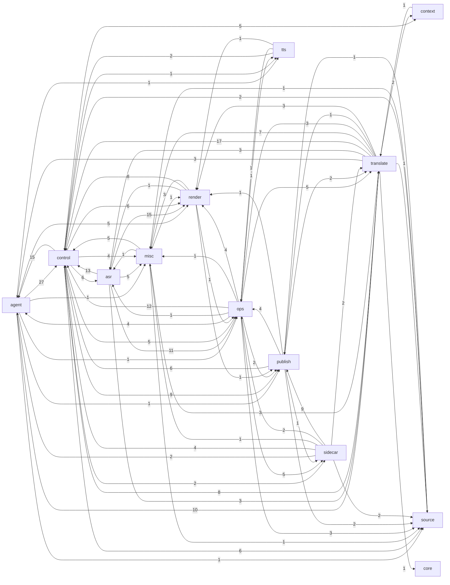

# Phụ thuộc giữa các lớp

_Sinh tự động bởi `scripts/brain_build.py` lúc 2026-11-17 19:05. Đừng sửa tay — chạy lại script._

Cạnh A → B = module lớp A import module lớp B (số = số cặp module).

## Ngược chiều đáng chú ý

Lớp pipeline/media (`source/asr/translate/tts/render`) import ngược `control`/`agent` là dấu hiệu coupling cần xem.

- [pronoun_consistency](../modules/pronoun_consistency.md) → [agent_pronoun_pass](../modules/agent_pronoun_pass.md)
- [script_lint](../modules/script_lint.md) → [agent_name_pass](../modules/agent_name_pass.md)
- [translate](../modules/translate.md) → [agent_hang_fix](../modules/agent_hang_fix.md)
- [translate](../modules/translate.md) → [batch_config](../modules/batch_config.md)

## Fan-in / fan-out

| Module | Fan-in (được import) | Fan-out (import) | Hot-reload |
|---|---:|---:|---|
| [server](../modules/server.md) | 5 | 44 |  |
| [translate](../modules/translate.md) | 14 | 18 |  |
| [manifest](../modules/manifest.md) | 34 | 1 |  |
| [config](../modules/config.md) | 36 | 0 |  |
| [llm](../modules/llm.md) | 21 | 2 |  |
| [translate_simple.pipeline](../modules/translate_simple.pipeline.md) | 2 | 21 |  |
| [agent_brain](../modules/agent_brain.md) | 2 | 14 |  |
| [agent_tele_cmd](../modules/agent_tele_cmd.md) | 3 | 18 | canva_client, check_block, lib_check, meta_studio, test_channel |
| [subs](../modules/subs.md) | 20 | 1 |  |
| [film_db](../modules/film_db.md) | 15 | 2 | check_block |
| [hongguo_bridge](../modules/hongguo_bridge.md) | 12 | 5 |  |
| [render](../modules/render.md) | 4 | 10 |  |
| [agent_core](../modules/agent_core.md) | 4 | 11 |  |
| [translate_simple.cfg](../modules/translate_simple.cfg.md) | 11 | 3 |  |
| [translate_simple.stage_draft](../modules/translate_simple.stage_draft.md) | 3 | 11 |  |
| [asr](../modules/asr.md) | 6 | 7 |  |
| [vram](../modules/vram.md) | 16 | 0 |  |
| [translate_simple.stage_review](../modules/translate_simple.stage_review.md) | 4 | 6 |  |
| [agent_hang_fix](../modules/agent_hang_fix.md) | 5 | 6 |  |
| [fileio](../modules/fileio.md) | 15 | 0 |  |
| [series_glossary](../modules/series_glossary.md) | 5 | 3 |  |
| [source_preflight](../modules/source_preflight.md) | 11 | 3 |  |
| [translate_simple.script_store](../modules/translate_simple.script_store.md) | 7 | 2 |  |
| [cloud_retry](../modules/cloud_retry.md) | 4 | 2 |  |
| [fun_asr_nano](../modules/fun_asr_nano.md) | 7 | 7 |  |
| [translate_simple.plan_view](../modules/translate_simple.plan_view.md) | 7 | 0 |  |
| [agent_heal](../modules/agent_heal.md) | 5 | 3 |  |
| [agent_hold](../modules/agent_hold.md) | 6 | 4 |  |
| [agent_watch](../modules/agent_watch.md) | 9 | 3 |  |
| [auto_publisher](../modules/auto_publisher.md) | 4 | 6 |  |
| [media_ts](../modules/media_ts.md) | 8 | 2 |  |
| [routes_agent](../modules/routes_agent.md) | 1 | 11 |  |
| [agent_qa_ask](../modules/agent_qa_ask.md) | 3 | 8 |  |
| [agent_quality](../modules/agent_quality.md) | 6 | 3 |  |
| [job_queue](../modules/job_queue.md) | 9 | 0 |  |
| [pronoun_consistency](../modules/pronoun_consistency.md) | 2 | 5 |  |
| [separate](../modules/separate.md) | 3 | 5 |  |
| [translate_simple.zh_source](../modules/translate_simple.zh_source.md) | 2 | 8 |  |
| [firered_asr](../modules/firered_asr.md) | 0 | 9 |  |
| [meta_studio](../modules/meta_studio.md) | 4 | 5 |  |

## Không ai import và không ai nhắc tên file (ứng viên code chết — kiểm .bat/UI trước khi xoá)

[context_studio.__init__](../modules/context_studio.__init__.md), [context_studio.app_streamlit](../modules/context_studio.app_streamlit.md), [core.__init__](../modules/core.__init__.md), [tools.asr_boundary_scan](../modules/tools.asr_boundary_scan.md), [tools.collect_manual_edits](../modules/tools.collect_manual_edits.md), [tools.simple_stats](../modules/tools.simple_stats.md), [translate_simple.__init__](../modules/translate_simple.__init__.md)
