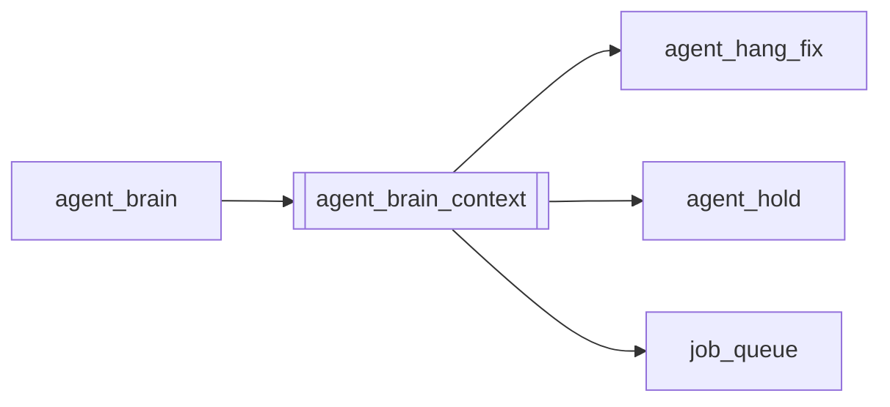

# `agent_brain_context`

[← Index](../generated/module-index.md) · [Brain home](../README.md)

<!-- AUTO:START — sinh bởi scripts/brain_build.py 2026-11-17 19:05. Đừng sửa tay khối này. -->
**File:** `agent_brain_context.py` · **Lớp:** `agent` · **287 dòng** (251 code) · **8 hàm**, **0 class** · sha1 `5d552fed21`

> System snapshot cho Second Brain LLM — toàn hệ, không chỉ 1 job.

### Phụ thuộc

- **Gọi tới (import nội bộ):** [agent_hang_fix](./agent_hang_fix.md), [agent_hold](./agent_hold.md), [job_queue](./job_queue.md)
- **Được dùng bởi:** [agent_brain](./agent_brain.md)
- **Test:** `tests/test_agent_brain_events.py`

### Hàm & class top-level

| Tên | Dòng | Dài | Tham số | Docstring |
|---|---:|---:|---|---|
| `_self_base` | 14 | 7 | `` | URL server Pineline đang chạy brain (fix 2026-11-11: trước cứng :8801 → V4/V5 điều khiển nhầm V2). |
| `_ping` | 23 | 11 | `url, timeout` |  |
| `_disk` | 36 | 11 | `path` |  |
| `_job_brief` | 49 | 94 | `work_root, d` |  |
| `_hold_cls` | 145 | 6 | `agent` |  |
| `_finished` | 153 | 6 | `d` |  |
| `build_system_snapshot` | 161 | 87 | `work_root, max_jobs` |  |
| `snapshot_to_prompt` | 250 | 6 | `snap, max_chars` | JSON gọn cho LLM user message. |

### Config / env keys (2)

`PINELINE_BASE`, `PINELINE_PORT`

**Cổng nhắc tới:** 3377, 8000, 8083, 8802

**File/artifact nhắc tới:** `manifest.json`, `output.mp4`, `qa_brain.json`, `script.json`

**Tín hiệu rủi ro (đếm tĩnh):** broad_except=9 · swallow_except=3

### Lịch sử (từ docs/)

- **Fix logs (4):**
  - [Port V2 → V4: Brain bỏ qua job đã xong + phân loại park tự động (⏸) / HOLD cần người (⛔)](../../fixes/2026-11-13-port-brain-finished-hold.md)
  - [2026-11-13 — Brain: job đã xong bị heal «thất bại» + park tự động bị báo nhầm «HOLD / Cần bạn»](../../fixes/2026-11-13-brain-finished-hold.md)
  - [REVIEW lỗi bị coi là đã soát · park treo hàng đợi · Brain V4 điều khiển nhầm V2](../../fixes/2026-11-11-review-fail-park-port.md)
  - [2026-11-11 — machine-config: cổng/thư mục phụ thuộc máy thành setting (V4 — layout phẳng)](../../fixes/2026-11-11-machine-config.md)
- **Reviews:** [2026-11-11-v4-v5-port-review](../../reviews/2026-11-11-v4-v5-port-review.md)
- Nhắc trong CHANGELOG: **2** lần · DECISIONS: **1** lần

<!-- AUTO:END -->

<!-- MANUAL:START -->
## Vai trò (viết tay)

_Chưa viết. 2–4 câu: module này chịu trách nhiệm gì trong pipeline, ai gọi nó, nó KHÔNG làm gì._

## Luồng chính

_Các hàm vào (entry) → bước chính → output/side effect. Ghi tên hàm thật._

## Bất biến & hợp đồng

_Điều luôn phải đúng (vd: chỉ ghi manifest qua `Manifest.update`; 1 job / ghế). Vi phạm = bug._

## Bẫy đã biết

_Lỗi từng gặp + link `docs/fixes/...`. Những chỗ dễ sửa sai._

## Ghi chú vận hành

_Config key quan trọng, cần restart gì khi sửa (:8801 / :8802 / hot-reload), cách test._
<!-- MANUAL:END -->
