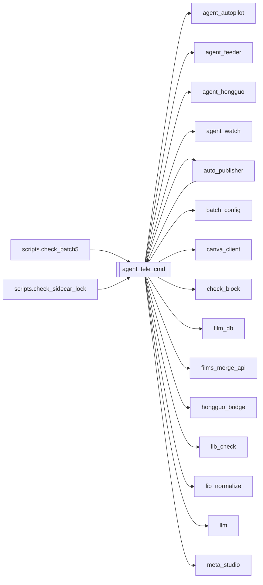

# `agent_tele_cmd`

[← Index](../generated/module-index.md) · [Brain home](../README.md)

<!-- AUTO:START — sinh bởi scripts/brain_build.py 2026-11-17 19:05. Đừng sửa tay khối này. -->
**File:** `agent_tele_cmd.py` · **Lớp:** `sidecar` · **2464 dòng** (2235 code) · **42 hàm**, **2 class** · sha1 `3464f16aec`

> Sidecar: Telegram lệnh + Auto-pilot + HTTP :8802 KHÔNG restart Pineline server — chỉ gọi API :8801. Chạy:  python agent_tele_cmd.py

### Phụ thuộc

- **Gọi tới (import nội bộ):** [agent_autopilot](./agent_autopilot.md), [agent_feeder](./agent_feeder.md), [agent_hongguo](./agent_hongguo.md), [agent_watch](./agent_watch.md), [auto_publisher](./auto_publisher.md), [batch_config](./batch_config.md), [canva_client](./canva_client.md), [check_block](./check_block.md), [film_db](./film_db.md), [films_merge_api](./films_merge_api.md), [hongguo_bridge](./hongguo_bridge.md), [lib_check](./lib_check.md), [lib_normalize](./lib_normalize.md), [llm](./llm.md), [meta_studio](./meta_studio.md), [test_channel](./test_channel.md), [title_mt](./title_mt.md), [uploader_settings_api](./uploader_settings_api.md)
- **Hot-reload (`importlib.reload`):** `canva_client`, `check_block`, `lib_check`, `meta_studio`, `test_channel`
- **Được dùng bởi:** [auto_publisher](./auto_publisher.md), [scripts.check_batch5](./scripts.check_batch5.md), [scripts.check_sidecar_lock](./scripts.check_sidecar_lock.md)
- **Được nhắc tên file `.py` (subprocess/script) bởi:** [migrate_work](./migrate_work.md), [restart_server](./restart_server.md), [scripts.check_batch2](./scripts.check_batch2.md)
- **Test:** `tests/test_agent_hold_telegram.py`
- **Thư viện ngoài:** `PIL`, `requests`

### Hàm & class top-level

| Tên | Dòng | Dài | Tham số | Docstring |
|---|---:|---:|---|---|
| **class `CtrlHandler`** | 986 | 8 method | |  |
| **class `_ExclusiveHTTPServer`** | 2390 | 1 method | | Windows: SO_REUSEADDR (mặc định của HTTPServer) cho bản thứ 2 bind trùng cổng. |
| `_load_history_from_disk` | 83 | 10 | `` |  |
| `_save_history_to_disk` | 95 | 11 | `` |  |
| `get_user_history` | 111 | 9 | `uid` |  |
| `add_user_history` | 122 | 11 | `uid, role, content` |  |
| `clear_user_history` | 135 | 5 | `uid` |  |
| `_ensure_agent_telegram` | 142 | 4 | `` |  |
| `tg_send` | 148 | 3 | `text, force` |  |
| `tg_api` | 153 | 13 | `method, payload` |  |
| `allowed_uids` | 168 | 3 | `` |  |
| `tg_send_video` | 173 | 19 | `chat_id, path, caption, buttons, meta` |  |
| `send_preview` | 197 | 42 | `uid, ref, ep` | Gửi tập xem thử (miễn phí) vào chat: video + nút chuyển tập + nút làm A-Z. |
| `send_covers` | 241 | 37 | `uid, page` | Album ảnh bìa (tối đa 10) của trang Leaderboard/Catalog đang xem — giống lưới poster của app. |
| `_edit_or_send` | 280 | 10 | `uid, cq, text, buttons` |  |
| `spawn_preview` | 292 | 2 | `uid, ref, ep` |  |
| `_parse_catalog_args` | 301 | 25 | `text` | '/hg catalog Urban popular completed' → genre / sort / status; phần còn lại = từ khoá. |
| `hg_tele_command` | 328 | 223 ⚠️ | `raw, uid` |  |
| `_send_confirm_buttons` | 553 | 12 | `uid, confirms` |  |
| `_agent_ask` | 567 | 13 | `msg, uid` | Chat agent; có uid (Telegram) thì tool phá huỷ đỗ lại và gửi nút ✅/❌. |
| `_qa_post` | 586 | 7 | `body` |  |
| `_qa_strip_buttons` | 595 | 5 | `d` | Hết câu chờ → gỡ nút trên mọi tin hỏi của job (tránh bấm lại). |
| `_qa_show` | 602 | 18 | `uid, ref` | /qa <job>: hiện lại câu bị cờ + đề xuất + 3 nút (có thể mất ~1–2' nếu phải nhờ LLM đề xuất). |
| `_qa_callback` | 622 | 11 | `uid, cq, data` |  |
| `_qa_reply` | 635 | 22 | `uid, msg, text` | Reply vào tin HOLD QA → gửi câu VI mới. True = đã xử lý (không đưa sang agent chat). |
| `_confirm_callback` | 659 | 12 | `uid, cq, data` |  |
| `_slash_hint` | 681 | 32 | `text` | Chữ thường (không '/') mà đổi trạng thái → ("hint", gợi ý) nếu ngắn kiểu lệnh hoặc có tiền tố |
| `handle_command` | 715 | 219 ⚠️ | `text, uid` |  |
| `_agent_reply` | 936 | 10 | `msg, uid` |  |
| `_fetch_poster_bytes` | 948 | 33 | `name` |  |
| `autopilot_loop` | 2036 | 21 | `stop` |  |
| `filmdb_loop` | 2062 | 17 | `stop` |  |
| `runwatch_loop` | 2127 | 10 | `stop` | Luôn theo dõi job chạy + báo xong/treo; chỉ tự xử lý treo khi Auto-pilot ON. |
| `feeder_loop` | 2139 | 13 | `stop` |  |
| `_sync_and_report` | 2157 | 10 | `reason` |  |
| `config_watch_loop` | 2169 | 15 | `stop` |  |
| `_inline_kb` | 2186 | 3 | `rows` |  |
| `_on_callback` | 2191 | 96 | `cq, allow` |  |
| `telegram_loop` | 2289 | 49 | `stop` |  |
| `is_priority_cmd` | 2344 | 4 | `text` | Lệnh chạy ngay trên luồng poll, không xếp sau lượt agent đang nghĩ (tới 180s). |
| `_tg_worker` | 2350 | 10 | `stop` |  |
| `_handle_tg_text` | 2362 | 26 | `uid, text` |  |
| `_single_instance_lock` | 2400 | 14 | `` | Khoá 1 bản / cổng; trả file handle (giữ sống tới khi thoát) hoặc None nếu đã có bản khác. |
| `main` | 2416 | 45 | `` |  |

**Hàm dài ≥120 dòng:** `CtrlHandler.do_POST` (619, L1415), `CtrlHandler.do_GET` (371, L1043), `hg_tele_command` (223, L328), `handle_command` (219, L715)

### Config / env keys (11)

`AGENT_TELEGRAM`, `AUTOPILOT_HOST`, `AUTOPILOT_PORT`, `AUTOPILOT_TICK_SEC`, `FILMDB_SEC`, `PINELINE_BASE`, `QUEUE_LIVE_CONFIG`, `RUNWATCH_SEC`, `TELEGRAM_POLL_SEC`, `TEMP`, `TMP`

**Cổng nhắc tới:** 8000, 8801, 8802

**File/artifact nhắc tới:** `tele_chat_history.json`

**Tín hiệu rủi ro (đếm tĩnh):** broad_except=61 · file_writes=3 · global_stmt=3 · sleep=3 · subprocess=1 · swallow_except=10 · threads=12

### Lịch sử (từ docs/)

- **Fix logs (14):**
  - [Port V2 → V4: Second Brain (tin Telegram theo mẫu + gỡ HOLD khi chạy tay) + đóng dấu luồng dịch theo job](../../fixes/2026-11-12-port-brain-hold-pipeline.md)
  - [REVIEW lỗi bị coi là đã soát · park treo hàng đợi · Brain V4 điều khiển nhầm V2](../../fixes/2026-11-11-review-fail-park-port.md)
  - [2026-11-11 — machine-config: cổng/thư mục phụ thuộc máy thành setting (V4 — layout phẳng)](../../fixes/2026-11-11-machine-config.md)
  - [Meta tạo ảnh không work sau khi chuyển GPT local :3377](../../fixes/2026-11-09-meta-ai-image-3377.md)
  - [Helper Pineline leak / lệch WinUI (spawn riêng)](../../fixes/2026-11-08-helper-singleton-winui-parity.md)
  - [Settings + Uploader API 404 trên :8802; thiếu skip upload](../../fixes/2026-11-07-uploader-settings-8802.md)
  - [Films UI :8802 — onclick/`jq` chết + Settings/Uploader 404](../../fixes/2026-11-07-films-ui-syntax.md)
  - [Films UI thiếu nút gộp job đã làm (combine)](../../fixes/2026-11-07-films-combine-ui.md)
  - [Gộp job đã làm nối sai thứ tự Phần](../../fixes/2026-11-07-combine-part-order.md)
  - [Films UI: Studio lỗi + SyntaxError Test + poster 404 + toolbar rối](../../fixes/2026-11-06-films-ui-studio-test.md)
  - [Phim đã xoá thư mục vẫn tồn đọng trong films/ui và thiếu chức năng xoá phim](../../fixes/2026-10-09-films-ui-delete-missing.md)
  - [2026-10-06 — Đợt 5 review: agent an toàn hơn](../../fixes/2026-10-06-batch5-agent-safety.md)
  - [2026-10-06 — Đợt 4 review: tranh chấp ghi, một bản tiến trình, checkpoint an toàn](../../fixes/2026-10-06-batch4-write-races.md)
  - [2026-10-06 — Đợt 2 review: bảo mật + config một nguồn + LLM sập không để trống câu](../../fixes/2026-10-06-batch2-security.md)
- **Reviews:** [2026-11-11-v4-v5-port-review](../../reviews/2026-11-11-v4-v5-port-review.md), [2026-11-07-films-ui-swarm](../../reviews/2026-11-07-films-ui-swarm.md), [2026-11-02-v4-structure-sync](../../reviews/2026-11-02-v4-structure-sync.md), [2026-11-02-v4-structure-and-v2-port](../../reviews/2026-11-02-v4-structure-and-v2-port.md), [2026-10-06-code-review](../../reviews/2026-10-06-code-review.md)
- Nhắc trong CHANGELOG: **12** lần · DECISIONS: **1** lần

<!-- AUTO:END -->

<!-- MANUAL:START -->
## Vai trò (viết tay)

_Chưa viết. 2–4 câu: module này chịu trách nhiệm gì trong pipeline, ai gọi nó, nó KHÔNG làm gì._

## Luồng chính

_Các hàm vào (entry) → bước chính → output/side effect. Ghi tên hàm thật._

## Bất biến & hợp đồng

_Điều luôn phải đúng (vd: chỉ ghi manifest qua `Manifest.update`; 1 job / ghế). Vi phạm = bug._

## Bẫy đã biết

_Lỗi từng gặp + link `docs/fixes/...`. Những chỗ dễ sửa sai._

## Ghi chú vận hành

_Config key quan trọng, cần restart gì khi sửa (:8801 / :8802 / hot-reload), cách test._
<!-- MANUAL:END -->
