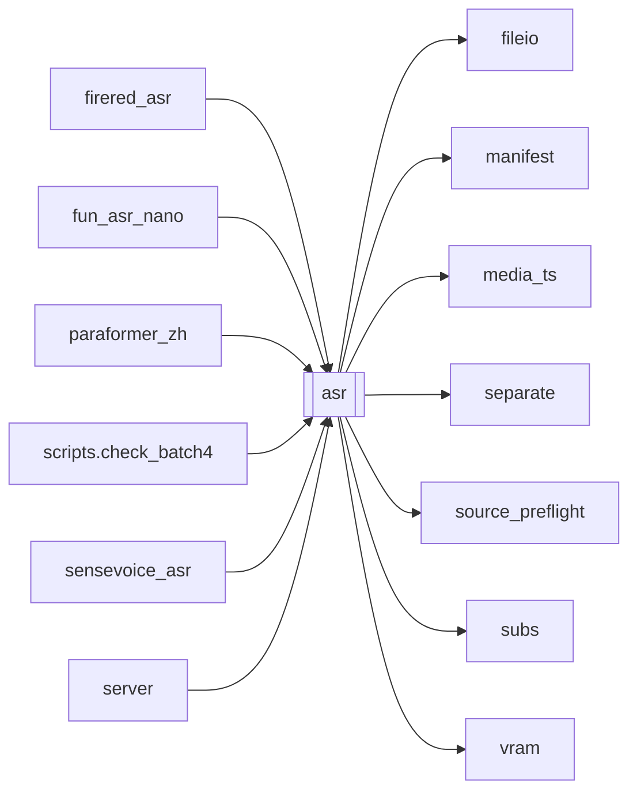

# `asr`

[← Index](../generated/module-index.md) · [Brain home](../README.md)

<!-- AUTO:START — sinh bởi scripts/brain_build.py 2026-11-17 19:05. Đừng sửa tay khối này. -->
**File:** `asr.py` · **Lớp:** `asr` · **488 dòng** (409 code) · **16 hàm**, **0 class** · sha1 `6661cc417d`

> asr.py — STAGE 2 (phần đầu): tách audio + nhận diện lời (Whisper). Đầu vào : work/<job>/source.mp4  (từ stage download) Đầu ra  : work/<job>/audio.wav   (16kHz mono — mặc định trích từ vocals.wav (Demucs), xem resolve_as

### Phụ thuộc

- **Gọi tới (import nội bộ):** [fileio](./fileio.md), [manifest](./manifest.md), [media_ts](./media_ts.md), [separate](./separate.md), [source_preflight](./source_preflight.md), [subs](./subs.md), [vram](./vram.md)
- **Được dùng bởi:** [firered_asr](./firered_asr.md), [fun_asr_nano](./fun_asr_nano.md), [paraformer_zh](./paraformer_zh.md), [scripts.check_batch4](./scripts.check_batch4.md), [sensevoice_asr](./sensevoice_asr.md), [server](./server.md)
- **Được nhắc tên file `.py` (subprocess/script) bởi:** [restart_server](./restart_server.md), [scripts.check_batch4](./scripts.check_batch4.md), [server](./server.md), [translate](./translate.md), [translate_simple.pipeline](./translate_simple.pipeline.md)
- **Test:** `tests/test_asr_demucs.py`, `tests/test_separate_demucs_chunks.py`, `tests/test_video_preflight.py`
- **Thư viện ngoài:** `ctranslate2`, `faster_whisper`, `soundfile`

### Hàm & class top-level

| Tên | Dòng | Dài | Tham số | Docstring |
|---|---:|---:|---|---|
| `_audio_marker` | 46 | 2 | `wav` |  |
| `_src_id` | 50 | 4 | `src` |  |
| `extract_audio` | 56 | 13 | `src, out_wav` | Tách audio về 16kHz mono PCM — chuẩn đầu vào Whisper. Ghi .partial rồi replace + marker nguồn. |
| `_wav_seconds` | 71 | 11 | `p` |  |
| `_probe_seconds` | 84 | 7 | `p` |  |
| `audio_wav_stale` | 93 | 28 | `src, wav, keep_legacy` | audio.wav có sẵn không dùng được: rỗng, marker khác nguồn / khác filter mốc, hoặc (chưa có |
| `ensure_audio_wav` | 123 | 12 | `src, wav, force, keep_legacy` | Trích audio.wav khi thiếu / hỏng / khác nguồn (hoặc force). True nếu vừa trích. |
| `asr_use_demucs` | 137 | 5 | `` | ASR_USE_DEMUCS — mặc định BẬT (2026-11-12): ASR chạy trên vocals.wav (Demucs). |
| `_asr_ui_phase` | 144 | 17 | `work_dir, phase, cur_text` | Hiện pha của stage asr (vd 'separate' = đang tách giọng) — ghi qua Manifest.update. |
| `_marker_src_name` | 163 | 5 | `wav` |  |
| `resolve_asr_source` | 170 | 71 | `work_dir, video_src, force_demucs, device` | Xác định nguồn audio cho ASR (engine sẽ ensure_audio_wav(src, audio.wav) 16k mono). |
| `_cut_wav_from` | 243 | 7 | `src_wav, out_wav, start_sec` | Cắt phần còn lại từ start_sec (resume ASR giữa chừng). |
| `pick_device` | 252 | 11 | `device` | Chọn cuda nếu có GPU, không thì cpu. Trả (device, compute_type). |
| `_salvage_asr` | 265 | 26 | `m, asr_path, rows, wav, total, err` | Crash/treo: giữ asr.json đã có, status pending để bấm Tiếp tục. |
| `run_asr` | 293 | 172 ⚠️ | `work_dir, model_size, lang, device, compute_type, force` |  |
| `main` | 467 | 18 | `argv` |  |

**Hàm dài ≥120 dòng:** `run_asr` (172, L293)

**File/artifact nhắc tới:** `asr.json`, `audio.wav`, `audio_resume.wav`, `sub.zh.srt`, `vocals.wav`

**Tín hiệu rủi ro (đếm tĩnh):** broad_except=11 · file_writes=2 · subprocess=2 · swallow_except=4 · threads=1

### Lịch sử (từ docs/)

- **Fix logs (10):**
  - [simple-junk-park: câu ASR rác «None.» làm dịch simple park mãi → part 1/2 kẹt, phim không ghép](../../fixes/2026-11-13-simple-junk-park.md)
  - [Port V2 → V4: preflight/chuẩn hoá video nguồn + extract_pcm bền + FireRed cắt ở khoảng lặng + câu ASR rác / pa](../../fixes/2026-11-13-port-preflight-slice-junk.md)
  - [firered-slice-silence: FireRed ASR chia slice tại khoảng lặng + đệm chồng lấn (hết cắt đôi/lặp/mất chữ ở biên ](../../fixes/2026-11-13-firered-slice-silence.md)
  - [2026-11-13 — Brain: job đã xong bị heal «thất bại» + park tự động bị báo nhầm «HOLD / Cần bạn»](../../fixes/2026-11-13-brain-finished-hold.md)
  - [Preflight + chuẩn hoá video nguồn trước khi vào job (+ 2 lỗi review extract_pcm)](../../fixes/2026-11-12-video-preflight.md)
  - [translate-simple «next»: lexicon src · bảng quy tắc xưng hô · bổ sung cặp thiếu · học lại · nguồn ZH · gỡ lặp ](../../fixes/2026-11-12-translate-simple-next.md)
  - [Port V2 → V4: luồng dịch `translate_simple` (MẶC ĐỊNH) + Demucs trước ASR](../../fixes/2026-11-12-port-simple-demucs.md)
  - [asr-demucs-default: ASR mặc định chạy trên giọng tách Demucs + separate.py chia khúc tại khoảng lặng, cắt/ghép](../../fixes/2026-11-12-asr-demucs-default.md)
  - [Job gốc sau split: part upload xong nhưng parent báo lỗi / chưa hoàn thành](../../fixes/2026-11-03-split-parent-false-failed.md)
  - [2026-10-06 — Đợt 4 review: tranh chấp ghi, một bản tiến trình, checkpoint an toàn](../../fixes/2026-10-06-batch4-write-races.md)
- **Reviews:** [2026-11-12-translate-simple-next-review](../../reviews/2026-11-12-translate-simple-next-review.md), [2026-11-02-v4-structure-and-v2-port](../../reviews/2026-11-02-v4-structure-and-v2-port.md), [2026-10-06-code-review](../../reviews/2026-10-06-code-review.md)
- Nhắc trong CHANGELOG: **7** lần · DECISIONS: **0** lần

<!-- AUTO:END -->

<!-- MANUAL:START -->
## Vai trò (viết tay)

_Chưa viết. 2–4 câu: module này chịu trách nhiệm gì trong pipeline, ai gọi nó, nó KHÔNG làm gì._

## Luồng chính

_Các hàm vào (entry) → bước chính → output/side effect. Ghi tên hàm thật._

## Bất biến & hợp đồng

_Điều luôn phải đúng (vd: chỉ ghi manifest qua `Manifest.update`; 1 job / ghế). Vi phạm = bug._

## Bẫy đã biết

_Lỗi từng gặp + link `docs/fixes/...`. Những chỗ dễ sửa sai._

## Ghi chú vận hành

_Config key quan trọng, cần restart gì khi sửa (:8801 / :8802 / hot-reload), cách test._
<!-- MANUAL:END -->
