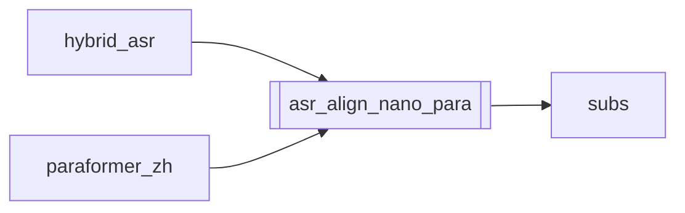

# `asr_align_nano_para`

[← Index](../generated/module-index.md) · [Brain home](../README.md)

<!-- AUTO:START — sinh bởi scripts/brain_build.py 2026-11-11 02:37. Đừng sửa tay khối này. -->
**File:** `asr_align_nano_para.py` · **Lớp:** `asr` · **384 dòng** (326 code) · **10 hàm**, **0 class** · sha1 `c43e719230`

> asr_align_nano_para.py — Hybrid A: chữ Fun-ASR-Nano + timestamp Paraformer (char-ts). Đầu vào (sidecar, không đụng asr.json): asr.fun_nano.json              — text tốt (VAD mốc thô)

### Phụ thuộc

- **Gọi tới (import nội bộ):** [subs](./subs.md)
- **Được dùng bởi:** [hybrid_asr](./hybrid_asr.md), [paraformer_zh](./paraformer_zh.md)
- **Test:** ❌ chưa có test import trực tiếp

### Hàm & class top-level

| Tên | Dòng | Dài | Tham số | Docstring |
|---|---:|---:|---|---|
| `_norm_chars` | 32 | 2 | `text` |  |
| `_ms_pair_to_s` | 36 | 4 | `pair` | FunASR Paraformer timestamp luôn là milliseconds (vd. [8530, 8730] = 8.53s). |
| `extract_char_timeline` | 42 | 24 | `res` | Từ raw FunASR generate() → [{ch, start, end}, ...] (giây). |
| `_zip_text_ts` | 68 | 33 | `text, ts` |  |
| `chars_from_segments_spread` | 103 | 20 | `segs` | Fallback khi không có char-ts: trải đều ký tự trong từng câu Para. |
| `_dtw_align` | 125 | 62 | `nano_chars, para_chars` | DTW: trả map nano_idx -> para_idx (độ dài = len(nano_chars)). |
| `_window_map` | 189 | 21 | `nano_chars, para_chars` | Map tỉ lệ + chỉnh local khi quá dài cho full DTW. |
| `align_nano_to_para` | 212 | 104 | `nano_rows, para_chars` | Giữ text Nano; start/end lấy từ char-ts Para đã align. |
| `run_align` | 318 | 51 | `work_dir, nano_name, chars_name, para_name, out_tag` |  |
| `main` | 371 | 10 | `argv` |  |

**File/artifact nhắc tới:** `.meta.json`, `asr.fun_nano.json`, `asr.paraformer_zh.chars.json`, `asr.paraformer_zh.json`

**Tín hiệu rủi ro (đếm tĩnh):** file_writes=3

### Lịch sử (từ docs/)

- Fix logs: —
- Nhắc trong CHANGELOG: **0** lần · DECISIONS: **0** lần

<!-- AUTO:END -->

<!-- MANUAL:START -->
## Vai trò (viết tay)

_Chưa viết. 2–4 câu: module này chịu trách nhiệm gì trong pipeline, ai gọi nó, nó KHÔNG làm gì._

## Luồng chính

_Các hàm vào (entry) → bước chính → output/side effect. Ghi tên hàm thật._

## Bất biến & hợp đồng

_Điều luôn phải đúng (vd: chỉ ghi manifest qua `Manifest.update`; 1 job / ghế). Vi phạm = bug._

## Bẫy đã biết

_Lỗi từng gặp + link `docs/fixes/...`. Những chỗ dễ sửa sai._

## Ghi chú vận hành

_Config key quan trọng, cần restart gì khi sửa (:8801 / :8802 / hot-reload), cách test._
<!-- MANUAL:END -->
