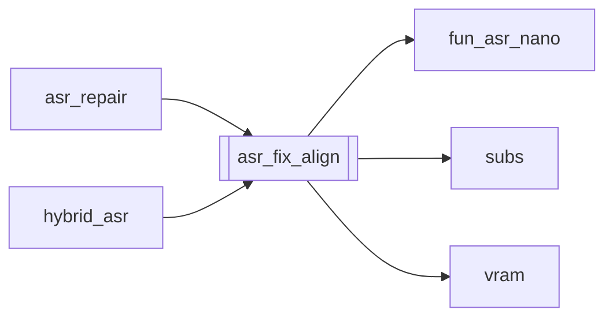

# `asr_fix_align`

[← Index](../generated/module-index.md) · [Brain home](../README.md)

<!-- AUTO:START — sinh bởi scripts/brain_build.py 2026-11-11 02:37. Đừng sửa tay khối này. -->
**File:** `asr_fix_align.py` · **Lớp:** `asr` · **330 dòng** (288 code) · **7 hàm**, **0 class** · sha1 `dc110ecfd9`

> asr_fix_align.py — Phương án 3: fix monotonic_fix Bước 1 (fallback): chỗ timing bịa/đảo → trả start/end về Nano VAD Bước 2 (forced align): Qwen3-ForcedAligner chỉ trên các đoạn vừa fallback

### Phụ thuộc

- **Gọi tới (import nội bộ):** [fun_asr_nano](./fun_asr_nano.md), [subs](./subs.md), [vram](./vram.md)
- **Được dùng bởi:** [asr_repair](./asr_repair.md), [hybrid_asr](./hybrid_asr.md)
- **Test:** ❌ chưa có test import trực tiếp
- **Thư viện ngoài:** `numpy`, `qwen_asr`, `soundfile`, `torch`

### Hàm & class top-level

| Tên | Dòng | Dài | Tham số | Docstring |
|---|---:|---:|---|---|
| `_load` | 41 | 2 | `path` |  |
| `_save_asr` | 45 | 8 | `work, tag, rows` |  |
| `step1_nano_fallback` | 55 | 48 | `aligned, nano` | Chỗ monotonic_fix (và đảo thời gian): lấy lại timing Nano theo chữ. |
| `_merge_indices_to_windows` | 105 | 22 | `rows, indices, gap_s` | Gộp index gần nhau thành cửa sổ FA. |
| `step2_forced_align` | 129 | 104 | `rows, wav, indices, device, pad_s, max_windows` | Forced-align từng cửa sổ chứa các câu nano_fallback. |
| `run_fix` | 235 | 75 | `work_dir, aligned_name, nano_name, device, step1_only, step2_only, …` |  |
| `main` | 312 | 15 | `argv` |  |

### Config / env keys (4)

`ASR_FA_PAD_S`, `HF_HUB_DISABLE_SYMLINKS`, `HF_HUB_DISABLE_SYMLINKS_WARNING`, `QWEN3_FORCED_ALIGNER`

**File/artifact nhắc tới:** `asr.aligned.json`, `asr.aligned_fa.meta.json`, `asr.aligned_fix.json`, `asr.aligned_fix.meta.json`, `asr.fun_nano.json`, `audio.wav`

**Tín hiệu rủi ro (đếm tĩnh):** broad_except=1 · file_writes=5

### Lịch sử (từ docs/)

- Fix logs: —
- Nhắc trong CHANGELOG: **0** lần · DECISIONS: **0** lần

<!-- AUTO:END -->

<!-- MANUAL:START -->
## Vai trò (viết tay)

_Chưa viết. 2–4 câu: module này chịu trách nhiệm gì trong pipeline, ai gọi nó, nó KHÔNG làm gì._

## Luồng chính

_Các hàm vào (entry) → bước chính → output/side effect. Ghi tên hàm thật._

## Bất biến & hợp đồng

_Điều luôn phải đúng (vd: chỉ ghi manifest qua `Manifest.update`; 1 job / ghế). Vi phạm = bug._

## Bẫy đã biết

_Lỗi từng gặp + link `docs/fixes/...`. Những chỗ dễ sửa sai._

## Ghi chú vận hành

_Config key quan trọng, cần restart gì khi sửa (:8801 / :8802 / hot-reload), cách test._
<!-- MANUAL:END -->
