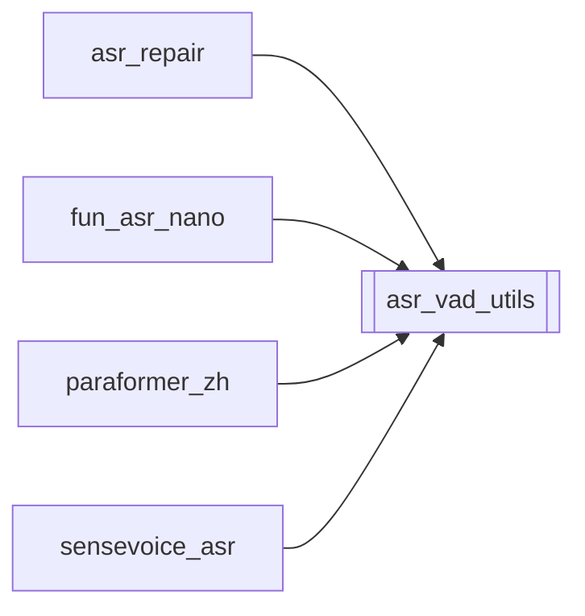

# `asr_vad_utils`

[← Index](../generated/module-index.md) · [Brain home](../README.md)

<!-- AUTO:START — sinh bởi scripts/brain_build.py 2026-11-11 02:37. Đừng sửa tay khối này. -->
**File:** `asr_vad_utils.py` · **Lớp:** `asr` · **158 dòng** (137 code) · **5 hàm**, **0 class** · sha1 `c031df59e1`

> asr_vad_utils.py — VAD kwargs FunASR thật + pad/overlap khi cắt đoạn. FunASR fsmn-vad (1.4.x) dùng tên khác Silero/Whisper: max_end_silence_time, max_start_silence_time,

### Phụ thuộc

- **Gọi tới (import nội bộ):** —
- **Được dùng bởi:** [asr_repair](./asr_repair.md), [fun_asr_nano](./fun_asr_nano.md), [paraformer_zh](./paraformer_zh.md), [sensevoice_asr](./sensevoice_asr.md)
- **Test:** ❌ chưa có test import trực tiếp

### Hàm & class top-level

| Tên | Dòng | Dài | Tham số | Docstring |
|---|---:|---:|---|---|
| `vad_kwargs_from_env` | 33 | 19 | `base` | Cho phép override qua env ASR_VAD_* (ms). |
| `parse_vad_ranges` | 54 | 15 | `vad_res, ms_to_s` | FunASR VAD generate → [(start_s, end_s), ...]. |
| `merge_close_ranges` | 71 | 29 | `ranges, gap_s, max_dur_s` | Gộp đoạn kề nhau (khoảng hở < gap_s), nhưng không gộp nếu tổng độ dài vượt max_dur_s. |
| `pad_ranges` | 102 | 37 | `ranges, audio_dur, pad_s, overlap_s, max_dur_s` | Mỗi VAD range → slice ASR có pad + overlap với hàng xóm. |
| `shift_char_timeline` | 141 | 18 | `chars, offset_s, keep_start, keep_end` | Cộng offset (slice_start) vào char-ts; optional cắt ngoài cửa sổ VAD gốc. |

### Config / env keys (4)

`ASR_VAD_MAX_SEGMENT_S`, `ASR_VAD_MERGE_GAP_S`, `ASR_VAD_OVERLAP_S`, `ASR_VAD_PAD_S`

### Lịch sử (từ docs/)

- Fix logs: —
- **Reviews:** [2026-11-02-v4-structure-and-v2-port](../../reviews/2026-11-02-v4-structure-and-v2-port.md), [2026-10-06-code-review](../../reviews/2026-10-06-code-review.md)
- Nhắc trong CHANGELOG: **0** lần · DECISIONS: **0** lần

<!-- AUTO:END -->

<!-- MANUAL:START -->
## Vai trò (viết tay)

_Chưa viết. 2–4 câu: module này chịu trách nhiệm gì trong pipeline, ai gọi nó, nó KHÔNG làm gì._

## Luồng chính

_Các hàm vào (entry) → bước chính → output/side effect. Ghi tên hàm thật._

## Bất biến & hợp đồng

_Điều luôn phải đúng (vd: chỉ ghi manifest qua `Manifest.update`; 1 job / ghế). Vi phạm = bug._

## Bẫy đã biết

_Lỗi từng gặp + link `docs/fixes/...`. Những chỗ dễ sửa sai._

## Ghi chú vận hành

_Config key quan trọng, cần restart gì khi sửa (:8801 / :8802 / hot-reload), cách test._
<!-- MANUAL:END -->
