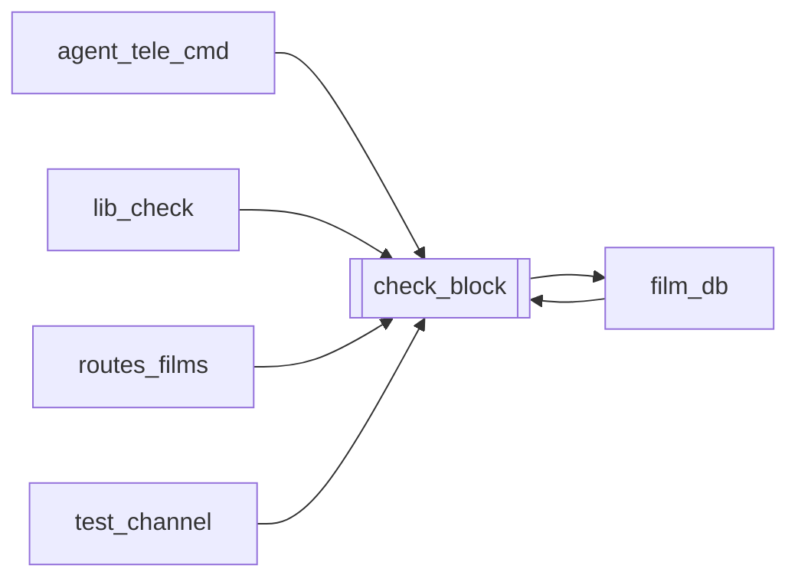

# `check_block`

[← Index](../generated/module-index.md) · [Brain home](../README.md)

<!-- AUTO:START — sinh bởi scripts/brain_build.py 2026-11-11 02:37. Đừng sửa tay khối này. -->
**File:** `check_block.py` · **Lớp:** `ops` · **350 dòng** (296 code) · **4 hàm**, **0 class** · sha1 `e2b4059b4c`

> check_block.py — Module kiểm tra trạng thái Bản quyền / Block YouTube (Cơ chế 1: Không cần đăng nhập). Kiểm tra qua YouTube oEmbed và YouTube Watch Page (ytInitialPlayerResponse). Phát hiện: Clean (Sạch), Blocked (Chặn t

### Phụ thuộc

- **Gọi tới (import nội bộ):** [film_db](./film_db.md)
- **Được dùng bởi:** [agent_tele_cmd](./agent_tele_cmd.md), [film_db](./film_db.md), [lib_check](./lib_check.md), [routes_films](./routes_films.md), [test_channel](./test_channel.md)
- **Test:** ❌ chưa có test import trực tiếp

### Hàm & class top-level

| Tên | Dòng | Dài | Tham số | Docstring |
|---|---:|---:|---|---|
| `_utc_now` | 21 | 2 | `` |  |
| `extract_video_id` | 25 | 25 | `url_or_id` | Trích xuất Video ID (11 ký tự) từ link YouTube bất kỳ hoặc ID thô. |
| `check_youtube_block` | 52 | 265 ⚠️ | `url_or_id, timeout` | Kiểm tra video YouTube có bị Block hay dính bản quyền không (không cần cookie/đăng nhập). |
| `check_film_by_job` | 319 | 32 | `job_id` | Kiểm tra trạng thái bản quyền của một phim theo job_id và lưu kết quả vào film_db. |

**Hàm dài ≥120 dòng:** `check_youtube_block` (265, L52)

**Tín hiệu rủi ro (đếm tĩnh):** broad_except=4 · swallow_except=3

### Lịch sử (từ docs/)

- Fix logs: —
- Nhắc trong CHANGELOG: **0** lần · DECISIONS: **0** lần

<!-- AUTO:END -->

<!-- MANUAL:START -->
## Vai trò (viết tay)

_Chưa viết. 2–4 câu: module này chịu trách nhiệm gì trong pipeline, ai gọi nó, nó KHÔNG làm gì._

## Luồng chính

_Các hàm vào (entry) → bước chính → output/side effect. Ghi tên hàm thật._

## Bất biến & hợp đồng

_Điều luôn phải đúng (vd: chỉ ghi manifest qua `Manifest.update`; 1 job / ghế). Vi phạm = bug._

## Bẫy đã biết

_Lỗi từng gặp + link `docs/fixes/...`. Những chỗ dễ sửa sai._

## Ghi chú vận hành

_Config key quan trọng, cần restart gì khi sửa (:8801 / :8802 / hot-reload), cách test._
<!-- MANUAL:END -->
