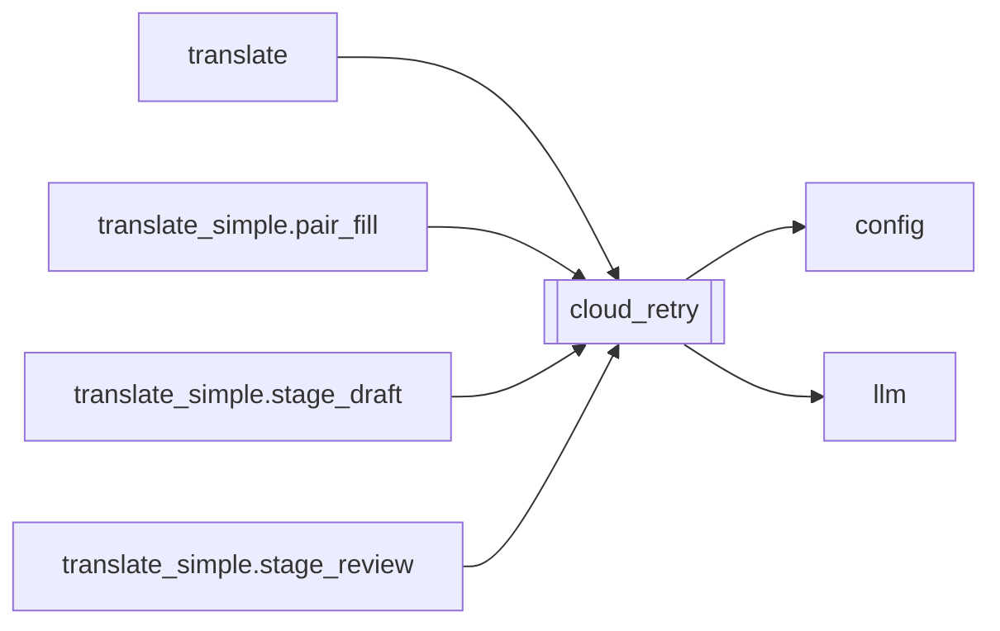

# `cloud_retry`

[← Index](../generated/module-index.md) · [Brain home](../README.md)

<!-- AUTO:START — sinh bởi scripts/brain_build.py 2026-11-17 19:05. Đừng sửa tay khối này. -->
**File:** `cloud_retry.py` · **Lớp:** `misc` · **520 dòng** (440 code) · **16 hàm**, **2 class** · sha1 `036e47e0ed`

> cloud_retry.py — fix 2026-11-11 translate-b2 (Việc A): THỬ LẠI model cloud (Aurora/GPT…) khi bị limit/quota (429) hoặc lỗi tạm (5xx/timeout) TRƯỚC khi đổi sang local / park. Aurora xoay vòng tài khoản → 429/limit thường 

### Phụ thuộc

- **Gọi tới (import nội bộ):** [config](./config.md), [llm](./llm.md)
- **Được dùng bởi:** [translate](./translate.md), [translate_simple.pair_fill](./translate_simple.pair_fill.md), [translate_simple.stage_draft](./translate_simple.stage_draft.md), [translate_simple.stage_review](./translate_simple.stage_review.md)
- **Test:** `tests/test_deepseek_empty_and_brain_idle.py`, `tests/test_translate_b2.py`, `tests/test_translate_b2_review.py`, `tests/test_translate_b3.py`, `tests/test_translate_simple.py`, `tests/test_translate_simple_next.py`, `tests/test_translate_simple_next_review.py`, `tests/test_translate_simple_scenarios.py`
- **Thư viện ngoài:** `requests`

### Hàm & class top-level

| Tên | Dòng | Dài | Tham số | Docstring |
|---|---:|---:|---|---|
| **class `CloudRetryStopped`** | 55 | 1 method | | User bấm Dừng (.stop) trong lúc chờ thử lại cloud. Thông điệp chứa «stopped by user» |
| **class `CloudGate`** | 263 | 10 method | | Circuit breaker mềm DÙNG CHUNG cho mọi luồng gọi cùng nhà cung cấp cloud. |
| `_chain` | 87 | 6 | `e` |  |
| `error_status` | 95 | 16 | `e` | Mã HTTP: response.status_code (dọc chuỗi __cause__/__context__) hoặc mẫu thông điệp |
| `classify_cloud_retry` | 113 | 43 | `e` | "limit" (429 / thông điệp limit-quota-rate) · "transient" (5xx, timeout, mất kết nối, |
| `_parse_retry_after` | 158 | 15 | `v` |  |
| `retry_after_seconds` | 181 | 30 | `e` | Retry-After từ header response (dọc chuỗi lỗi) hoặc field/thông điệp |
| `_cfg` | 215 | 8 | `cfg_get, key, default` |  |
| `retry_count` | 225 | 6 | `cfg_get` |  |
| `backoff_schedule` | 233 | 11 | `cfg_get` |  |
| `outage_budget_sec` | 246 | 9 | `n_max, sched` | review 2026-11-12: ngân sách chờ CHUNG cho một đợt limit = tổng backoff của n_max lần |
| `local_fallback_enabled` | 257 | 2 | `cfg_get` |  |
| `gate_key` | 389 | 5 | `model` |  |
| `get_gate` | 396 | 7 | `model` |  |
| `reset_gates` | 405 | 3 | `` |  |
| `_sleep_with_stop` | 410 | 9 | `sec, stop_check` |  |
| `stop_checker` | 421 | 5 | `stop_path` |  |
| `call_with_cloud_retry` | 428 | 93 | `fn, model, label, what, stop_check, retries, schedule, cfg_get, gat…` | Gọi fn() với retry cloud. Lỗi không thuộc limit/transient → ném ngay (hành vi cũ). |

**Tín hiệu rủi ro (đếm tĩnh):** broad_except=9 · swallow_except=3

### Lịch sử (từ docs/)

- **Fix logs (2):**
  - [translate-simple: luồng dịch mới (plan ∥ NMT → review 1 lần/lô → vá câu bị cờ → cổng), sau cờ TRANSLATE_PIPELI](../../fixes/2026-11-12-translate-simple.md)
  - [Port V2 → V4: luồng dịch `translate_simple` (MẶC ĐỊNH) + Demucs trước ASR](../../fixes/2026-11-12-port-simple-demucs.md)
- Nhắc trong CHANGELOG: **2** lần · DECISIONS: **0** lần

<!-- AUTO:END -->

<!-- MANUAL:START -->
## Vai trò (viết tay)

_Chưa viết. 2–4 câu: module này chịu trách nhiệm gì trong pipeline, ai gọi nó, nó KHÔNG làm gì._

## Luồng chính

_Các hàm vào (entry) → bước chính → output/side effect. Ghi tên hàm thật._

## Bất biến & hợp đồng

_Điều luôn phải đúng (vd: chỉ ghi manifest qua `Manifest.update`; 1 job / ghế). Vi phạm = bug._

## Bẫy đã biết

_Lỗi từng gặp + link `docs/fixes/...`. Những chỗ dễ sửa sai._

## Ghi chú vận hành

_Config key quan trọng, cần restart gì khi sửa (:8801 / :8802 / hot-reload), cách test._
<!-- MANUAL:END -->
