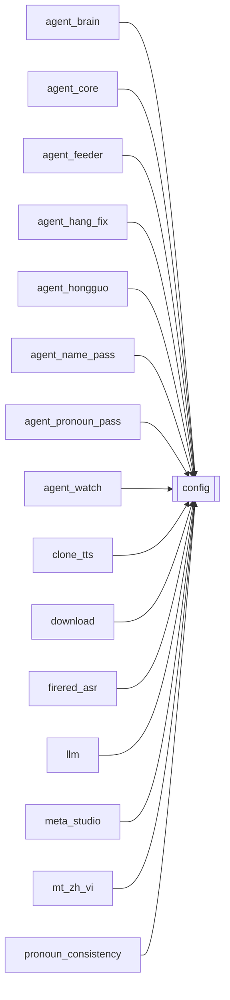

# `config`

[← Index](../generated/module-index.md) · [Brain home](../README.md)

<!-- AUTO:START — sinh bởi scripts/brain_build.py 2026-11-11 02:37. Đừng sửa tay khối này. -->
**File:** `config.py` · **Lớp:** `control` · **188 dòng** (148 code) · **8 hàm**, **0 class** · sha1 `af4401b1f1`

> config.py — Cấu hình/đường dẫn PORTABLE cho Pineline. Thứ tự ưu tiên khi lấy 1 giá trị: biến môi trường  >  pineline.config.json  >  mặc định. install.py sẽ ghi pineline.config.json với đường dẫn thật của máy (venv, HF c

### Phụ thuộc

- **Gọi tới (import nội bộ):** —
- **Được dùng bởi:** [agent_brain](./agent_brain.md), [agent_core](./agent_core.md), [agent_feeder](./agent_feeder.md), [agent_hang_fix](./agent_hang_fix.md), [agent_hongguo](./agent_hongguo.md), [agent_name_pass](./agent_name_pass.md), [agent_pronoun_pass](./agent_pronoun_pass.md), [agent_watch](./agent_watch.md), [clone_tts](./clone_tts.md), [download](./download.md), [firered_asr](./firered_asr.md), [llm](./llm.md), [meta_studio](./meta_studio.md), [mt_zh_vi](./mt_zh_vi.md), [pronoun_consistency](./pronoun_consistency.md), [render](./render.md), [render_fx](./render_fx.md), [routes_uploader_settings](./routes_uploader_settings.md), [scripts.check_batch2](./scripts.check_batch2.md), [scripts.check_batch3](./scripts.check_batch3.md), [server](./server.md), [sfx_lib](./sfx_lib.md), [subs](./subs.md), [translate](./translate.md), [uploader_settings_api](./uploader_settings_api.md)
- **Được nhắc tên file `.py` (subprocess/script) bởi:** [restart_server](./restart_server.md), [scripts.brain_build](./scripts.brain_build.md)
- **Test:** `tests/test_chatgpt_route.py`

### Hàm & class top-level

| Tên | Dòng | Dài | Tham số | Docstring |
|---|---:|---:|---|---|
| `_load_cfg` | 20 | 19 | `force` | Nạp lại pineline.config.json khi file đổi (tránh setdefault env khóa giá trị cũ). |
| `_from_file_keys` | 73 | 2 | `` |  |
| `inject_env` | 77 | 24 | `` | Chép pineline.config.json (rồi config.json) vào os.environ để tiến trình con kế thừa. |
| `get` | 103 | 23 | `key, default` | env var  >  config.json  >  default. |
| `llm_settings` | 128 | 13 | `` | LLM cho job (dịch/review) — đọc lúc gọi để sửa pineline.config.json có hiệu lực không cần restart. |
| `pass_llm_model` | 143 | 14 | `kind` | Model cho pass ngắn (name/pronoun). Ưu tiên NAME_MODEL/PRONOUN_MODEL → CHATGPT_* → REVIEW → LLM. |
| `agent_llm` | 159 | 11 | `` | LLM cho agent chat / feeder: AGENT_* rồi LLM_* (cả hai file trước env). |
| `venv_python` | 172 | 4 | `venv_dir` | Đường dẫn python trong venv, đúng theo OS. |

### Config / env keys (25)

`AGENT_API_KEY`, `AGENT_BASE_URL`, `AGENT_FALLBACK_MODEL`, `AGENT_MODEL`, `AURORA_BASE_URL`, `CHATGPT_BASE_URL`, `CHATGPT_MODEL`, `HF_HOME`, `HF_HUB_DISABLE_SYMLINKS`, `HF_HUB_DISABLE_SYMLINKS_WARNING`, `LLM_API_KEY`, `LLM_BASE_URL`, `LLM_MODEL`, `NAME_MODEL`, `OMNI_CWD`, `OMNI_DEVICE`, `OMNI_MODEL`, `OMNI_PY`, `PINELINE_OMNI_ENV`, `PINELINE_VIENEU_ENV`, `PRONOUN_MODEL`, `REVIEW_MODEL`, `TRANSLATE_MODEL`, `VIENEU_DEVICE`, `VIENEU_PY`

**Cổng nhắc tới:** 8083

**File/artifact nhắc tới:** `config.json`, `pineline.config.json`

**Tín hiệu rủi ro (đếm tĩnh):** broad_except=2 · global_stmt=1

### Lịch sử (từ docs/)

- **Fix logs (3):**
  - [2026-10-06 — Đợt 6 review: bảo trì (git, pytest, M3, dọn script chết)](../../fixes/2026-10-06-batch6-maintenance.md)
  - [2026-10-06 — Đợt 3 review: opts một nguồn, config file-first, ghi nguyên tử](../../fixes/2026-10-06-batch3-single-source.md)
  - [2026-10-06 — Đợt 2 review: bảo mật + config một nguồn + LLM sập không để trống câu](../../fixes/2026-10-06-batch2-security.md)
- **Reviews:** [2026-10-06-code-review](../../reviews/2026-10-06-code-review.md)
- Nhắc trong CHANGELOG: **4** lần · DECISIONS: **1** lần

<!-- AUTO:END -->

<!-- MANUAL:START -->
## Vai trò (viết tay)

Nguồn cấu hình portable: đường dẫn máy, venv, model, key LLM. Đọc `pineline.config.json` (secret — **không commit, không in**) + env + default. Tự nạp lại file khi mtime đổi (`_load_cfg`).

## Luồng chính

- `get(key, default)` — hàm mọi module dùng (thường alias `cfg`, `_cfg_get`, `_get`…). Danh sách key + nơi đọc: `generated/config-keys.md`.
- `inject_env()` — đẩy giá trị file vào env cho subprocess.
- `llm_settings()`, `pass_llm_model(kind)`, `agent_llm()` — gói cấu hình LLM theo vai.
- `venv_python(venv_dir)` — đường python của venv engine.

## Bất biến & hợp đồng — thứ tự ưu tiên

| Nhóm key | Thắng |
|---|---|
| `LLM_FILE_FIRST_KEYS` (LLM_*, TRANSLATE/REVIEW/NAME/PRONOUN_MODEL, CHATGPT_*, AURORA_*, REVIEW_PARALLEL*, REVIEW_BACKUP, REVIEW_PASS1_*…), `AGENT_FILE_FIRST_KEYS`, `RENDER_ENCODER/DUB_VOL/BGM_VOL`, tiền tố `SUB_`, `HARDSUB_` | **file** > env > default — sửa file có hiệu lực ngay |
| Còn lại | env (`run_v2.bat`, shell) > file > default |
| Opts job | snapshot `queue_opts` lúc xếp hàng (không thuộc config.py) |

Lý do file-first: env kế thừa từ shell khởi động server từng giữ model đã bỏ suốt phiên (comment trong `config.py`).

## Bẫy đã biết

- Module đọc key **lúc import** (hằng số module-level) sẽ không thấy thay đổi file tới khi restart — kiểm trước khi hứa "có hiệu lực ngay".
- Key mới phải thêm vào `pineline.config.example.json`; key LLM/REVIEW mới cân nhắc thêm vào `LLM_FILE_FIRST_KEYS`.
- Docs không được ghi giá trị secret — chỉ tên key.

## Ghi chú vận hành

Sửa `config.py` → restart :8801 + :8802. Sửa `pineline.config.json` → key file-first ăn ngay, key env-first cần restart với `--clean-env`.
<!-- MANUAL:END -->
