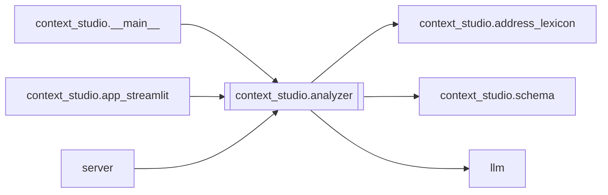

# `context_studio.analyzer`

[← Index](../generated/module-index.md) · [Brain home](../README.md)

<!-- AUTO:START — sinh bởi scripts/brain_build.py 2026-11-11 02:37. Đừng sửa tay khối này. -->
**File:** `context_studio/analyzer.py` · **Lớp:** `context` · **264 dòng** (245 code) · **5 hàm**, **0 class** · sha1 `7224e79da0`

> 01 — Context analyzer: SRT Trung → glossary draft (+ style_lock).

### Phụ thuộc

- **Gọi tới (import nội bộ):** [context_studio.address_lexicon](./context_studio.address_lexicon.md), [context_studio.schema](./context_studio.schema.md), [llm](./llm.md)
- **Được dùng bởi:** [context_studio.__main__](./context_studio.__main__.md), [context_studio.app_streamlit](./context_studio.app_streamlit.md), [server](./server.md)
- **Test:** ❌ chưa có test import trực tiếp

### Hàm & class top-level

| Tên | Dòng | Dài | Tham số | Docstring |
|---|---:|---:|---|---|
| `_heuristic_analyze` | 12 | 85 | `segments` | Không cần API — scaffold để xem flow. Heuristic thô. |
| `_sample_lines` | 99 | 28 | `segments, max_chars` | Đầu phim + 10 cửa sổ rải đều cả tập — phim dài 3000+ câu có cast đổi theo arc, |
| `_llm_analyze` | 129 | 114 | `segments, model` | Gọi LLM qua Pineline llm.chat nếu có; fallback heuristic. |
| `analyze` | 245 | 5 | `segments, use_llm, model` |  |
| `summarize` | 252 | 13 | `glossary` | Tóm tắt cho UI. |

### Config / env keys (2)

`LLM_MODEL`, `TRANSLATE_MODEL`

**Tín hiệu rủi ro (đếm tĩnh):** broad_except=2

### Lịch sử (từ docs/)

- Fix logs: —
- Nhắc trong CHANGELOG: **0** lần · DECISIONS: **0** lần

<!-- AUTO:END -->

<!-- MANUAL:START -->
## Vai trò (viết tay)

_Chưa viết. 2–4 câu: module này chịu trách nhiệm gì trong pipeline, ai gọi nó, nó KHÔNG làm gì._

## Luồng chính

_Các hàm vào (entry) → bước chính → output/side effect. Ghi tên hàm thật._

## Bất biến & hợp đồng

_Điều luôn phải đúng (vd: chỉ ghi manifest qua `Manifest.update`; 1 job / ghế). Vi phạm = bug._

## Bẫy đã biết

_Lỗi từng gặp + link `docs/fixes/...`. Những chỗ dễ sửa sai._

## Ghi chú vận hành

_Config key quan trọng, cần restart gì khi sửa (:8801 / :8802 / hot-reload), cách test._
<!-- MANUAL:END -->
