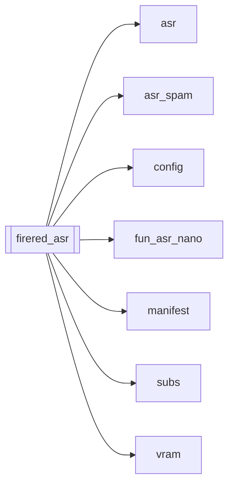

# `firered_asr`

[← Index](../generated/module-index.md) · [Brain home](../README.md)

<!-- AUTO:START — sinh bởi scripts/brain_build.py 2026-11-11 02:37. Đừng sửa tay khối này. -->
**File:** `firered_asr.py` · **Lớp:** `asr` · **340 dòng** (294 code) · **5 hàm**, **0 class** · sha1 `4d926349fe`

> firered_asr.py — STAGE ASR bằng FireRedASR2-AED (system VAD+LID+ASR+Punc). Cần clone repo + tải model local (không pip một dòng): scripts\install_firered_asr.bat

### Phụ thuộc

- **Gọi tới (import nội bộ):** [asr](./asr.md), [asr_spam](./asr_spam.md), [config](./config.md), [fun_asr_nano](./fun_asr_nano.md), [manifest](./manifest.md), [subs](./subs.md), [vram](./vram.md)
- **Được dùng bởi:** —
- **Được nhắc tên file `.py` (subprocess/script) bởi:** [restart_server](./restart_server.md), [server](./server.md)
- **Test:** ❌ chưa có test import trực tiếp
- **Thư viện ngoài:** `fireredasr2s`

### Hàm & class top-level

| Tên | Dòng | Dài | Tham số | Docstring |
|---|---:|---:|---|---|
| `_roots` | 47 | 6 | `` |  |
| `_ensure_firered_importable` | 55 | 13 | `root` |  |
| `_parse_firered_result` | 70 | 45 | `result` | FireRedAsr2System.process → [{start,end,text}]. |
| `run_asr_firered` | 117 | 210 ⚠️ | `work_dir, device, force` |  |
| `main` | 329 | 8 | `argv` |  |

**Hàm dài ≥120 dòng:** `run_asr_firered` (210, L117)

### Config / env keys (7)

`FIRERED_MODELS`, `FIRERED_ROOT`, `FIRERED_SLICE_SEC`, `FIRERED_USE_HALF`, `HF_HUB_DISABLE_SYMLINKS`, `HF_HUB_DISABLE_SYMLINKS_WARNING`, `PATH`

**File/artifact nhắc tới:** `asr.json`, `audio.wav`, `sub.zh.srt`

**Tín hiệu rủi ro (đếm tĩnh):** broad_except=3 · file_writes=2 · subprocess=1

### Lịch sử (từ docs/)

- **Fix logs (2):**
  - [FireRedASR mặc định BF16 (use_half)](../../fixes/2026-11-10-firered-use-half.md)
  - [2026-10-06 — Đợt 4 review: tranh chấp ghi, một bản tiến trình, checkpoint an toàn](../../fixes/2026-10-06-batch4-write-races.md)
- **Reviews:** [2026-10-06-code-review](../../reviews/2026-10-06-code-review.md)
- Nhắc trong CHANGELOG: **1** lần · DECISIONS: **0** lần

<!-- AUTO:END -->

<!-- MANUAL:START -->
## Vai trò (viết tay)

_Chưa viết. 2–4 câu: module này chịu trách nhiệm gì trong pipeline, ai gọi nó, nó KHÔNG làm gì._

## Luồng chính

_Các hàm vào (entry) → bước chính → output/side effect. Ghi tên hàm thật._

## Bất biến & hợp đồng

_Điều luôn phải đúng (vd: chỉ ghi manifest qua `Manifest.update`; 1 job / ghế). Vi phạm = bug._

## Bẫy đã biết

_Lỗi từng gặp + link `docs/fixes/...`. Những chỗ dễ sửa sai._

## Ghi chú vận hành

_Config key quan trọng, cần restart gì khi sửa (:8801 / :8802 / hot-reload), cách test._
<!-- MANUAL:END -->
