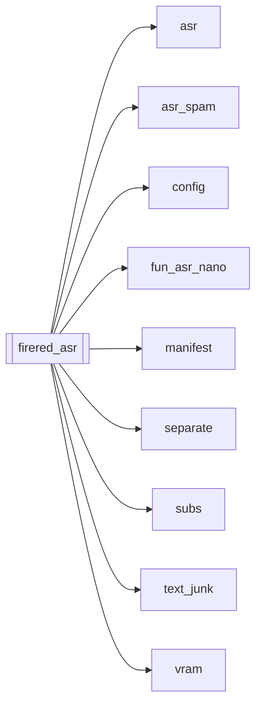

# `firered_asr`

[← Index](../generated/module-index.md) · [Brain home](../README.md)

<!-- AUTO:START — sinh bởi scripts/brain_build.py 2026-11-17 19:05. Đừng sửa tay khối này. -->
**File:** `firered_asr.py` · **Lớp:** `asr` · **565 dòng** (484 code) · **14 hàm**, **0 class** · sha1 `54799c45c4`

> firered_asr.py — STAGE ASR bằng FireRedASR2-AED (system VAD+LID+ASR+Punc). Cần clone repo + tải model local (không pip một dòng): scripts\install_firered_asr.bat

### Phụ thuộc

- **Gọi tới (import nội bộ):** [asr](./asr.md), [asr_spam](./asr_spam.md), [config](./config.md), [fun_asr_nano](./fun_asr_nano.md), [manifest](./manifest.md), [separate](./separate.md), [subs](./subs.md), [text_junk](./text_junk.md), [vram](./vram.md)
- **Được dùng bởi:** —
- **Được nhắc tên file `.py` (subprocess/script) bởi:** [agent_brain_notify](./agent_brain_notify.md), [restart_server](./restart_server.md), [server](./server.md), [tools.asr_boundary_scan](./tools.asr_boundary_scan.md), [translate_simple.zh_source](./translate_simple.zh_source.md)
- **Test:** `tests/test_firered_slice_silence.py`, `tests/test_simple_junk_park.py`
- **Thư viện ngoài:** `fireredasr2s`, `numpy`

### Hàm & class top-level

| Tên | Dòng | Dài | Tham số | Docstring |
|---|---:|---:|---|---|
| `_roots` | 47 | 6 | `` |  |
| `_ensure_firered_importable` | 55 | 13 | `root` |  |
| `_parse_firered_result` | 70 | 17 | `result` | FireRedAsr2System.process → [{start,end,text}] — đã bỏ câu rác (text_junk.is_junk_text). |
| `_parse_firered_result_raw` | 89 | 45 | `result` | FireRedAsr2System.process → [{start,end,text}] (chưa lọc rác). |
| `_num_env` | 145 | 13 | `name, default` |  |
| `slice_cfg` | 160 | 10 | `` | FIRERED_SLICE_SEC=0 -> không chia (một lượt cả file). |
| `_is_pcm16_mono16k` | 172 | 7 | `info` |  |
| `_read_i16` | 181 | 7 | `info, f, start, count` |  |
| `find_cut_frame` | 190 | 53 | `info, f, target_sec, lo_sec, hi_sec, min_sil_sec, sil_db` | Điểm cắt (frame) trong [lo_sec, hi_sec] gần target_sec. |
| `plan_slices` | 245 | 44 | `wav_path, conf` | [{start,end,core0,core1,sil_left,sil_right}] theo FRAME. Lõi phủ kín [0,n) không chồng. |
| `describe_plan` | 291 | 10 | `plan, rate` |  |
| `transcribe_sliced` | 303 | 53 | `process_fn, wav, tmp_dir, conf, on_slice` | Chạy process_fn(path, uttid) -> dict FireRed trên từng slice; trả rows tuyệt đối. |
| `run_asr_firered` | 358 | 194 ⚠️ | `work_dir, device, force` |  |
| `main` | 554 | 8 | `argv` |  |

**Hàm dài ≥120 dòng:** `run_asr_firered` (194, L358)

### Config / env keys (6)

`FIRERED_MODELS`, `FIRERED_ROOT`, `FIRERED_USE_HALF`, `HF_HUB_DISABLE_SYMLINKS`, `HF_HUB_DISABLE_SYMLINKS_WARNING`, `PATH`

**File/artifact nhắc tới:** `asr.json`, `asr16k.wav`, `audio.wav`, `sub.zh.srt`

**Tín hiệu rủi ro (đếm tĩnh):** broad_except=5 · file_writes=2 · subprocess=1

### Lịch sử (từ docs/)

- **Fix logs (6):**
  - [simple-junk-park: câu ASR rác «None.» làm dịch simple park mãi → part 1/2 kẹt, phim không ghép](../../fixes/2026-11-13-simple-junk-park.md)
  - [Port V2 → V4: preflight/chuẩn hoá video nguồn + extract_pcm bền + FireRed cắt ở khoảng lặng + câu ASR rác / pa](../../fixes/2026-11-13-port-preflight-slice-junk.md)
  - [firered-slice-silence: FireRed ASR chia slice tại khoảng lặng + đệm chồng lấn (hết cắt đôi/lặp/mất chữ ở biên ](../../fixes/2026-11-13-firered-slice-silence.md)
  - [translate-simple «next»: lexicon src · bảng quy tắc xưng hô · bổ sung cặp thiếu · học lại · nguồn ZH · gỡ lặp ](../../fixes/2026-11-12-translate-simple-next.md)
  - [FireRedASR mặc định BF16 (use_half)](../../fixes/2026-11-10-firered-use-half.md)
  - [2026-10-06 — Đợt 4 review: tranh chấp ghi, một bản tiến trình, checkpoint an toàn](../../fixes/2026-10-06-batch4-write-races.md)
- **Reviews:** [2026-10-06-code-review](../../reviews/2026-10-06-code-review.md)
- Nhắc trong CHANGELOG: **2** lần · DECISIONS: **0** lần

<!-- AUTO:END -->

<!-- MANUAL:START -->
## Vai trò (viết tay)

_Chưa viết. 2–4 câu: module này chịu trách nhiệm gì trong pipeline, ai gọi nó, nó KHÔNG làm gì._

## Luồng chính

_Các hàm vào (entry) → bước chính → output/side effect. Ghi tên hàm thật._

## Bất biến & hợp đồng

_Điều luôn phải đúng (vd: chỉ ghi manifest qua `Manifest.update`; 1 job / ghế). Vi phạm = bug._

## Bẫy đã biết

_Lỗi từng gặp + link `docs/fixes/...`. Những chỗ dễ sửa sai._

## Ghi chú vận hành

_Config key quan trọng, cần restart gì khi sửa (:8801 / :8802 / hot-reload), cách test._
<!-- MANUAL:END -->
