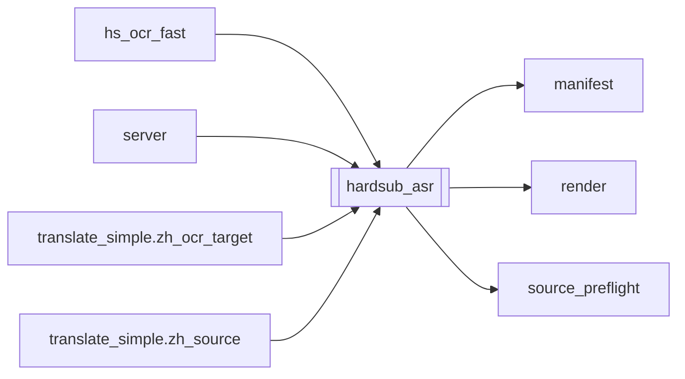

# `hardsub_asr`

[← Index](../generated/module-index.md) · [Brain home](../README.md)

<!-- AUTO:START — sinh bởi scripts/brain_build.py 2026-11-17 19:05. Đừng sửa tay khối này. -->
**File:** `hardsub_asr.py` · **Lớp:** `asr` · **447 dòng** (385 code) · **12 hàm**, **0 class** · sha1 `4df0f78d58`

> hardsub_asr.py — OCR hardsub chỉ để RÀ SOÁT / SỬA sub ZH (asr · srt). Một nhiệm vụ: RapidOCR đọc dải hardsub → so với asr.json / sub.zh → báo thiếu·sai → vá chữ ZH

### Phụ thuộc

- **Gọi tới (import nội bộ):** [manifest](./manifest.md), [render](./render.md), [source_preflight](./source_preflight.md)
- **Được dùng bởi:** [hs_ocr_fast](./hs_ocr_fast.md), [server](./server.md), [translate_simple.zh_ocr_target](./translate_simple.zh_ocr_target.md), [translate_simple.zh_source](./translate_simple.zh_source.md)
- **Test:** `tests/test_translate_simple_next.py`, `tests/test_translate_simple_next_review.py`
- **Thư viện ngoài:** `rapidocr_onnxruntime`

### Hàm & class top-level

| Tên | Dòng | Dài | Tham số | Docstring |
|---|---:|---:|---|---|
| `_find_video` | 31 | 4 | `work_dir` |  |
| `_probe_size` | 37 | 11 | `video` |  |
| `_norm_zh` | 50 | 4 | `s` |  |
| `zh_sim` | 56 | 10 | `a, b` | Độ giống 0..1 (chuỗi đã chuẩn hóa). |
| `_band_y_frac` | 68 | 25 | `work_dir` | (y0, y1) tỷ lệ chiều cao — ưu tiên hardsub_band.json. |
| `extract_hardsub_cues` | 95 | 64 | `work_dir, dur, fps, conf_min` | OCR crop đáy → list {start,end,zh,n,source}. |
| `_samples_to_cues` | 161 | 34 | `samples, gap` | Gộp frame liên tiếp cùng/gần text thành cue. |
| `merge_hardsub_into_asr` | 197 | 81 | `asr, hs_cues, min_sim` | Giữ timing ASR; chỉ thay text khi hardsub KHỚP chữ (tránh dính câu bên cạnh). |
| `_to_srt` | 280 | 22 | `rows, key` |  |
| `sync_script_zh` | 304 | 40 | `work_dir, asr_rows` | Cập nhật script.json zh theo asr (khớp i hoặc time). |
| `run_hardsub_asr` | 346 | 79 | `work_dir, dur, fps, apply, merge_only, force` |  |
| `main` | 427 | 17 | `argv` |  |

**File/artifact nhắc tới:** `asr.hardsub.json`, `asr.json`, `hardsub_band.json`, `hardsub_cues.json`, `script.json`, `sub.zh.hardsub.srt`

**Tín hiệu rủi ro (đếm tĩnh):** broad_except=4 · file_writes=5 · subprocess=2 · swallow_except=2

### Lịch sử (từ docs/)

- **Fix logs (4):**
  - [Port V2 → V4: preflight/chuẩn hoá video nguồn + extract_pcm bền + FireRed cắt ở khoảng lặng + câu ASR rác / pa](../../fixes/2026-11-13-port-preflight-slice-junk.md)
  - [Preflight + chuẩn hoá video nguồn trước khi vào job (+ 2 lỗi review extract_pcm)](../../fixes/2026-11-12-video-preflight.md)
  - [translate-simple «next»: lexicon src · bảng quy tắc xưng hô · bổ sung cặp thiếu · học lại · nguồn ZH · gỡ lặp ](../../fixes/2026-11-12-translate-simple-next.md)
  - [Port V2 → V4: luồng dịch `translate_simple` (MẶC ĐỊNH) + Demucs trước ASR](../../fixes/2026-11-12-port-simple-demucs.md)
- **Reviews:** [2026-11-12-translate-simple-next-review](../../reviews/2026-11-12-translate-simple-next-review.md)
- Nhắc trong CHANGELOG: **1** lần · DECISIONS: **0** lần

<!-- AUTO:END -->

<!-- MANUAL:START -->
## Vai trò (viết tay)

_Chưa viết. 2–4 câu: module này chịu trách nhiệm gì trong pipeline, ai gọi nó, nó KHÔNG làm gì._

## Luồng chính

_Các hàm vào (entry) → bước chính → output/side effect. Ghi tên hàm thật._

## Bất biến & hợp đồng

_Điều luôn phải đúng (vd: chỉ ghi manifest qua `Manifest.update`; 1 job / ghế). Vi phạm = bug._

## Bẫy đã biết

_Lỗi từng gặp + link `docs/fixes/...`. Những chỗ dễ sửa sai._

## Ghi chú vận hành

_Config key quan trọng, cần restart gì khi sửa (:8801 / :8802 / hot-reload), cách test._
<!-- MANUAL:END -->
