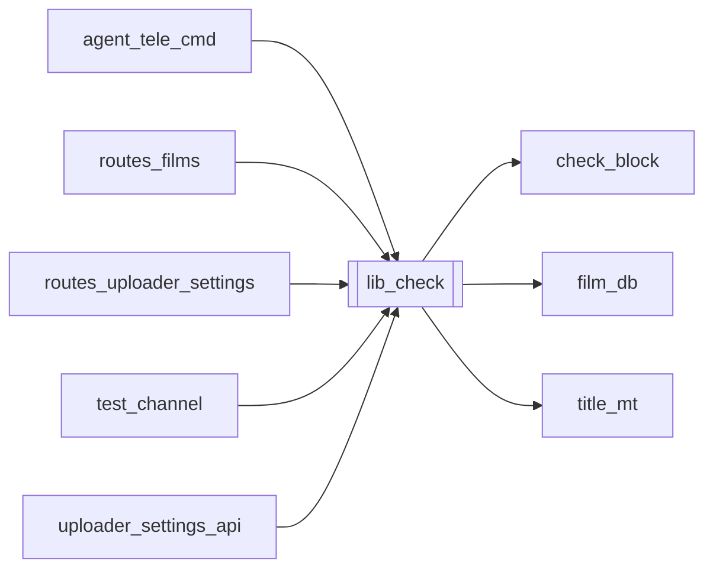

# `lib_check`

[← Index](../generated/module-index.md) · [Brain home](../README.md)

<!-- AUTO:START — sinh bởi scripts/brain_build.py 2026-11-11 02:37. Đừng sửa tay khối này. -->
**File:** `lib_check.py` · **Lớp:** `ops` · **411 dòng** (345 code) · **9 hàm**, **0 class** · sha1 `389bba4644`

> lib_check.py — Kiểm tra bản quyền / Block YouTube cho Phim trong Thư viện gốc (D:\Lib) trước khi làm job. Bao gồm: - Tìm video nguồn (merged hoặc tập đầu).

### Phụ thuộc

- **Gọi tới (import nội bộ):** [check_block](./check_block.md), [film_db](./film_db.md), [title_mt](./title_mt.md)
- **Được dùng bởi:** [agent_tele_cmd](./agent_tele_cmd.md), [routes_films](./routes_films.md), [routes_uploader_settings](./routes_uploader_settings.md), [test_channel](./test_channel.md), [uploader_settings_api](./uploader_settings_api.md)
- **Test:** ❌ chưa có test import trực tiếp
- **Thư viện ngoài:** `yt_accounts`

### Hàm & class top-level

| Tên | Dòng | Dài | Tham số | Docstring |
|---|---:|---:|---|---|
| `resolve_title_vi` | 30 | 42 | `name, title_vi` | Tìm hoặc dịch tên tiếng Việt cho tên mùa/phim để dễ nhận biết. |
| `find_source_video` | 74 | 14 | `name` | Tìm file video nguồn cho thư mục season trong D:\Lib. |
| `cut_sample` | 90 | 76 | `name, start_sec, dur_sec, title_vi` | Cắt một đoạn clip mẫu siêu nhanh (90s) từ video gốc để up test, kèm tên tiếng Việt dễ nhận biết. |
| `add_to_yt_queue` | 168 | 66 | `name, sample_path, title, privacy, account, title_vi` | Đưa video sample (hoặc video gốc) vào hàng chờ upload của yt_uploader. |
| `test_library_by_url` | 236 | 27 | `name, url_or_id` | Kiểm tra URL hoặc Video ID YouTube test cho 1 bộ phim trong Thư viện. |
| `scan_all_lib_from_yt_queue` | 265 | 63 | `check_live` | Quét toàn bộ các video thuộc D:\Lib trong queue_state.json và cập nhật trạng thái. |
| `clear_samples` | 330 | 25 | `older_than_hours` | Dọn dẹp các file video mẫu 90s trong data/samples để giải phóng dung lượng ổ cứng. |
| `list_yt_accounts` | 357 | 20 | `` | Lấy danh sách tài khoản đã cấu hình trong Z:\yt_uploader. |
| `batch_enqueue_untested_lib` | 379 | 32 | `names, limit, privacy, account` | Cắt mẫu 90s và đưa hàng loạt các mùa chưa test trong D:\Lib vào hàng chờ yt_uploader. |

### Config / env keys (2)

`LIB_ROOT`, `YT_UPLOADER_DIR`

**File/artifact nhắc tới:** `feeder_state.json`, `queue_state.json`, `s.mp4`

**Tín hiệu rủi ro (đếm tĩnh):** broad_except=8 · file_writes=1 · subprocess=2 · swallow_except=4

### Lịch sử (từ docs/)

- Fix logs: —
- **Reviews:** [2026-11-02-v4-structure-sync](../../reviews/2026-11-02-v4-structure-sync.md), [2026-11-02-v4-structure-and-v2-port](../../reviews/2026-11-02-v4-structure-and-v2-port.md), [2026-11-02-v4-duplication-audit](../../reviews/2026-11-02-v4-duplication-audit.md)
- Nhắc trong CHANGELOG: **1** lần · DECISIONS: **0** lần

<!-- AUTO:END -->

<!-- MANUAL:START -->
## Vai trò (viết tay)

_Chưa viết. 2–4 câu: module này chịu trách nhiệm gì trong pipeline, ai gọi nó, nó KHÔNG làm gì._

## Luồng chính

_Các hàm vào (entry) → bước chính → output/side effect. Ghi tên hàm thật._

## Bất biến & hợp đồng

_Điều luôn phải đúng (vd: chỉ ghi manifest qua `Manifest.update`; 1 job / ghế). Vi phạm = bug._

## Bẫy đã biết

_Lỗi từng gặp + link `docs/fixes/...`. Những chỗ dễ sửa sai._

## Ghi chú vận hành

_Config key quan trọng, cần restart gì khi sửa (:8801 / :8802 / hot-reload), cách test._
<!-- MANUAL:END -->
