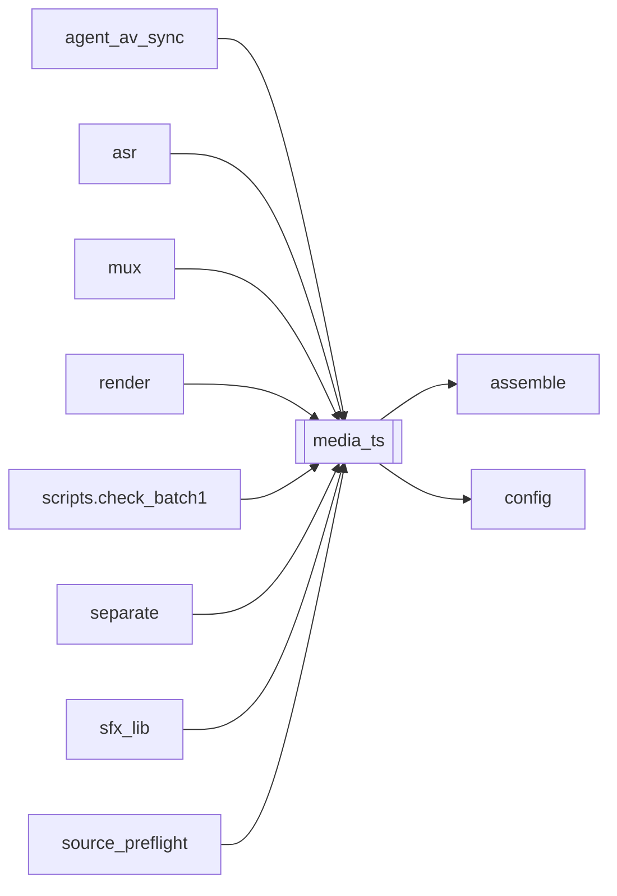

# `media_ts`

[← Index](../generated/module-index.md) · [Brain home](../README.md)

<!-- AUTO:START — sinh bởi scripts/brain_build.py 2026-11-17 19:05. Đừng sửa tay khối này. -->
**File:** `media_ts.py` · **Lớp:** `render` · **1014 dòng** (888 code) · **32 hàm**, **0 class** · sha1 `3d00df7487`

> Mốc thời gian tiếng của file nguồn — sửa tiếng "dồn mẫu" ở file ghép nhiều tập. File ghép copy nhiều tập AAC giữ lại 1024 mẫu mồi (priming) đầu mỗi tập: gói đó có mốc gần như trùng gói trước (stts ~0) nhưng vẫn chứa 23 m

### Phụ thuộc

- **Gọi tới (import nội bộ):** [assemble](./assemble.md), [config](./config.md)
- **Được dùng bởi:** [agent_av_sync](./agent_av_sync.md), [asr](./asr.md), [mux](./mux.md), [render](./render.md), [scripts.check_batch1](./scripts.check_batch1.md), [separate](./separate.md), [sfx_lib](./sfx_lib.md), [source_preflight](./source_preflight.md)
- **Được nhắc tên file `.py` (subprocess/script) bởi:** [restart_server](./restart_server.md)
- **Test:** `tests/test_extract_pcm_robust.py`, `tests/test_extract_pcm_timing.py`, `tests/test_video_preflight.py`

### Hàm & class top-level

| Tên | Dòng | Dài | Tham số | Docstring |
|---|---:|---:|---|---|
| `_decode_errors` | 58 | 11 | `stderr` | Số dòng lỗi GIẢI MÃ (không tính cảnh báo mốc dts/pts của muxer). |
| `_dead_zero_run` | 71 | 39 | `wav, min_sec, tail_only` | Mốc (s) bắt đầu đoạn mẫu = 0 tuyệt đối dài ≥ min_sec, SAU khi đã có tiếng. |
| `_full_tol_sec` | 112 | 14 | `` | EXTRACT_FULL_TOL_SEC (env / pineline.config.json), mặc định 1.0 s. |
| `_ffprobe_duration` | 128 | 10 | `path` |  |
| `_ffprobe_audio_duration` | 140 | 11 | `path` | Độ dài khai báo của luồng tiếng đầu tiên (s); 0 nếu không đọc được. |
| `_ffmpeg_pcm_cmd` | 153 | 28 | `src, out, ac, ar, af, ss, t, rf64, pre_in` |  |
| `_write_silence_wav` | 183 | 11 | `out, dur, ac, ar, rf64` |  |
| `_write_silence_frames` | 196 | 16 | `out, n_frames, ac, ar, rf64` | Im lặng ĐÚNG n_frames mẫu (pcm_s16le). wave lỗi → lavfi (độ chính xác ms). |
| `_force_wav_frames` | 214 | 51 | `wav, n_frames, ac, ar, rf64` | Ép wav về ĐÚNG n_frames mẫu: thừa → cắt đuôi, thiếu → đệm im lặng ở đuôi. |
| `_fit_wav_to_duration` | 267 | 29 | `wav, target_sec, ac, ar, rf64` | Cắt/pad PCM về đúng target_sec (tránh async từng khúc làm wav dài hơn hình). |
| `_concat_wav_parts` | 298 | 23 | `parts, out, rf64` |  |
| `_extract_window` | 323 | 37 | `src, out, ss, t, ac, ar, af, rf64, dead_check, pre_in` | Trích [ss, ss+t). Trả duration thực; 0 nếu thất bại/rỗng. Số dòng lỗi giải mã → _LAST_WIN. |
| `_has_zero_run` | 365 | 27 | `wav, min_sec` | Có đoạn mẫu 0 tuyệt đối ≥ min_sec ở bất kỳ đâu (kể cả đầu khúc / cả khúc). |
| `_zero_tail_sec` | 394 | 22 | `wav` | Độ dài (s) đoạn mẫu 0 tuyệt đối ở ĐUÔI file (cả file 0 → cả độ dài). Đọc ngược theo khối. |
| `_nonzero_frac` | 418 | 17 | `wav` | Tỉ lệ khối 10 ms có mẫu khác 0 (đo "còn tiếng" để chọn bản trích tốt hơn). |
| `_audio_seek_source` | 437 | 39 | `src, tmp` | Copy luồng tiếng ra file chỉ-tiếng để seek theo GÓI TIẾNG (không theo keyframe hình). |
| `_extract_pcm_chunked` | 478 | 128 ⚠️ | `src, out, start, end, ac, ar, af, rf64, chunk_sec, head, seek_src, …` | Ghép head (optional) + các khúc [start, end); chỗ AAC chết → silence cùng độ dài. |
| `extract_pcm_from_video` | 608 | 133 ⚠️ | `src, out, ac, ar, af, rf64, chunk_sec` | Tách PCM từ video. Full-file trước; AAC rematrix/hỏng → salvage + chunk + silence. |
| `_boxes` | 743 | 15 | `f, start, end` |  |
| `_child` | 760 | 2 | `f, s, e, name` |  |
| `mp4_track_stts` | 764 | 37 | `video, kind` | (timescale, [(count, delta)]) của track đầu tiên loại `kind` (soun/vide). |
| `audio_drift_points` | 803 | 25 | `video` | Trục 'dồn mẫu' → trục mốc: (vị trí theo mẫu [s], tiếng dư tích luỹ tới đó [s]). |
| `audio_ts_drift` | 830 | 4 | `video` | Tổng tiếng dư so với mốc (s). 0 nếu không đọc được. |
| `make_retime` | 836 | 11 | `video` | Hàm t(trục dồn mẫu) → t(trục hình). None nếu lệch không đáng kể. |
| `_probe_dur` | 849 | 7 | `p` |  |
| `_retime_srt` | 858 | 9 | `text, f` |  |
| `ensure_job_audio_ts` | 869 | 68 | `work_dir, video` | Job đã ASR trên audio dồn mẫu → dời mốc về trục hình + ghép lại dub_fit. |
| `_tmp_of` | 939 | 2 | `p` |  |
| `_backup_once` | 943 | 4 | `p, bak` | Không bao giờ đè backup đã có — bản trong _pre_audio_ts luôn là bản gốc trước lần dời đầu. |
| `_atomic_write` | 949 | 4 | `p, text` |  |
| `_commit_retime` | 955 | 32 | `work_dir, info` | Pha thay file — chạy lại an toàn: mỗi bước kiểm tra trạng thái trước khi làm. |
| `main` | 989 | 22 | `argv` |  |

**Hàm dài ≥120 dòng:** `extract_pcm_from_video` (133, L608), `_extract_pcm_chunked` (128, L478)

### Config / env keys (1)

`EXTRACT_FULL_TOL_SEC`

**File/artifact nhắc tới:** `.alt.wav`, `.audio_ts_fixed.json`, `.audio_ts_pending.json`, `.concat.txt`, `asr.json`, `audio.ts.wav`, `audio.wav`, `audio_seek.m4a`, `head.wav`, `manifest.json`, `mixed_audio.partial.wav`, `mixed_audio.wav`, `no_vocals.wav`, `orig_audio.wav`, `script.display.json`, `script.json`, `script.pre_review.json`, `sub.vi.burn.srt`, `sub.vi.srt`, `sub.zh.srt`, `tts.json`, `vocals.wav`

**Tín hiệu rủi ro (đếm tĩnh):** broad_except=1 · file_writes=4 · subprocess=12

### Lịch sử (từ docs/)

- **Fix logs (7):**
  - [Port V2 → V4: preflight/chuẩn hoá video nguồn + extract_pcm bền + FireRed cắt ở khoảng lặng + câu ASR rác / pa](../../fixes/2026-11-13-port-preflight-slice-junk.md)
  - [Preflight + chuẩn hoá video nguồn trước khi vào job (+ 2 lỗi review extract_pcm)](../../fixes/2026-11-12-video-preflight.md)
  - [Port V2 → V4: luồng dịch `translate_simple` (MẶC ĐỊNH) + Demucs trước ASR](../../fixes/2026-11-12-port-simple-demucs.md)
  - [asr-demucs-default: ASR mặc định chạy trên giọng tách Demucs + separate.py chia khúc tại khoảng lặng, cắt/ghép](../../fixes/2026-11-12-asr-demucs-default.md)
  - [Phim dài ~12h lệch khung sub — nguyên nhân + split_parts](../../fixes/2026-11-02-longfilm-sub-drift-split.md)
  - [2026-10-06 — Đợt 4 review: tranh chấp ghi, một bản tiến trình, checkpoint an toàn](../../fixes/2026-10-06-batch4-write-races.md)
  - [Đợt 1 — chặn mất dữ liệu (review 6/10)](../../fixes/2026-10-06-batch1-data-loss.md)
- **Reviews:** [2026-10-06-code-review](../../reviews/2026-10-06-code-review.md)
- Nhắc trong CHANGELOG: **4** lần · DECISIONS: **0** lần

<!-- AUTO:END -->

<!-- MANUAL:START -->
## Vai trò (viết tay)

_Chưa viết. 2–4 câu: module này chịu trách nhiệm gì trong pipeline, ai gọi nó, nó KHÔNG làm gì._

## Luồng chính

_Các hàm vào (entry) → bước chính → output/side effect. Ghi tên hàm thật._

## Bất biến & hợp đồng

_Điều luôn phải đúng (vd: chỉ ghi manifest qua `Manifest.update`; 1 job / ghế). Vi phạm = bug._

## Bẫy đã biết

_Lỗi từng gặp + link `docs/fixes/...`. Những chỗ dễ sửa sai._

## Ghi chú vận hành

_Config key quan trọng, cần restart gì khi sửa (:8801 / :8802 / hot-reload), cách test._
<!-- MANUAL:END -->
