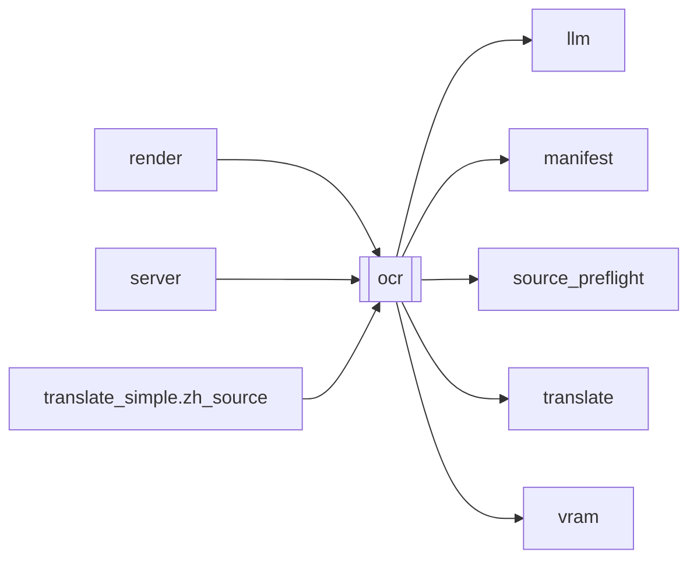

# `ocr`

[← Index](../generated/module-index.md) · [Brain home](../README.md)

<!-- AUTO:START — sinh bởi scripts/brain_build.py 2026-11-17 19:05. Đừng sửa tay khối này. -->
**File:** `ocr.py` · **Lớp:** `asr` · **268 dòng** (219 code) · **8 hàm**, **0 class** · sha1 `28281d8adc`

> ocr.py — STAGE OCR: đọc chữ TRÊN HÌNH (tên nhân vật / địa danh / caption / thẻ) mà KHÔNG nằm trong phụ đề thoại, rồi dịch sang tiếng Việt. Đầu vào : work/<job>/source.mp4 + asr.json (để trừ chữ trùng thoại)

### Phụ thuộc

- **Gọi tới (import nội bộ):** [llm](./llm.md), [manifest](./manifest.md), [source_preflight](./source_preflight.md), [translate](./translate.md), [vram](./vram.md)
- **Được dùng bởi:** [render](./render.md), [server](./server.md), [translate_simple.zh_source](./translate_simple.zh_source.md)
- **Được nhắc tên file `.py` (subprocess/script) bởi:** [server](./server.md)
- **Test:** ❌ chưa có test import trực tiếp
- **Thư viện ngoài:** `rapidocr_onnxruntime`

### Hàm & class top-level

| Tên | Dòng | Dài | Tham số | Docstring |
|---|---:|---:|---|---|
| `_meaningful` | 39 | 8 | `t` | Giữ chữ CÓ NGHĨA: ≥2 chữ Hán, hoặc số ≥3 chữ số (ID). Bỏ rác latin / 1 chữ đơn. |
| `_find_video` | 54 | 4 | `work_dir` |  |
| `_probe_size` | 60 | 10 | `video` |  |
| `extract_keyframes` | 72 | 34 | `video, out_dir, dur, stride` | Trích KEYFRAME + mốc giờ. Giải mã chỉ I-frame nên nhanh. stride: lấy cách quãng. |
| `_classify_zone` | 108 | 13 | `cx, cy, text` | Trả 'wm' (watermark), 'sub' (hardsub thoại), hoặc 'cand' (ứng viên). |
| `run_ocr` | 123 | 113 | `work_dir, dur, stride, model, force` |  |
| `_translate_entries` | 238 | 17 | `entries, model` | Dịch danh sách chữ trên hình sang tiếng Việt (1 lời gọi LLM). |
| `main` | 257 | 8 | `argv` |  |

**File/artifact nhắc tới:** `asr.json`, `ocr.json`

**Tín hiệu rủi ro (đếm tĩnh):** broad_except=3 · file_writes=1 · subprocess=3

### Lịch sử (từ docs/)

- **Fix logs (4):**
  - [Port V2 → V4: preflight/chuẩn hoá video nguồn + extract_pcm bền + FireRed cắt ở khoảng lặng + câu ASR rác / pa](../../fixes/2026-11-13-port-preflight-slice-junk.md)
  - [Preflight + chuẩn hoá video nguồn trước khi vào job (+ 2 lỗi review extract_pcm)](../../fixes/2026-11-12-video-preflight.md)
  - [translate-simple «next»: lexicon src · bảng quy tắc xưng hô · bổ sung cặp thiếu · học lại · nguồn ZH · gỡ lặp ](../../fixes/2026-11-12-translate-simple-next.md)
  - [Port V2 → V4: luồng dịch `translate_simple` (MẶC ĐỊNH) + Demucs trước ASR](../../fixes/2026-11-12-port-simple-demucs.md)
- **Reviews:** [2026-10-06-code-review](../../reviews/2026-10-06-code-review.md)
- Nhắc trong CHANGELOG: **1** lần · DECISIONS: **0** lần

<!-- AUTO:END -->

<!-- MANUAL:START -->
## Vai trò (viết tay)

_Chưa viết. 2–4 câu: module này chịu trách nhiệm gì trong pipeline, ai gọi nó, nó KHÔNG làm gì._

## Luồng chính

_Các hàm vào (entry) → bước chính → output/side effect. Ghi tên hàm thật._

## Bất biến & hợp đồng

_Điều luôn phải đúng (vd: chỉ ghi manifest qua `Manifest.update`; 1 job / ghế). Vi phạm = bug._

## Bẫy đã biết

_Lỗi từng gặp + link `docs/fixes/...`. Những chỗ dễ sửa sai._

## Ghi chú vận hành

_Config key quan trọng, cần restart gì khi sửa (:8801 / :8802 / hot-reload), cách test._
<!-- MANUAL:END -->
