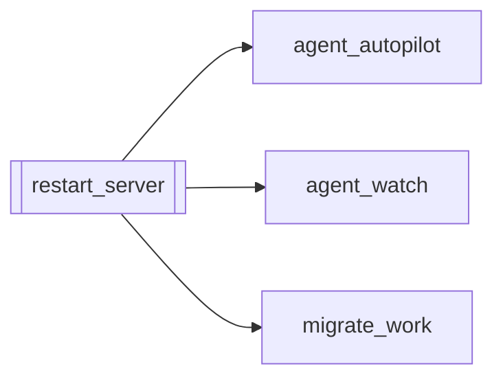

# `restart_server`

[← Index](../generated/module-index.md) · [Brain home](../README.md)

<!-- AUTO:START — sinh bởi scripts/brain_build.py 2026-11-11 02:37. Đừng sửa tay khối này. -->
**File:** `restart_server.py` · **Lớp:** `control` · **237 dòng** (203 code) · **8 hàm**, **0 class** · sha1 `762d04f043`

> Restart server Pineline (giữ sidecar), khôi phục hàng đợi + Auto-pilot. Port mặc định V4: 8804 (env PORT / PINELINE_BASE). Vẫn nhận 8801 nếu đặt env. --after-current: rút job chờ, đợi job đang chạy xong rồi mới restart (

### Phụ thuộc

- **Gọi tới (import nội bộ):** [agent_autopilot](./agent_autopilot.md), [agent_watch](./agent_watch.md), [migrate_work](./migrate_work.md)
- **Được dùng bởi:** —
- **Được nhắc tên file `.py` (subprocess/script) bởi:** [agent_tele_cmd](./agent_tele_cmd.md)
- **Test:** ❌ chưa có test import trực tiếp

### Hàm & class top-level

| Tên | Dòng | Dài | Tham số | Docstring |
|---|---:|---:|---|---|
| `_manifest_opts` | 48 | 6 | `job_id` |  |
| `_tg` | 56 | 7 | `msg` |  |
| `_proc_env` | 65 | 7 | `pattern` |  |
| `_precheck` | 74 | 11 | `` | '' nếu code mới compile + import được; ngược lại là lỗi (không restart). |
| `_requeue` | 87 | 13 | `order, opts` |  |
| `_start_server` | 102 | 19 | `clean_env, env` |  |
| `_restart_sidecar` | 123 | 7 | `env` |  |
| `main` | 132 | 96 | `` |  |

### Config / env keys (2)

`AGENT_TELEGRAM`, `PORT`

**Cổng nhắc tới:** 8802

**File/artifact nhắc tới:** `manifest.json`, `restart_pending.json`

**Tín hiệu rủi ro (đếm tĩnh):** broad_except=5 · file_writes=1 · sleep=5 · subprocess=5

### Lịch sử (từ docs/)

- **Fix logs (7):**
  - [Hongguo "Merge all": không thấy đang chạy gì, 16 series rất lâu mới ra 1](../../fixes/2026-10-07-hg-merge-queue.md)
  - [Restart hẹn giờ chết giữa chừng, server :8801 nằm chết](../../fixes/2026-10-06-restart-killed-itself.md)
  - [Đợt 7: gỡ UI cũ, tách server.py](../../fixes/2026-10-06-batch7-ui-split.md)
  - [2026-10-06 — Đợt 6 review: bảo trì (git, pytest, M3, dọn script chết)](../../fixes/2026-10-06-batch6-maintenance.md)
  - [2026-10-06 — Đợt 5 review: agent an toàn hơn](../../fixes/2026-10-06-batch5-agent-safety.md)
  - [2026-10-06 — Đợt 4 review: tranh chấp ghi, một bản tiến trình, checkpoint an toàn](../../fixes/2026-10-06-batch4-write-races.md)
  - [Đợt 1 — chặn mất dữ liệu (review 6/10)](../../fixes/2026-10-06-batch1-data-loss.md)
- **Reviews:** [2026-11-02-v4-structure-sync](../../reviews/2026-11-02-v4-structure-sync.md), [2026-11-02-v4-structure-and-v2-port](../../reviews/2026-11-02-v4-structure-and-v2-port.md), [2026-11-02-v4-duplication-audit](../../reviews/2026-11-02-v4-duplication-audit.md), [2026-10-06-code-review](../../reviews/2026-10-06-code-review.md)
- Nhắc trong CHANGELOG: **14** lần · DECISIONS: **1** lần

<!-- AUTO:END -->

<!-- MANUAL:START -->
## Vai trò (viết tay)

_Chưa viết. 2–4 câu: module này chịu trách nhiệm gì trong pipeline, ai gọi nó, nó KHÔNG làm gì._

## Luồng chính

_Các hàm vào (entry) → bước chính → output/side effect. Ghi tên hàm thật._

## Bất biến & hợp đồng

_Điều luôn phải đúng (vd: chỉ ghi manifest qua `Manifest.update`; 1 job / ghế). Vi phạm = bug._

## Bẫy đã biết

_Lỗi từng gặp + link `docs/fixes/...`. Những chỗ dễ sửa sai._

## Ghi chú vận hành

_Config key quan trọng, cần restart gì khi sửa (:8801 / :8802 / hot-reload), cách test._
<!-- MANUAL:END -->
