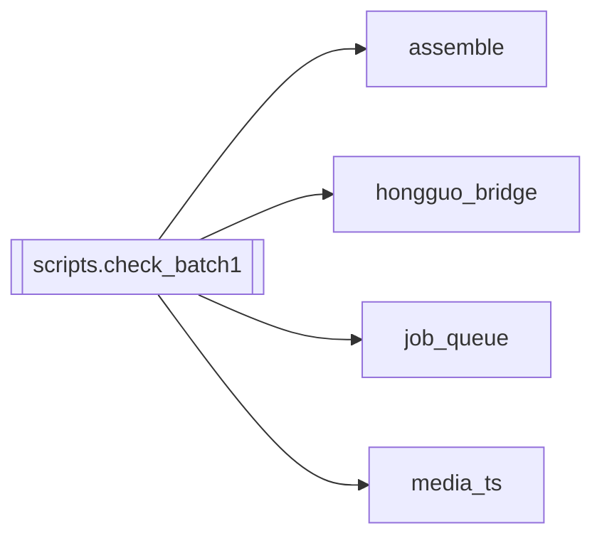

# `scripts.check_batch1`

[← Index](../generated/module-index.md) · [Brain home](../README.md)

<!-- AUTO:START — sinh bởi scripts/brain_build.py 2026-11-11 02:37. Đừng sửa tay khối này. -->
**File:** `scripts/check_batch1.py` · **Lớp:** `ops` · **294 dòng** (245 code) · **11 hàm**, **0 class** · sha1 `6147ce1ccc`

> Test đợt 1 (chặn mất dữ liệu) — chỉ dùng thư mục tạm, không đụng job/queue/thư viện thật.

### Phụ thuộc

- **Gọi tới (import nội bộ):** [assemble](./assemble.md), [hongguo_bridge](./hongguo_bridge.md), [job_queue](./job_queue.md), [media_ts](./media_ts.md)
- **Được dùng bởi:** —
- **Test:** ❌ chưa có test import trực tiếp
- **Thư viện ngoài:** `numpy`, `soundfile`

### Hàm & class top-level

| Tên | Dòng | Dài | Tham số | Docstring |
|---|---:|---:|---|---|
| `check` | 21 | 4 | `name, cond, extra` |  |
| `extract` | 27 | 7 | `path, names, g` |  |
| `ffmk` | 36 | 4 | `path, dur` |  |
| `touch` | 42 | 2 | `p, t` |  |
| `test_s1` | 47 | 41 | `` |  |
| `test_s6` | 91 | 32 | `` |  |
| `test_hongguo` | 126 | 55 | `` |  |
| `test_pick` | 184 | 21 | `` |  |
| `test_feeder_sids` | 207 | 6 | `` |  |
| `test_m2` | 216 | 34 | `` |  |
| `test_m5` | 253 | 28 | `` |  |

**File/artifact nhắc tới:** `_job_queue.json`, `a.wav`, `audio.ts.wav`, `audio.wav`, `b.wav`, `c.wav`, `concat.txt`, `full_merged.mp4`, `manifest.json`, `nope.mp4`, `output.mp4`, `script.display.json`, `script.json`, `trailer.mp4`, `tts.json`, `tts_fit.json`, `x.json`, `第001集.mp4`, `第002集.mp4`

**Tín hiệu rủi ro (đếm tĩnh):** broad_except=1 · eval_exec=1 · file_writes=19 · sleep=1 · subprocess=2

### Lịch sử (từ docs/)

- **Fix logs (2):**
  - [2026-10-06 — Đợt 2 review: bảo mật + config một nguồn + LLM sập không để trống câu](../../fixes/2026-10-06-batch2-security.md)
  - [Đợt 1 — chặn mất dữ liệu (review 6/10)](../../fixes/2026-10-06-batch1-data-loss.md)
- Nhắc trong CHANGELOG: **1** lần · DECISIONS: **0** lần

<!-- AUTO:END -->

<!-- MANUAL:START -->
## Vai trò (viết tay)

_Chưa viết. 2–4 câu: module này chịu trách nhiệm gì trong pipeline, ai gọi nó, nó KHÔNG làm gì._

## Luồng chính

_Các hàm vào (entry) → bước chính → output/side effect. Ghi tên hàm thật._

## Bất biến & hợp đồng

_Điều luôn phải đúng (vd: chỉ ghi manifest qua `Manifest.update`; 1 job / ghế). Vi phạm = bug._

## Bẫy đã biết

_Lỗi từng gặp + link `docs/fixes/...`. Những chỗ dễ sửa sai._

## Ghi chú vận hành

_Config key quan trọng, cần restart gì khi sửa (:8801 / :8802 / hot-reload), cách test._
<!-- MANUAL:END -->
