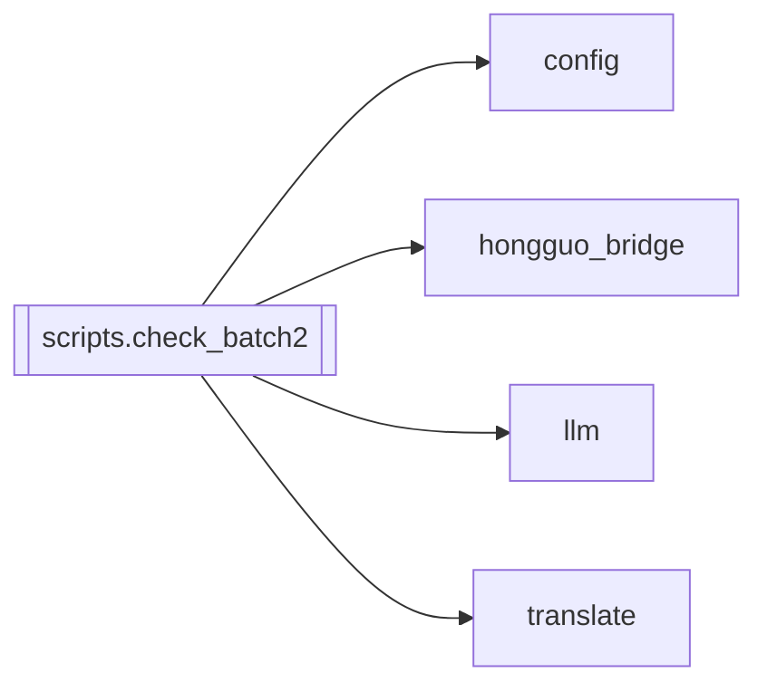

# `scripts.check_batch2`

[← Index](../generated/module-index.md) · [Brain home](../README.md)

<!-- AUTO:START — sinh bởi scripts/brain_build.py 2026-11-11 02:37. Đừng sửa tay khối này. -->
**File:** `scripts/check_batch2.py` · **Lớp:** `ops` · **305 dòng** (241 code) · **9 hàm**, **1 class** · sha1 `ec1e58f124`

> Kiểm thử đợt 2 (bảo mật + config 1 nguồn + LLM lỗi dừng stage). KHÔNG chạm server/sidecar live: middleware & handler được tách bằng AST rồi exec vào app/handler giả.

### Phụ thuộc

- **Gọi tới (import nội bộ):** [config](./config.md), [hongguo_bridge](./hongguo_bridge.md), [llm](./llm.md), [translate](./translate.md)
- **Được dùng bởi:** —
- **Test:** ❌ chưa có test import trực tiếp
- **Thư viện ngoài:** `fastapi`, `redact`, `requests`

### API routes (2)

| Method | Path | Handler | Dòng |
|---|---|---|---:|
| GET | `/api/x` | `_x` | 58 |
| GET | `/ui` | `_ui` | 63 |

### Hàm & class top-level

| Tên | Dòng | Dài | Tham số | Docstring |
|---|---:|---:|---|---|
| **class `R`** | 186 | 3 method | |  |
| `check` | 18 | 8 | `name, cond` |  |
| `extract` | 28 | 11 | `path, names` |  |
| `_x` | 58 | 2 | `` |  |
| `_ui` | 63 | 2 | `` |  |
| `mk` | 104 | 9 | `headers` |  |
| `post_ok` | 199 | 3 | `url, headers, json, timeout` |  |
| `post_400` | 222 | 3 | `url, headers, json, timeout` |  |
| `boom` | 253 | 3 | `*a, **k` |  |
| `parse_err` | 266 | 4 | `rows_, *a, **k` |  |

**Cổng nhắc tới:** 11434, 8801, 8802

**File/artifact nhắc tới:** `config.json`

**Tín hiệu rủi ro (đếm tĩnh):** eval_exec=2 · global_stmt=1

### Lịch sử (từ docs/)

- **Fix logs (2):**
  - [2026-10-06 — Đợt 6 review: bảo trì (git, pytest, M3, dọn script chết)](../../fixes/2026-10-06-batch6-maintenance.md)
  - [2026-10-06 — Đợt 2 review: bảo mật + config một nguồn + LLM sập không để trống câu](../../fixes/2026-10-06-batch2-security.md)
- Nhắc trong CHANGELOG: **1** lần · DECISIONS: **0** lần

<!-- AUTO:END -->

<!-- MANUAL:START -->
## Vai trò (viết tay)

_Chưa viết. 2–4 câu: module này chịu trách nhiệm gì trong pipeline, ai gọi nó, nó KHÔNG làm gì._

## Luồng chính

_Các hàm vào (entry) → bước chính → output/side effect. Ghi tên hàm thật._

## Bất biến & hợp đồng

_Điều luôn phải đúng (vd: chỉ ghi manifest qua `Manifest.update`; 1 job / ghế). Vi phạm = bug._

## Bẫy đã biết

_Lỗi từng gặp + link `docs/fixes/...`. Những chỗ dễ sửa sai._

## Ghi chú vận hành

_Config key quan trọng, cần restart gì khi sửa (:8801 / :8802 / hot-reload), cách test._
<!-- MANUAL:END -->
