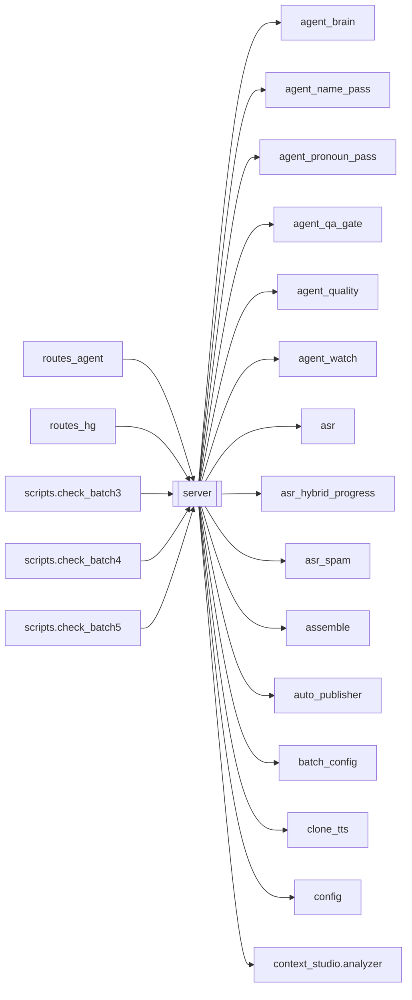

# `server`

[← Index](../generated/module-index.md) · [Brain home](../README.md)

<!-- AUTO:START — sinh bởi scripts/brain_build.py 2026-11-11 02:37. Đừng sửa tay khối này. -->
**File:** `server.py` · **Lớp:** `control` · **6644 dòng** (5799 code) · **176 hàm**, **28 class** · sha1 `75d34eeddf`

> server.py — Backend web Phase 1 (FastAPI). Bọc engine (download -> asr -> translate) thành app web: - Phục vụ trang dashboard (web/index.html)

### Phụ thuộc

- **Gọi tới (import nội bộ):** [agent_brain](./agent_brain.md), [agent_name_pass](./agent_name_pass.md), [agent_pronoun_pass](./agent_pronoun_pass.md), [agent_qa_gate](./agent_qa_gate.md), [agent_quality](./agent_quality.md), [agent_watch](./agent_watch.md), [asr](./asr.md), [asr_hybrid_progress](./asr_hybrid_progress.md), [asr_spam](./asr_spam.md), [assemble](./assemble.md), [auto_publisher](./auto_publisher.md), [batch_config](./batch_config.md), [clone_tts](./clone_tts.md), [config](./config.md), [context_studio.analyzer](./context_studio.analyzer.md), [context_studio.character_mapper](./context_studio.character_mapper.md), [context_studio.exporter](./context_studio.exporter.md), [context_studio.schema](./context_studio.schema.md), [context_studio.srt_io](./context_studio.srt_io.md), [download](./download.md), [hardsub_asr](./hardsub_asr.md), [hg_ui_ctx](./hg_ui_ctx.md), [hongguo_bridge](./hongguo_bridge.md), [job_queue](./job_queue.md), [llm](./llm.md), [manifest](./manifest.md), [ocr](./ocr.md), [playlist](./playlist.md), [render](./render.md), [render_fx](./render_fx.md), [routes_agent](./routes_agent.md), [routes_hg](./routes_hg.md), [routes_ui](./routes_ui.md), [separate](./separate.md), [series_glossary](./series_glossary.md), [split_parts](./split_parts.md), [subs](./subs.md), [translate](./translate.md), [translate_alts](./translate_alts.md), [vram](./vram.md)
- **Được dùng bởi:** [routes_agent](./routes_agent.md), [routes_hg](./routes_hg.md), [scripts.check_batch3](./scripts.check_batch3.md), [scripts.check_batch4](./scripts.check_batch4.md), [scripts.check_batch5](./scripts.check_batch5.md)
- **Được nhắc tên file `.py` (subprocess/script) bởi:** [agent_core](./agent_core.md), [agent_feeder](./agent_feeder.md), [app_desktop](./app_desktop.md), [migrate_work](./migrate_work.md), [restart_server](./restart_server.md), [routes_agent](./routes_agent.md), [routes_films](./routes_films.md), [routes_hg](./routes_hg.md), [routes_ui](./routes_ui.md), [scripts.check_batch1](./scripts.check_batch1.md), [scripts.check_batch2](./scripts.check_batch2.md), [scripts.check_batch3](./scripts.check_batch3.md), [scripts.check_batch4](./scripts.check_batch4.md), [scripts.tree_audit](./scripts.tree_audit.md)
- **Test:** `tests/test_hardsub_blur_toggle.py`, `tests/test_park_review_retry.py`, `tests/test_queue_jobs_api.py`, `tests/test_queue_run_one.py`, `tests/test_server_split.py`, `tests/test_source_link.py`
- **Thư viện ngoài:** `fastapi`, `faster_whisper`, `huggingface_hub`, `psutil`, `pydantic`, `uvicorn`

### API routes (68)

| Method | Path | Handler | Dòng |
|---|---|---|---:|
| POST | `/api/agent/brain/tick` | `api_agent_brain_tick` | 6597 |
| GET | `/api/brand-logos` | `list_brand_logos` | 5559 |
| POST | `/api/clone-voice` | `clone_voice` | 5686 |
| GET | `/api/cookies` | `cookies_status` | 5200 |
| POST | `/api/cookies` | `import_cookies` | 5226 |
| GET | `/api/frames` | `list_frames` | 5549 |
| GET | `/api/fs/list-dirs` | `api_fs_list_dirs` | 3015 |
| POST | `/api/fs/pick-dir` | `api_fs_pick_dir` | 3069 |
| POST | `/api/fs/pick-dirs` | `api_fs_pick_dirs` | 3143 |
| GET | `/api/jobs` | `list_jobs` | 5272 |
| POST | `/api/jobs` | `create_job` | 2461 |
| POST | `/api/jobs/group` | `jobs_group` | 2552 |
| POST | `/api/jobs/local` | `create_local_job_upload` | 3209 |
| POST | `/api/jobs/local-batch` | `create_local_job_batch` | 2932 |
| POST | `/api/jobs/local-path` | `create_local_job_path` | 2861 |
| DELETE | `/api/jobs/{job_id}` | `delete_job` | 6349 |
| GET | `/api/jobs/{job_id}` | `job_detail` | 5286 |
| POST | `/api/jobs/{job_id}/apply-alt` | `apply_alt_pick` | 5075 |
| POST | `/api/jobs/{job_id}/asr-engine` | `set_asr_engine` | 4535 |
| POST | `/api/jobs/{job_id}/asr-select` | `select_asr_source` | 4851 |
| GET | `/api/jobs/{job_id}/asr-sources` | `list_asr_sources` | 4833 |
| POST | `/api/jobs/{job_id}/assemble` | `assemble_job` | 6202 |
| DELETE | `/api/jobs/{job_id}/audio` | `delete_audio` | 6034 |
| POST | `/api/jobs/{job_id}/audio` | `upload_audio` | 6000 |
| GET | `/api/jobs/{job_id}/context-studio` | `get_context_studio` | 4939 |
| POST | `/api/jobs/{job_id}/context-studio` | `run_context_studio_api` | 4995 |
| GET | `/api/jobs/{job_id}/file/{path:path}` | `job_file` | 6296 |
| GET | `/api/jobs/{job_id}/hardsub-asr` | `get_hardsub_asr` | 5164 |
| POST | `/api/jobs/{job_id}/hardsub-asr` | `run_hardsub_asr_api` | 5134 |
| POST | `/api/jobs/{job_id}/mark-done` | `mark_job_done` | 3953 |
| POST | `/api/jobs/{job_id}/merge-parts` | `api_merge_job_parts` | 6257 |
| POST | `/api/jobs/{job_id}/mux` | `mux_job` | 6167 |
| POST | `/api/jobs/{job_id}/reveal` | `reveal_job` | 6268 |
| POST | `/api/jobs/{job_id}/run-all` | `run_all` | 4216 |
| POST | `/api/jobs/{job_id}/run/{stage}` | `run_stage` | 3869 |
| POST | `/api/jobs/{job_id}/script-clean-spam` | `clean_script_spam` | 4162 |
| POST | `/api/jobs/{job_id}/script-line` | `edit_script_line` | 4058 |
| POST | `/api/jobs/{job_id}/source` | `upload_source` | 5922 |
| POST | `/api/jobs/{job_id}/source-path` | `import_source_path` | 5960 |
| POST | `/api/jobs/{job_id}/split-parts` | `api_split_job_parts` | 6246 |
| GET | `/api/jobs/{job_id}/split-plan` | `get_split_plan` | 6224 |
| GET | `/api/jobs/{job_id}/srt/{lang}` | `job_srt` | 5887 |
| POST | `/api/jobs/{job_id}/start` | `start_job` | 3247 |
| POST | `/api/jobs/{job_id}/stop` | `stop_job` | 3932 |
| POST | `/api/jobs/{job_id}/translate` | `retranslate_job` | 6095 |
| GET | `/api/jobs/{job_id}/translate-alts` | `get_translate_alts` | 5030 |
| POST | `/api/jobs/{job_id}/translate-alts` | `run_translate_alts_api` | 5049 |
| POST | `/api/jobs/{job_id}/translate-fill` | `translate_fill` | 4011 |
| POST | `/api/jobs/{job_id}/tts` | `regen_tts` | 5776 |
| POST | `/api/jobs/{job_id}/tts-clip` | `regen_clip` | 5870 |
| POST | `/api/jobs/{job_id}/tts-voice` | `set_tts_voice` | 4201 |
| GET | `/api/jobs/{job_id}/tts-wav-ok` | `tts_wav_ok` | 5760 |
| GET|HEAD | `/api/jobs/{job_id}/video` | `job_video` | 5457 |
| GET | `/api/llm/models` | `get_available_llm_models` | 6611 |
| GET | `/api/models` | `get_available_llm_models` | 6611 |
| POST | `/api/queue/group` | `jobs_group` | 2552 |
| GET | `/api/queue/jobs` | `api_queue_jobs_state` | 2823 |
| POST | `/api/queue/jobs` | `api_queue_jobs_add` | 2668 |
| POST | `/api/queue/jobs/clear` | `api_queue_jobs_clear` | 2856 |
| POST | `/api/queue/jobs/group` | `api_queue_jobs_add_group` | 2685 |
| POST | `/api/queue/jobs/move` | `api_queue_jobs_move` | 2794 |
| POST | `/api/queue/jobs/opts` | `api_queue_jobs_opts` | 2701 |
| POST | `/api/queue/jobs/remove` | `api_queue_jobs_remove` | 2722 |
| POST | `/api/queue/jobs/reorder` | `api_queue_jobs_reorder` | 2810 |
| POST | `/api/queue/jobs/sort` | `api_queue_jobs_sort` | 2785 |
| POST | `/api/queue/jobs/stop` | `api_queue_jobs_stop` | 2851 |
| GET | `/api/voice-sample` | `voice_sample` | 5719 |
| GET | `/api/voices` | `list_voices` | 5541 |

### Hàm & class top-level

| Tên | Dòng | Dài | Tham số | Docstring |
|---|---:|---:|---|---|
| **class `_Stopped`** | 721 | 0 method | | Người dùng bấm Dừng — không phải lỗi. |
| **class `NewJob`** | 1167 | 0 method | |  |
| **class `LocalJobIn`** | 1173 | 0 method | | Tạo job từ video local — không cần URL. |
| **class `LocalBatchIn`** | 1184 | 0 method | | Import nhiều path (file và/hoặc folder), 1 dòng = 1 path. |
| **class `HgSubmitIn`** | 1194 | 0 method | |  |
| **class `HgMergeIn`** | 1201 | 0 method | |  |
| **class `JobGroupReq`** | 1207 | 0 method | | Gom / sửa nhóm series trên hàng chờ. |
| **class `HgBaseIn`** | 1217 | 0 method | |  |
| **class `TTSReq`** | 1221 | 0 method | |  |
| **class `ClipReq`** | 1228 | 0 method | |  |
| **class `MuxReq`** | 1234 | 0 method | |  |
| **class `TranslateReq`** | 1259 | 0 method | |  |
| **class `ScriptLineEdit`** | 1269 | 0 method | | Sửa tay 1 câu trong script.json (zh và/hoặc vi). |
| **class `TTSVoiceReq`** | 1276 | 0 method | |  |
| **class `RunAllReq`** | 1282 | 0 method | |  |
| **class `JobQueueReq`** | 1310 | 0 method | |  |
| **class `JobQueueGroupReq`** | 1316 | 0 method | | Enqueue cả series theo group_id (sort group_index). |
| **class `JobQueueRemoveReq`** | 1322 | 0 method | |  |
| **class `AgentChatReq`** | 1326 | 0 method | | Pineline V2 — chat với AI Agent nhúng. |
| **class `AgentConfirmReq`** | 1336 | 0 method | |  |
| **class `AsrEngineReq`** | 1341 | 0 method | |  |
| **class `AsrSelectReq`** | 1345 | 0 method | | Chọn file ASR sidecar → promote thành asr.json (vd asr.fun_nano.json). |
| **class `ContextStudioReq`** | 1350 | 0 method | | PRE-SCAN Context Studio trước dịch. |
| **class `TranslateAltsReq`** | 1356 | 0 method | | Quét câu → phương án dịch tối ưu (ngữ cảnh + văn phong). |
| **class `ApplyAltReq`** | 1363 | 0 method | |  |
| **class `MarkDoneReq`** | 1368 | 0 method | |  |
| **class `HardsubAsrReq`** | 5126 | 0 method | |  |
| **class `SourcePathIn`** | 5916 | 0 method | |  |
| `_mux_output_ok` | 93 | 6 | `work_dir, min_bytes` |  |
| `_part_pipeline_complete` | 101 | 19 | `work_dir` | Part đã mux + output đủ lớn và không bị đánh stale → không chạy lại pipeline. |
| `_ensure_parent_mux_merged_done` | 122 | 25 | `work_dir, n_parts` | Heal UI parent: đã có Full/merged mà mux còn running@80%. |
| `_parent_full_output_ok` | 149 | 9 | `work_dir, sub_ids` |  |
| `_all_split_parts_complete` | 160 | 14 | `parent_id` | True nếu parent có sub_job_ids và mọi part đã mux/output xong. |
| `_queue_split_parent_merge_if_ready` | 176 | 89 | `parent_id, reason` | Parts đã xong mà parent chưa Full (worker auto-split chết/restart) → xếp ghép nền. |
| `_notify_parent_after_part_done` | 267 | 9 | `part_job_id` | Part mux xong → nếu mọi part xong thì xếp merge về job gốc. |
| `_split_parent_id` | 278 | 5 | `job_id` | d693…_p03 → d693… ; job thường → None. |
| `_job_any_busy` | 285 | 7 | `job_id` | Trả tên stage đang claim, hoặc None. |
| `_job_lineage_busy` | 294 | 15 | `job_id` | Busy của job hoặc parent auto-split (part chạy dưới claim của parent). |
| `_claim_stage` | 311 | 7 | `job_id, stage` | Giữ chỗ trước khi submit thread — chống bấm 2-3 lần tạo nhiều task. |
| `_release_stage` | 320 | 5 | `job_id, stage` |  |
| `_busy_response` | 327 | 9 | `job_id, work_dir` | 409 nếu job đang có claim hoặc stage 'running' trong manifest, ngược lại None. |
| `_submit_claimed` | 338 | 17 | `executor, job_id, stage, fn, *args, **kwargs` | Claim (job, stage) rồi submit; nhả claim khi xong. Trả 409 nếu đã có claim. |
| `_manifest_running` | 357 | 10 | `work_dir` | Stage đang 'running' trong manifest (nếu có). |
| `_job_proc_alive` | 369 | 6 | `job_id` | True nếu còn subprocess engine/ffmpeg đăng ký cho job. |
| `_path_key` | 377 | 10 | `p` | Khoá so đường dẫn: work là junction → D:, psutil.cwd() trả đường Z: chưa resolve. |
| `_json_rows` | 389 | 6 | `p` |  |
| `_stage_complete_on_disk` | 397 | 26 | `work_dir, stage` | Artifact ĐỦ (không phải bản dở sau Dừng/crash) — điều kiện để tự nâng stage lên done. |
| `_stage_has_artifact` | 425 | 22 | `work_dir, stage` | Artifact đĩa đủ để coi stage đã xong (dùng heal stale running). |
| `_heal_stale_running` | 449 | 106 | `work_dir` | Sửa stage status=running mồ côi (kill/crash/skip không mark_done). |
| `_next_incomplete_stage` | 557 | 8 | `work_dir` | Bước WIRED đầu tiên chưa done (để mark_running đúng — không ép lại ASR). |
| `_run_engine` | 567 | 74 | `script, work_dir, *args` | Chạy engine NẶNG (ASR/TTS) ở TIẾN TRÌNH RIÊNG. |
| `_iter_job_engine_procs` | 651 | 41 | `job_id, script_name` | Quét toàn hệ thống process Python đang chạy engine cho job_id (kể cả orphan). |
| `_kill_job_engine_procs` | 694 | 13 | `job_id, script_name, exclude_pid` | Kill process engine trùng job (system-wide). Trả số process đã kill. |
| `_noisy_log` | 713 | 6 | `line` | Lọc log rác TTS (ref_text dài, tqdm...). Giữ gen_text + [ok]/[tts]/lỗi. |
| `_kill_job_children` | 725 | 73 | `job_id` | Kill MỌI tiến trình liên quan job (asr/clone_tts/demucs/ffmpeg/aria2c), |
| `_stop_job` | 800 | 83 | `job_id` | Dừng mọi việc đang chạy của 1 job + đưa stage 'running' về 'pending'. |
| `_clear_stop` | 885 | 12 | `job_id` | Xoá cờ Stop in-memory + file .stop (cả WORK_ROOT lẫn D:\PinelineV2_work). |
| `_check_stopped` | 899 | 11 | `job_id` | True nếu user bấm Dừng (in-memory hoặc file .stop). |
| `_stage_artifact_payload` | 918 | 58 | `work_dir, stage` | Nếu đĩa đã có kết quả bước → payload để mark_done. None = chưa có artifact. |
| `_heal_stages_from_disk` | 978 | 20 | `m` | Misclick/Dừng giữa chừng: file đã ĐỦ mà status còn pending/failed → đánh done. |
| `_force_mark_stage` | 1000 | 15 | `m, stage, require_artifact` | Đánh dấu 1 bước done ngay (không chạy lại). |
| `_url_host` | 1030 | 6 | `v` |  |
| async `_local_only_guard` | 1039 | 14 | `request, call_next` | Chỉ phục vụ máy này: Host lạ = DNS rebinding; Origin/Referer lạ trên /api = trang web |
| async `_quiet_conn_reset` | 1056 | 14 | `` | Trên Windows, khi client (UI poll) đóng kết nối đột ngột giữa request, event |
| `_reset_stale_running` | 1073 | 38 | `` | Khi server khởi động, KHÔNG có thread nào đang chạy. Vậy mọi stage còn ghi |
| `_start_queue_worker` | 1114 | 5 | `` | Worker hàng đợi chỉ chạy SAU khi reset stage treo + kill engine orphan; chạy lúc import |
| `_resume_hg_merge` | 1122 | 10 | `` | Hàng đợi gộp Hongguo nạp lại từ work/logs/hg_merge_state.json → chạy tiếp nếu Hongguo đang mở |
| `_startup_fix_tts` | 1134 | 31 | `work_dir, st` | Khôi phục voice/progress TTS sau crash — không mất cấu hình. |
| `_process_gpu` | 1374 | 25 | `job_id, target` | Phần NẶNG (GPU/LLM): ASR -> Dịch. Chạy ở hàng đợi _gpu (tuần tự). |
| `run_pipeline` | 1401 | 16 | `job_id, url, target, cookies_from_browser` | TẢI (hàng đợi _dl, song song). Tải xong -> đẩy ASR+Dịch sang hàng đợi _gpu |
| `_check_and_run_auto_split_parts` | 1419 | 145 ⚠️ | `job_id, target, audio_mode, voice_vol, orig_vol, use_ocr, fit, reso…` | Tự động phát hiện video dài (>= 3.0h): |
| `_auto_pipeline` | 1566 | 49 | `job_id, audio_mode, voice_vol, orig_vol, use_ocr, fit, resolution, …` | 1-CLICK (chạy ở hàng _dl): tải (nếu cần) -> đẩy phần GPU sang hàng _gpu. |
| `_run_requested_review` | 1617 | 59 | `wd, target` | Rà soát do Agent/user yêu cầu (manifest.agent.review_request): rà tên nhân vật theo bảng |
| `_save_series_glossary` | 1678 | 9 | `wd` |  |
| `_auto_gpu` | 1694 | 320 ⚠️ | `job_id, target, audio_mode, voice_vol, orig_vol, use_ocr, fit, reso…` | Phần GPU của 1-click (hàng _gpu, tuần tự): ASR -> Dịch -> TTS -> [Tách nền] |
| `_has_cjk` | 2022 | 2 | `s` |  |
| `_extract_vi_title` | 2026 | 28 | `raw` | Bóc tách tên tiếng Việt từ response LLM có thể dài dòng / giải thích. |
| `_translate_title` | 2056 | 45 | `job_id` | Dịch tiêu đề gốc (Trung) sang tiếng Việt bằng gemma4 local, lưu title_vi. |
| `_maybe_translate_title` | 2103 | 13 | `job_id, title` | Kích hoạt dịch tiêu đề (lazy) nếu còn tiếng Trung. Bỏ qua khi ASR/TTS đang |
| `_asr_labels_from_source` | 2121 | 16 | `src_name` | Suy engine + model từ tên file sidecar (nguồn sự thật). |
| `_sync_asr_labels` | 2139 | 36 | `work_dir, asr` | Ép engine/model khớp asr_source (+ n_segments từ asr.json nếu có). |
| `_apply_hybrid_asr_overlay` | 2177 | 23 | `work_dir, result` | Hybrid FA: UI đọc stages.asr — overlay % từ asr.*.progress.json nếu sidecar đang chạy. |
| `read_job` | 2202 | 131 ⚠️ | `work_dir` |  |
| `_create` | 2345 | 14 | `url, target, cookies_from_browser, group` | Tạo 1 job ở trạng thái CHỜ (chưa chạy). Người dùng bấm ▶ Bắt đầu mới chạy. |
| `_job_id_local` | 2361 | 2 | `key` |  |
| `_create_local_shell` | 2365 | 20 | `target, job_key, title, orig_path, group` | Tạo job local (không URL). job_key ổn định theo path để resume cùng file. |
| `_list_local_videos` | 2387 | 24 | `root, recursive, limit` | Liệt kê file video trong folder (sắp tên tự nhiên). |
| `_import_local_video_file` | 2413 | 45 | `src, target, move, title, group` | Copy/move 1 file video → job local. Trả dict ok/job_id hoặc error. |
| `create_job` | 2461 | 24 | `job` | Thêm link -> tạo job CHỜ. 1 link ra NHIỀU video (multi-P/playlist) -> gom |
| `_patch_job_group` | 2487 | 28 | `job_id, group_id, group_title, group_index, group_total, part_title` | Ghi/xoá group_* trong manifest.request. Trả False nếu job không tồn tại. |
| `_renumber_group` | 2517 | 31 | `group_id, title` | Sắp lại group_index 1..N theo index cũ (hoặc created). Trả job_ids còn trong nhóm. |
| `jobs_group` | 2552 | 113 | `body` | Gom job thành series / thêm vào nhóm / đổi tên / tách. |
| `api_queue_jobs_add` | 2668 | 14 | `req` |  |
| `api_queue_jobs_add_group` | 2685 | 13 | `req` |  |
| `api_queue_jobs_opts` | 2701 | 18 | `body` | {"opts_by_job": {job_id: opts}} — đổi opts job đang chờ tại chỗ (nguyên tử, giữ thứ tự). |
| `api_queue_jobs_remove` | 2722 | 5 | `req` |  |
| `_queue_current_detail` | 2729 | 53 | `job_id` | Stage/progress/ETA thô cho dashboard queue. |
| `api_queue_jobs_sort` | 2785 | 6 | `body` |  |
| `api_queue_jobs_move` | 2794 | 13 | `body` |  |
| `api_queue_jobs_reorder` | 2810 | 10 | `body` |  |
| `api_queue_jobs_state` | 2823 | 25 | `` |  |
| `api_queue_jobs_stop` | 2851 | 2 | `` |  |
| `api_queue_jobs_clear` | 2856 | 2 | `` |  |
| `create_local_job_path` | 2861 | 68 | `body` | Tạo job từ file HOẶC folder video local. |
| `create_local_job_batch` | 2932 | 80 | `body` | Import nhiều path (file + folder). Mỗi folder → 1 group riêng. |
| `api_fs_list_dirs` | 3015 | 51 | `path, count_videos, only_with_video` | Liệt kê folder con trực tiếp (1 cấp) để tick chọn import. |
| `api_fs_pick_dir` | 3069 | 71 | `title, initial` | Mở hộp thoại Windows chọn folder (native). Chạy process riêng để không kẹt uvicorn. |
| `api_fs_pick_dirs` | 3143 | 63 | `initial` | Hộp thoại chọn NHIỀU folder cùng lúc (Ctrl/Shift). Trả paths[]. |
| async `create_local_job_upload` | 3209 | 35 | `file, target` | Tạo job từ upload video (không cần link). File lớn nên dùng /local-path. |
| `start_job` | 3247 | 73 | `job_id` | Chạy tự động các bước còn lại (download -> asr -> dịch) cho 1 job. |
| `_run_stage` | 3322 | 105 | `job_id, stage, target, force, voice, speed, engine` | Chạy ĐÚNG 1 bước (người dùng tự chọn). download -> hàng _dl; còn lại -> _gpu. |
| `_save_tts_voice` | 3429 | 3 | `work_dir, voice` | Lưu giọng vào manifest + sidecar — KHÔNG được wipe stages khác. |
| `_save_tts_speed` | 3434 | 2 | `work_dir, speed` |  |
| `_save_tts_engine` | 3438 | 2 | `work_dir, engine` |  |
| `_patch_tts_fields` | 3442 | 41 | `work_dir, **fields` | Ghi field TTS an toàn: đọc đĩa trực tiếp, merge, atomic write. Không dùng |
| `_job_cfg_opts` | 3485 | 9 | `work_dir` | Gộp opts + queue_opts (queue_opts thắng) — dùng khi resolve voice/speed/engine. |
| `_resolve_voice` | 3496 | 24 | `work_dir, voice` | Giọng: arg → stages.tts → tts_config → queue_opts/opts → list[0] (cuối cùng). |
| `_resolve_queue_voice` | 3522 | 22 | `work_dir, voice` | Queue chỉ dùng giọng được chọn rõ ràng hoặc đã lưu cho chính job. |
| `_resolve_speed` | 3546 | 23 | `work_dir, speed` |  |
| `_asr_script` | 3587 | 2 | `engine` |  |
| `_patch_asr_fields` | 3591 | 31 | `work_dir, **fields` | Ghi field ASR an toàn (không wipe stages khác). |
| `_save_asr_engine` | 3624 | 27 | `work_dir, engine` | Lưu engine. Nếu đã có sidecar tương ứng → promote luôn (tránh lệch nhãn/nội dung). |
| `_resolve_asr_engine` | 3653 | 10 | `work_dir, engine` |  |
| `_resolve_tts_engine` | 3665 | 23 | `work_dir, engine` |  |
| `_do_tts` | 3690 | 21 | `work_dir, voice, speed, engine, force` | Chạy TTS clone tiếng Việt (vieneu/omnivoice). Điều phối worker venv riêng |
| `_do_render` | 3713 | 153 ⚠️ | `work_dir, force, audio_mode, voice_vol, orig_vol, add_sub, fit, res…` | Ghép giọng (assemble nếu chưa) rồi render video localize (che+sub+trộn nền). |
| `run_stage` | 3869 | 60 | `job_id, stage, force, voice, speed, engine` | Chạy riêng 1 bước của job (chủ động chọn bước nào làm). Kiểm tra điều kiện |
| `stop_job` | 3932 | 18 | `job_id` | DỪNG mọi việc đang chạy của job (kill subprocess asr/tts/demucs/ffmpeg/aria2c |
| `mark_job_done` | 3953 | 55 | `job_id, body` | Đánh dấu bước (hoặc cả job) = done NGAY — không chạy lại / không chờ. |
| `translate_fill` | 4011 | 44 | `job_id` | VÁ câu trống ở bước Dịch: chạy lại dịch với LÔ NHỎ (25) — run_translate tự |
| `edit_script_line` | 4058 | 101 | `job_id, req` | Sửa tay zh và/hoặc vi: ghi script.json + regen SRT. Không đụng TTS clip |
| `clean_script_spam` | 4162 | 36 | `job_id` | Rút chuỗi 哈/呃 spam trong script.json (ASR lỗi) + prefill vi trivial nếu trống. |
| `set_tts_voice` | 4201 | 12 | `job_id, req` | Lưu giọng TTS đã chọn vào manifest (để nút Chạy / tự động dùng đúng giọng). |
| `run_all` | 4216 | 78 | `job_id, req` | 1-CLICK: chạy tự động toàn bộ pipeline từ bước còn thiếu tới hết. |
| `_queue_run_one` | 4296 | 236 ⚠️ | `job_id, opts` | Run one queued job synchronously through mux and return status + detail. |
| `set_asr_engine` | 4535 | 9 | `job_id, req` | Lưu engine ASR (hybrid_fa / fun_asr_nano / …) cho job. |
| `_list_asr_sources` | 4564 | 51 | `work_dir` | Liệt kê asr.json + asr.*.json có dữ liệu (bỏ progress/meta/chars/bak). |
| `_promote_asr_source` | 4617 | 119 | `work_dir, source` | Copy sidecar → asr.json + sub.zh.srt; backup asr.json cũ. |
| `_invalidate_translate_for_asr` | 4738 | 43 | `work_dir, asr_source, n_asr` | Backup script + đánh dấu translate lệch khi đổi asr_source. |
| `_translate_asr_sync_info` | 4783 | 47 | `work_dir` | UI: script có khớp asr.json không? |
| `list_asr_sources` | 4833 | 15 | `job_id` | Danh sách file ASR có sẵn để chọn (Nano / FireRed / …). |
| `select_asr_source` | 4851 | 13 | `job_id, req` | Promote file ASR (vd asr.fun_nano.json) → asr.json + sub.zh.srt. |
| `_context_studio_input` | 4866 | 7 | `work_dir` | Ưu tiên asr.json → sub.zh.srt. |
| `_do_context_studio` | 4875 | 61 | `work_dir, use_llm` | Chạy PRE-SCAN → ghi pack vào work_dir. |
| `get_context_studio` | 4939 | 53 | `job_id` | Xem pack Context Studio (summary + style_lock + characters). |
| `run_context_studio_api` | 4995 | 32 | `job_id, req` | Chạy Context Studio PRE-SCAN → glossary/style_lock/qa_flags trong work/<job>. |
| `get_translate_alts` | 5030 | 16 | `job_id` | Pack analyze checklist + danh sách câu đa nghĩa (vi_alts.json). |
| `run_translate_alts_api` | 5049 | 23 | `job_id, req` | Quét câu đa nghĩa theo chunk + pack analyze → vi_alts.json. |
| `apply_alt_pick` | 5075 | 49 | `job_id, req` | Chốt một phương án alts[pick] → vi (+ regen SRT). |
| `run_hardsub_asr_api` | 5134 | 27 | `job_id, req` | OCR hardsub → rà/sửa chữ ZH trên ASR (giữ timing). Không thay bước dịch. |
| `get_hardsub_asr` | 5164 | 15 | `job_id` |  |
| `_cookie_info` | 5185 | 12 | `path` | Đếm cookie + kiểm định dạng Netscape của 1 file cookie. |
| `cookies_status` | 5200 | 3 | `` |  |
| `_header_to_netscape` | 5209 | 14 | `header, plat` | Chuyển chuỗi header 'name=value; name2=value2' (copy từ DevTools) -> Netscape. |
| async `import_cookies` | 5226 | 43 | `file, text, platform` | Nhập cookies bằng FILE (.txt Netscape từ extension) HOẶC dán TEXT vào popup. |
| `list_jobs` | 5272 | 11 | `` |  |
| `job_detail` | 5286 | 15 | `job_id` |  |
| `_audio_dur` | 5307 | 11 | `path` | Đo độ dài audio (giây) bằng ffprobe. Lỗi -> 0. |
| `_probe_video` | 5320 | 22 | `path` | Rút width/height/duration/vcodec bằng ffprobe. Lỗi -> {}. |
| `_clear_job_sources` | 5344 | 10 | `work_dir` | Xoá source.* / mảnh .part cũ trước khi import. |
| `_link_or_copy` | 5356 | 9 | `src, dest` | Hard link nếu được (cùng ổ — không tốn thêm dung lượng); khác ổ / FS không hỗ trợ mới copy. |
| `_direct_source_roots` | 5367 | 3 | `` |  |
| `_is_direct_source` | 5372 | 13 | `src` | File trong thư viện (SOURCE_DIRECT_ROOTS) → job đọc thẳng video_path, không đặt file vào job. |
| `_place_source` | 5387 | 11 | `src, work_dir, move` | Trả (đường dẫn video job dùng, cách đặt: direct/move/link/copy). |
| `_finalize_imported_source` | 5400 | 42 | `work_dir, dest, orig_name, source_kind, source_mode` | Ghi meta + mark download done. `dest` có thể nằm ngoài job (source_mode=direct: file thư viện). |
| `_find_video` | 5444 | 10 | `work_dir` | Tìm file video đã tải: ưu tiên video_path trong manifest, fallback glob. |
| `job_video` | 5457 | 12 | `job_id` | Stream video đã tải để preview. FileResponse tự xử lý Range -> tua được. |
| `_write_srt` | 5479 | 54 | `work_dir, lang` | Sinh .srt từ json nguồn, ghi ra sub.<lang>.srt. Trả (path, nội dung) hoặc |
| `_clone_voice_list` | 5535 | 3 | `` | Giọng clone dùng chung cho cả 2 engine (registry voices/f5_voices.json). |
| `list_voices` | 5541 | 5 | `` | Giọng clone (ref audio + lời) dùng chung — cả vieneu lẫn omnivoice đều |
| `list_frames` | 5549 | 7 | `` | Danh sách PNG khung trong assets/overlays/frames. |
| `list_brand_logos` | 5559 | 7 | `` | Logo kênh (assets/overlays/logos hoặc brand). |
| `_ref_asr_enabled` | 5575 | 20 | `` | ASR mẫu: mặc định tắt nếu chưa có model (tránh treo tải Whisper 2GB lúc Thêm giọng). |
| `_probe_audio_dur` | 5597 | 10 | `path` |  |
| `_transcribe_ref` | 5609 | 12 | `path` | Lấy transcript của clip mẫu (F5 cần ref_text). Model medium int8 nhẹ VRAM. |
| `_prep_ref` | 5623 | 60 | `raw, max_dur` | Chuẩn hoá clip mẫu: cắt ≤max_dur, xuất wav 24k mono. Trả (wav, ref_text, dur). |
| `clone_voice` | 5686 | 25 | `name, file` | Clone 1 giọng từ file mẫu (3-8s). Đăng ký vào registry chung (VieNeu/OmniVoice). |
| `voice_sample` | 5719 | 38 | `engine, voice, speed` | Đọc câu mẫu bằng engine+giọng (+ tốc độ) để nghe thử. Cache trên đĩa. |
| `tts_wav_ok` | 5760 | 13 | `job_id` | Danh sách index seg_*.wav còn trên đĩa (size OK) — UI khỏi báo thiếu oan khi chưa có tts.json. |
| `regen_tts` | 5776 | 91 | `job_id, req` | Lồng tiếng: mặc định RESUME (chỉ đọc câu thiếu). force=true -> đọc lại toàn bộ. |
| `regen_clip` | 5870 | 14 | `job_id, req` | Đọc lại DUY NHẤT 1 câu (index i) khi clip đó lỗi. Nhanh, không đụng câu khác. |
| `job_srt` | 5887 | 13 | `job_id, lang` | Sinh .srt từ asr.json (zh) / script.json (vi), ghi ra file trong job rồi |
| `_reveal_path` | 5902 | 12 | `target` | Mở trình quản lý file, bôi sẵn đúng file (nếu target là file) hoặc mở thư mục. |
| async `upload_source` | 5922 | 35 | `job_id, file` | Import source video qua upload (stream, không nhét cả file vào RAM). |
| `import_source_path` | 5960 | 37 | `job_id, body` | Import source từ đường dẫn local (cùng máy server) — phù hợp file multi-GB. |
| async `upload_audio` | 6000 | 31 | `job_id, file` | Nhập 1 file audio lồng tiếng LÀM SẴN ở ngoài (từ SRT) để dùng cho mux. |
| `delete_audio` | 6034 | 14 | `job_id` | Bỏ audio ngoài đã nhập -> quay lại dùng TTS nội bộ. |
| `_translate_batch_size` | 6050 | 10 | `` | Cỡ lô dịch — đọc TRANSLATE_BATCH (mặc định 20). Không hardcode 100. |
| `_translate_flow` | 6062 | 30 | `work_dir, target, model, review_model, review_only, mode, force` | Luồng dịch: (tùy chọn) DỊCH NHÁP rồi (tùy chọn) SOÁT lại lượt 2. |
| `retranslate_job` | 6095 | 69 | `job_id, req` | Dịch job: 1 lượt, HOẶC 2 lượt (nháp + soát), HOẶC chỉ soát bản có sẵn. |
| `mux_job` | 6167 | 32 | `job_id, req` | Render video localize -> output.mp4 (che watermark/hardsub + sub Việt + OCR |
| `assemble_job` | 6202 | 19 | `job_id, fit, max_speed` | Ghép clip TTS thành 1 track. |
| `get_split_plan` | 6224 | 19 | `job_id, target_hours` | Xem trước kế hoạch chia part thông minh cho video dài (trước khi chia). |
| `api_split_job_parts` | 6246 | 8 | `job_id, target_hours` | Chia video dài thành các sub-jobs (Part 1, Part 2...) để chạy pipeline độc lập chống lệch time. |
| `api_merge_job_parts` | 6257 | 8 | `job_id` | Ghép các sub-jobs đã render hoàn chỉnh thành bản Full output_full.mp4 (lossless concat 30s). |
| `reveal_job` | 6268 | 25 | `job_id, file` | Mở thư mục job trong Explorer, chọn sẵn 1 file. Không truyền file -> chọn |
| `job_file` | 6296 | 50 | `job_id, path` | Phục vụ 1 file BÊN TRONG work/<job_id>/ (asr.json, script.json, mp3...). |
| `delete_job` | 6349 | 16 | `job_id` | Xoá 1 job = xoá cả thư mục work/<job_id>/ (video, audio, manifest...). |
| `_queue_park_ready` | 6382 | 37 | `job_id` | True khi job đang park (HOLD/soát) có thể chạy tiếp TTS — không nhảy job khác. |
| async `_hg1_hg2_split` | 6535 | 29 | `request, call_next` | Tách hoàn toàn Hongguo1 / Hongguo2. |
| `_start_agent_watch` | 6567 | 10 | `` |  |
| `_start_agent_brain` | 6580 | 14 | `` | Second Brain — daemon full-silent (ops + quality + infra). |
| `api_agent_brain_tick` | 6597 | 10 | `` | Chạy 1 tick Second Brain thủ công (ops/debug). |
| `get_available_llm_models` | 6611 | 7 | `` | Trả về danh sách toàn bộ các model LLM khả dụng (llama-server :8083, Ollama, 9router). |

**Hàm dài ≥120 dòng:** `_auto_gpu` (320, L1694), `_queue_run_one` (236, L4296), `_do_render` (153, L3713), `_check_and_run_auto_split_parts` (145, L1419), `read_job` (131, L2202)

### Config / env keys (21)

`AGENT_QA_GATE`, `AUTO_REVIEW`, `DL_WORKERS`, `HF_HUB_DISABLE_SYMLINKS`, `HF_HUB_DISABLE_SYMLINKS_WARNING`, `HG_BACKEND`, `HG_HELPER_SINGLETON`, `HOST`, `JOB_WORKERS`, `PINELINE_PORT`, `PORT`, `PYTHONIOENCODING`, `QUEUE_REVIEW_RETRY_MAX`, `QUEUE_REVIEW_RETRY_SEC`, `REF_ASR`, `REF_ASR_DEVICE`, `REF_ASR_MODEL`, `SOURCE_DIRECT_ROOTS`, `TRANSLATE_BATCH`, `TRANSLATE_MODEL`, `VIENEU_BOOT_SEC`

**Cổng nhắc tới:** 8000

**File/artifact nhắc tới:** `.bak.json`, `_cookies.txt`, `_f5.wav`, `asr.aligned.json`, `asr.aligned_fa.json`, `asr.aligned_fix.json`, `asr.aligned_n1.json`, `asr.aligned_repaired.json`, `asr.consensus.json`, `asr.firered.json`, `asr.fun_nano.json`, `asr.fun_nano_retry.json`, `asr.hardsub.json`, `asr.json`, `asr.nano_fa.json`, `asr.paraformer_zh.json`, `asr.sensevoice.json`, `bgm.wav`, `context_pack.json`, `dub_fit.wav`, `dub_tts.wav`, `glossary.json`, `hardsub_cues.json`, `manifest.json`, `meta.json`, `no_vocals.wav`, `ocr.json`, `output.mp4`, `output.partial.mp4`, `output_full.mp4`, `qa_flags.json`, `script.display.json`, `script.json`, `script.pre_agent_review.json`, `source.mp4`, `sub.vi.srt`, `sub.zh.srt`, `tts.json`, `tts_config.json`, `vi_alts.json` … (+1)

**Tín hiệu rủi ro (đếm tĩnh):** broad_except=206 · file_writes=23 · global_stmt=2 · pools=3 · subprocess=10 · swallow_except=72

### Lịch sử (từ docs/)

- **Fix logs (31):**
  - [Studio SOP: 1 job / ghế — ASR→NMT→Aurora∥ REVIEW→TTS→mux→Done→next](../../fixes/2026-11-11-studio-1job-pipeline.md)
  - [REVIEW CLI song song + heal làm UI mất/soát % tụt](../../fixes/2026-11-10-review-heal-parallel.md)
  - [Queue nhảy job khi còn HOLD/soát dở — mất invariant studio 1 job→output](../../fixes/2026-11-10-queue-park-held.md)
  - [Stop lúc soát vẫn nhảy TTS / job không dừng](../../fixes/2026-11-09-stop-during-review-tts.md)
  - [Dịch dừng giữa chừng → nhảy TTS với số câu dở (vd 64/398 vs ASR 2698)](../../fixes/2026-11-08-translate-partial-tts-jump.md)
  - [Auto-split: part xong mà job gốc vẫn pending (không ghép Full)](../../fixes/2026-11-08-split-parent-merge-heal.md)
  - [Restore Hongguo1 nguyên bản + tách Hongguo2](../../fixes/2026-11-08-hongguo1-restore-isolate.md)
  - [Restore Hongguo classic + tách hoàn toàn Hongguo2](../../fixes/2026-11-08-hongguo1-full-split.md)
  - [Hongguo1 kẹt «Đang tải bảng hot…»](../../fixes/2026-11-08-hongguo1-boot-stuck.md)
  - [Helper Pineline leak / lệch WinUI (spawn riêng)](../../fixes/2026-11-08-helper-singleton-winui-parity.md)
  - [Part mux hiện «Sẵn sàng» trong lúc dò hardsub OCR](../../fixes/2026-11-07-mux-heal-hardsub-ocr.md)
  - [Thêm bật/tắt che hardsub (blur)](../../fixes/2026-11-07-hardsub-blur-toggle.md)
  - [Phần 6 «đang dịch» nhưng không thấy tiếng Việt (script.json 404)](../../fixes/2026-11-06-translate-stop-ghost.md)
  - [Bấm lồng tiếng / dịch xong rồi lại «force: dịch lại từ đầu»](../../fixes/2026-11-06-translate-force-wipe.md)
  - [Auto-split / ASR promote chồng luồng (parent 80% + TTS lại sau mux)](../../fixes/2026-11-05-autosplit-conflict-guards.md)
  - [Job gốc sau split: part upload xong nhưng parent báo lỗi / chưa hoàn thành](../../fixes/2026-11-03-split-parent-false-failed.md)
  - [Lệch xưng hô sau dịch (Ta–Ngươi / sai self–call)](../../fixes/2026-11-02-pronoun-xung-ho.md)
  - [Video nguồn bị chép thành 2 bản (thư viện + job)](../../fixes/2026-10-07-source-duplicate-copy.md)
  - [Hongguo "Merge all": không thấy đang chạy gì, 16 series rất lâu mới ra 1](../../fixes/2026-10-07-hg-merge-queue.md)
  - [Restart hẹn giờ chết giữa chừng, server :8801 nằm chết](../../fixes/2026-10-06-restart-killed-itself.md)
  - [Đợt 7: gỡ UI cũ, tách server.py](../../fixes/2026-10-06-batch7-ui-split.md)
  - [2026-10-06 — Đợt 6 review: bảo trì (git, pytest, M3, dọn script chết)](../../fixes/2026-10-06-batch6-maintenance.md)
  - [2026-10-06 — Đợt 5 review: agent an toàn hơn](../../fixes/2026-10-06-batch5-agent-safety.md)
  - [2026-10-06 — Đợt 4 review: tranh chấp ghi, một bản tiến trình, checkpoint an toàn](../../fixes/2026-10-06-batch4-write-races.md)
  - [2026-10-06 — Đợt 3 review: opts một nguồn, config file-first, ghi nguyên tử](../../fixes/2026-10-06-batch3-single-source.md)
  - … +6 file nữa
- **Reviews:** [2026-11-09-plan-file-review-style-code](../../reviews/2026-11-09-plan-file-review-style-code.md), [2026-11-06-v5-eng-swarm-translate-force](../../reviews/2026-11-06-v5-eng-swarm-translate-force.md), [2026-11-02-v4-structure-sync](../../reviews/2026-11-02-v4-structure-sync.md), [2026-11-02-v4-structure-and-v2-port](../../reviews/2026-11-02-v4-structure-and-v2-port.md), [2026-11-02-v4-duplication-audit](../../reviews/2026-11-02-v4-duplication-audit.md), [2026-10-06-code-review](../../reviews/2026-10-06-code-review.md)
- Nhắc trong CHANGELOG: **21** lần · DECISIONS: **9** lần

<!-- AUTO:END -->

<!-- MANUAL:START -->
## Vai trò (viết tay)

_Chưa viết. 2–4 câu: module này chịu trách nhiệm gì trong pipeline, ai gọi nó, nó KHÔNG làm gì._

## Luồng chính

_Các hàm vào (entry) → bước chính → output/side effect. Ghi tên hàm thật._

## Bất biến & hợp đồng

_Điều luôn phải đúng (vd: chỉ ghi manifest qua `Manifest.update`; 1 job / ghế). Vi phạm = bug._

## Bẫy đã biết

_Lỗi từng gặp + link `docs/fixes/...`. Những chỗ dễ sửa sai._

## Ghi chú vận hành

_Config key quan trọng, cần restart gì khi sửa (:8801 / :8802 / hot-reload), cách test._
<!-- MANUAL:END -->
