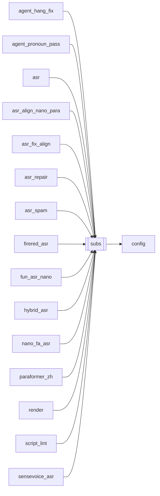

# `subs`

[← Index](../generated/module-index.md) · [Brain home](../README.md)

<!-- AUTO:START — sinh bởi scripts/brain_build.py 2026-11-11 02:37. Đừng sửa tay khối này. -->
**File:** `subs.py` · **Lớp:** `render` · **1106 dòng** (970 code) · **34 hàm**, **0 class** · sha1 `37a7dee4f4`

> subs.py — Sinh phụ đề .srt từ danh sách câu có timestamp. Dùng chung: asr.json (tiếng Trung, key 'text') và script.json (tiếng Việt, key 'vi') đều là list [{start, end, text/vi, ...}] -> đổ ra .srt chuẩn để import vào

### Phụ thuộc

- **Gọi tới (import nội bộ):** [config](./config.md)
- **Được dùng bởi:** [agent_hang_fix](./agent_hang_fix.md), [agent_pronoun_pass](./agent_pronoun_pass.md), [asr](./asr.md), [asr_align_nano_para](./asr_align_nano_para.md), [asr_fix_align](./asr_fix_align.md), [asr_repair](./asr_repair.md), [asr_spam](./asr_spam.md), [firered_asr](./firered_asr.md), [fun_asr_nano](./fun_asr_nano.md), [hybrid_asr](./hybrid_asr.md), [nano_fa_asr](./nano_fa_asr.md), [paraformer_zh](./paraformer_zh.md), [render](./render.md), [script_lint](./script_lint.md), [sensevoice_asr](./sensevoice_asr.md), [server](./server.md), [translate](./translate.md)
- **Test:** ❌ chưa có test import trực tiếp

### Hàm & class top-level

| Tên | Dòng | Dài | Tham số | Docstring |
|---|---:|---:|---|---|
| `_plain_len` | 27 | 2 | `text` |  |
| `_mask_number_dots` | 49 | 4 | `text` | Che dấu nghìn trong số để không bị tách câu tại «3.000» / «31,000». |
| `_unmask_number_dots` | 55 | 2 | `text` |  |
| `glue_vi_names` | 101 | 10 | `text` | Dán NBSP trong tên riêng — không xuống dòng giữa «Thiên Lang Tinh». |
| `unglue_vi_names` | 113 | 2 | `text` |  |
| `_is_compound_break` | 117 | 12 | `text, pos` | True nếu cắt tại pos đang tách đôi compound (…tấn/ công…). |
| `_snap_cut_to_vi_word` | 131 | 21 | `text, pos` | Ưu tiên cắt tại khoảng trắng VI; không cắt giữa từ / giữa số / compound. |
| `_snap_cut_outside_number` | 154 | 9 | `text, pos` | Đẩy điểm cắt ra ngoài token số (tránh «31.» + «000 tỷ»). |
| `split_text_by_punct` | 165 | 42 | `text, max_chars, weak` | Tách câu theo dấu câu. weak=True: mỗi mệnh đề sau ，、, là 1 đoạn (thoại TTS). |
| `_join_clause` | 212 | 5 | `a, b` | CJK dính liền; VI/Latin cần khoảng trắng («Đù,» + «thế…» → «Đù, thế…»). |
| `_is_punct_only` | 222 | 2 | `text` |  |
| `_split_for_display` | 226 | 35 | `text, max_chars, force_weak, hard` | Tách text cho sub: dấu câu -> dấu phẩy; hard=True thì cắt cứng phần còn dài. |
| `_slice_contiguous` | 263 | 49 | `text, weights` | Cắt 1 chuỗi thành N đoạn liên tiếp theo trọng số — không trộn với câu khác. |
| `merge_tiny_segments` | 314 | 44 | `segments, key, min_chars, min_dur` | Gộp mảnh ASR vụn: chỉ dấu câu, cắt giữa từ, clip < 0.45s quá ngắn. |
| `_merge_parts` | 360 | 17 | `parts, n` | Gộp parts dư thành đúng n cụm (ghép các cụm ngắn nhất liên tiếp). |
| `_expand_parts` | 379 | 16 | `parts, n, max_chars` | Chia parts ít hơn n thành đủ n cụm. |
| `_align_zh_vi` | 397 | 11 | `zh_parts, vi_parts, max_zh, max_vi` | Căn số cụm zh/vi; ưu tiên zh làm mốc thời gian. |
| `_spread_time_pairs` | 410 | 21 | `pairs, start, end, min_dur` | Chia [start,end] theo độ dài vi (fallback zh). |
| `_split_hard` | 433 | 92 | `text, max_chars` | Cắt cứng theo từ (Việt) hoặc ký tự (CJK) khi không còn dấu câu. |
| `split_long_segments` | 527 | 42 | `segments, max_chars, key, min_dur, max_dur` | Tách câu quá dài / quá lâu thành nhiều đoạn; chia thời gian theo độ dài chữ. |
| `split_bilingual_rows` | 571 | 150 ⚠️ | `rows, max_zh, max_vi, max_dur, min_dur` | Sau dịch ZH→VI: tách sub dài (CUT). Ưu tiên cắt theo VI rồi cắt ZH liền mạch. |
| `carry_tail_fragments` | 727 | 26 | `rows, max_vi, max_gap` | «…sáu mươi đứa. Đúng,» + «cùng lên…» → mảnh đầu câu sau sang cue kế tiếp. |
| `merge_broken_vi_number_rows` | 755 | 42 | `rows` | Gộp mảnh lệch số: «…31,» + «000 tỷ» / «当前血量31,» + «000亿» → 1 câu. |
| `heal_script_broken_numbers` | 799 | 5 | `rows` | Gộp số gãy trên script (giữ i của câu đầu) — trả (rows_mới, số_cặp_đã_gộp). |
| `sub_split_cfg` | 805 | 6 | `` |  |
| `_merge_short_orphans` | 813 | 42 | `parts, max_chars, orphan_max` | Gộp đuôi ngắn («này?», «Tinh,») — không nuốt lại «nhiều.» / «trường,». |
| `wrap_subtitle_text` | 857 | 83 | `text, max_chars, max_lines` | Gói phụ đề tối đa max_lines dòng, mỗi dòng ≤ max_chars. |
| `_wrap_cfg` | 942 | 5 | `key` |  |
| `expand_placed_with_display` | 949 | 66 | `placed, display, key` | Tách mỗi câu TTS (script 1:1) theo mảnh CUT trong script.display (src_i). |
| `_maybe_wrap` | 1017 | 10 | `text, key` |  |
| `fmt_ts` | 1029 | 9 | `sec` | Giây (float) -> 'HH:MM:SS,mmm' theo chuẩn SRT. |
| `to_srt` | 1040 | 14 | `segments, key` | Đổ list câu ra chuỗi SRT. Bỏ câu rỗng, đánh số lại liên tục. |
| `to_srt_fit` | 1056 | 26 | `segments, durs, key, margin, min_dur` | SRT burn theo script + dur TTS gốc (KHÔNG biết đàn hồi assemble). |
| `to_srt_placed` | 1084 | 23 | `placed, key, margin, min_dur` | SRT burn khớp giọng sau assemble_fit: dùng start/end thật trên dub_fit.wav. |

**Hàm dài ≥120 dòng:** `split_bilingual_rows` (150, L571)

### Config / env keys (5)

`SUB_MAX_DUR`, `SUB_SPLIT_CHARS_VI`, `SUB_SPLIT_CHARS_ZH`, `SUB_WRAP_CHARS`, `SUB_WRAP_LINES`

**Tín hiệu rủi ro (đếm tĩnh):** broad_except=3

### Lịch sử (từ docs/)

- Fix logs: —
- **Reviews:** [2026-10-06-code-review](../../reviews/2026-10-06-code-review.md)
- Nhắc trong CHANGELOG: **0** lần · DECISIONS: **0** lần

<!-- AUTO:END -->

<!-- MANUAL:START -->
## Vai trò (viết tay)

_Chưa viết. 2–4 câu: module này chịu trách nhiệm gì trong pipeline, ai gọi nó, nó KHÔNG làm gì._

## Luồng chính

_Các hàm vào (entry) → bước chính → output/side effect. Ghi tên hàm thật._

## Bất biến & hợp đồng

_Điều luôn phải đúng (vd: chỉ ghi manifest qua `Manifest.update`; 1 job / ghế). Vi phạm = bug._

## Bẫy đã biết

_Lỗi từng gặp + link `docs/fixes/...`. Những chỗ dễ sửa sai._

## Ghi chú vận hành

_Config key quan trọng, cần restart gì khi sửa (:8801 / :8802 / hot-reload), cách test._
<!-- MANUAL:END -->
