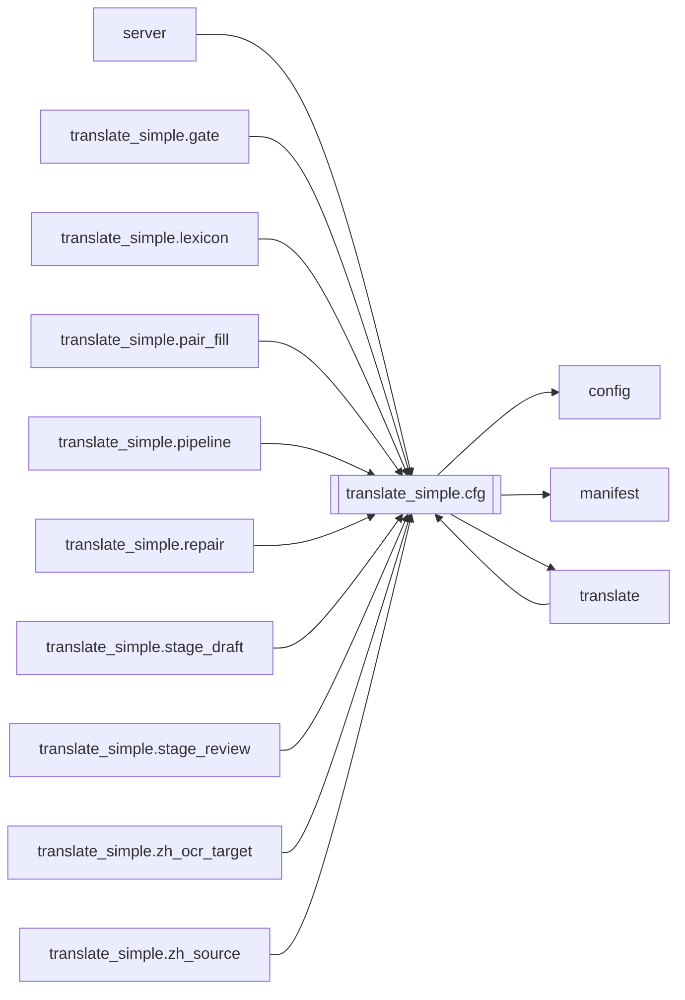

# `translate_simple.cfg`

[← Index](../generated/module-index.md) · [Brain home](../README.md)

<!-- AUTO:START — sinh bởi scripts/brain_build.py 2026-11-17 19:05. Đừng sửa tay khối này. -->
**File:** `translate_simple/cfg.py` · **Lớp:** `translate` · **372 dòng** (265 code) · **46 hàm**, **0 class** · sha1 `71ea152037`

> Cấu hình luồng simple — mọi khoá prefix SIMPLE_ đọc qua config.get (env > pineline.config.json > mặc định). Không sửa config.json. Khoá: TRANSLATE_PIPELINE       trống/simple = luồng này (MẶC ĐỊNH từ 2026-11-12 F2); lega

### Phụ thuộc

- **Gọi tới (import nội bộ):** [config](./config.md), [manifest](./manifest.md), [translate](./translate.md)
- **Được dùng bởi:** [server](./server.md), [translate](./translate.md), [translate_simple.gate](./translate_simple.gate.md), [translate_simple.lexicon](./translate_simple.lexicon.md), [translate_simple.pair_fill](./translate_simple.pair_fill.md), [translate_simple.pipeline](./translate_simple.pipeline.md), [translate_simple.repair](./translate_simple.repair.md), [translate_simple.stage_draft](./translate_simple.stage_draft.md), [translate_simple.stage_review](./translate_simple.stage_review.md), [translate_simple.zh_ocr_target](./translate_simple.zh_ocr_target.md), [translate_simple.zh_source](./translate_simple.zh_source.md)
- **Test:** `tests/test_simple_junk_park.py`, `tests/test_translate_simple.py`, `tests/test_translate_simple_a7_a8.py`, `tests/test_translate_simple_next.py`

### Hàm & class top-level

| Tên | Dòng | Dài | Tham số | Docstring |
|---|---:|---:|---|---|
| `get` | 55 | 6 | `key, default` |  |
| `_int` | 63 | 10 | `key, default, lo, hi` |  |
| `_float` | 75 | 10 | `key, default, lo, hi` |  |
| `_flag` | 87 | 2 | `key, default` |  |
| `pipeline_default` | 103 | 4 | `` | Luồng mặc định cho job MỚI: TRANSLATE_PIPELINE ∈ LEGACY_VALUES → legacy; trống/simple/khác → simple. |
| `pipeline_mode` | 109 | 3 | `` | 'simple' (mặc định) / 'legacy' (rollback) — giữ API port V4 (agent F4); = pipeline_default(). |
| `pipeline_is_simple` | 114 | 2 | `` |  |
| `_infer_job_pipeline` | 118 | 12 | `d, wd` | Job chưa đóng dấu (tạo trước F2): suy luồng đã dùng. None = chưa bắt đầu dịch. |
| `job_pipeline` | 132 | 35 | `work_dir, fresh, stamp` | Luồng dịch cho 1 job — mọi đường gọi dịch trong server hỏi hàm này. |
| `deepseek_concurrency` | 173 | 3 | `` | Số request song song cho DeepSeek Official API (mặc định 32, kẹp [1, 64]). |
| `batch` | 178 | 2 | `` |  |
| `batch_for_rows` | 182 | 18 | `n_rows, workers_count, explicit` | Tự chọn cỡ lô review theo số câu và mức song song: |
| `ctx` | 202 | 2 | `` |  |
| `workers` | 206 | 6 | `model` | Số worker song song cho review: DeepSeek dùng DEEPSEEK_CONCURRENCY (32), khác (Aurora/local) dùng SIMPLE_WORKERS (8). |
| `repair_rounds` | 214 | 2 | `` |  |
| `conf_min` | 218 | 2 | `` |  |
| `gate_flag_ratio` | 222 | 2 | `` |  |
| `gate_flag_max` | 226 | 9 | `n_rows` |  |
| `unreviewed_tolerance` | 237 | 9 | `n_rows` | fix 2026-11-13 agentM: số câu chưa soát được nhận bản nháp (thay vì park). Trống = max(3, 0.2% số câu). |
| `missing_batch` | 248 | 2 | `` |  |
| `max_tokens` | 252 | 2 | `` |  |
| `timeout` | 256 | 2 | `` |  |
| `temperature` | 260 | 2 | `` |  |
| `pronoun_analyze` | 264 | 2 | `` |  |
| `nmt_wait_plan` | 268 | 2 | `` |  |
| `nmt_unload` | 272 | 2 | `` |  |
| `trace_max_bytes` | 276 | 2 | `` |  |
| `suggest_pairs` | 280 | 2 | `` |  |
| `lexicon_exclude_golden` | 285 | 2 | `` |  |
| `pair_rules` | 289 | 2 | `` |  |
| `pair_fill` | 293 | 2 | `` |  |
| `pair_fill_min` | 297 | 2 | `` |  |
| `pair_fill_conf` | 301 | 2 | `` |  |
| `pair_fill_model` | 305 | 3 | `work_dir` |  |
| `learn_inferred` | 310 | 2 | `` |  |
| `zh_source` | 314 | 2 | `` |  |
| `zh_ocr_mode` | 318 | 3 | `` |  |
| `zh_ocr_pass_b` | 323 | 2 | `` |  |
| `zh_hs_samples` | 327 | 2 | `` |  |
| `zh_hs_min_ratio` | 331 | 2 | `` |  |
| `zh_namefix` | 335 | 2 | `` |  |
| `zh_namefix_min` | 339 | 2 | `` |  |
| `full_plan_enabled` | 343 | 3 | `` | A7: Lập plan đọc cả phim từ toàn bộ thoại ASR bằng LLM context lớn. |
| `overlap_cues` | 348 | 3 | `` | A8: Số câu ngữ cảnh chồng lấn liền trước cho mỗi lô review (0-10, mặc định 3). |
| `plan_model` | 353 | 9 | `work_dir` | Model LLM dùng cho bước lập plan A7. |
| `review_model` | 364 | 9 | `work_dir` |  |

**File/artifact nhắc tới:** `manifest.json`, `script.json`

**Tín hiệu rủi ro (đếm tĩnh):** broad_except=4

### Lịch sử (từ docs/)

- **Fix logs (6):**
  - [simple-junk-park: câu ASR rác «None.» làm dịch simple park mãi → part 1/2 kẹt, phim không ghép](../../fixes/2026-11-13-simple-junk-park.md)
  - [Port V2 → V4: preflight/chuẩn hoá video nguồn + extract_pcm bền + FireRed cắt ở khoảng lặng + câu ASR rác / pa](../../fixes/2026-11-13-port-preflight-slice-junk.md)
  - [translate-simple: luồng dịch mới (plan ∥ NMT → review 1 lần/lô → vá câu bị cờ → cổng), sau cờ TRANSLATE_PIPELI](../../fixes/2026-11-12-translate-simple.md)
  - [translate-simple «next»: lexicon src · bảng quy tắc xưng hô · bổ sung cặp thiếu · học lại · nguồn ZH · gỡ lặp ](../../fixes/2026-11-12-translate-simple-next.md)
  - [Port V2 → V4: luồng dịch `translate_simple` (MẶC ĐỊNH) + Demucs trước ASR](../../fixes/2026-11-12-port-simple-demucs.md)
  - [Port V2 → V4: Second Brain (tin Telegram theo mẫu + gỡ HOLD khi chạy tay) + đóng dấu luồng dịch theo job](../../fixes/2026-11-12-port-brain-hold-pipeline.md)
- Nhắc trong CHANGELOG: **1** lần · DECISIONS: **0** lần

<!-- AUTO:END -->

<!-- MANUAL:START -->
## Vai trò (viết tay)

_Chưa viết. 2–4 câu: module này chịu trách nhiệm gì trong pipeline, ai gọi nó, nó KHÔNG làm gì._

## Luồng chính

_Các hàm vào (entry) → bước chính → output/side effect. Ghi tên hàm thật._

## Bất biến & hợp đồng

_Điều luôn phải đúng (vd: chỉ ghi manifest qua `Manifest.update`; 1 job / ghế). Vi phạm = bug._

## Bẫy đã biết

_Lỗi từng gặp + link `docs/fixes/...`. Những chỗ dễ sửa sai._

## Ghi chú vận hành

_Config key quan trọng, cần restart gì khi sửa (:8801 / :8802 / hot-reload), cách test._
<!-- MANUAL:END -->
