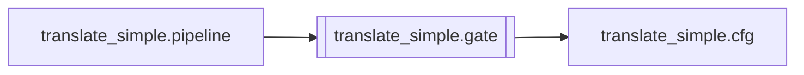

# `translate_simple.gate`

[← Index](../generated/module-index.md) · [Brain home](../README.md)

<!-- AUTO:START — sinh bởi scripts/brain_build.py 2026-11-17 19:05. Đừng sửa tay khối này. -->
**File:** `translate_simple/gate.py` · **Lớp:** `translate` · **49 dòng** (44 code) · **1 hàm**, **0 class** · sha1 `ce969037ea`

> Bước 6: cổng của luồng simple (hàm thuần — test được). done  : đủ câu so ASR (translate_coverage_gap = 0) + không câu trống + soát hết (mọi câu rv) + không còn chữ Hán + số câu còn cờ ≤ ngưỡng (SIMPLE_GATE_FLAG_MAX / SIM

### Phụ thuộc

- **Gọi tới (import nội bộ):** [translate_simple.cfg](./translate_simple.cfg.md)
- **Được dùng bởi:** [translate_simple.pipeline](./translate_simple.pipeline.md)
- **Test:** `tests/test_simple_r1_bugs.py`, `tests/test_translate_simple.py`
- **Thư viện ngoài:** `translate_simple`

### Hàm & class top-level

| Tên | Dòng | Dài | Tham số | Docstring |
|---|---:|---:|---|---|
| `decide` | 14 | 36 | `n_rows, n_asr, coverage_gap, n_missing, n_unreviewed, flags, plan_f…` |  |

### Lịch sử (từ docs/)

- **Fix logs (1):**
  - [simple-junk-park: câu ASR rác «None.» làm dịch simple park mãi → part 1/2 kẹt, phim không ghép](../../fixes/2026-11-13-simple-junk-park.md)
- Nhắc trong CHANGELOG: **0** lần · DECISIONS: **0** lần

<!-- AUTO:END -->

<!-- MANUAL:START -->
## Vai trò (viết tay)

_Chưa viết. 2–4 câu: module này chịu trách nhiệm gì trong pipeline, ai gọi nó, nó KHÔNG làm gì._

## Luồng chính

_Các hàm vào (entry) → bước chính → output/side effect. Ghi tên hàm thật._

## Bất biến & hợp đồng

_Điều luôn phải đúng (vd: chỉ ghi manifest qua `Manifest.update`; 1 job / ghế). Vi phạm = bug._

## Bẫy đã biết

_Lỗi từng gặp + link `docs/fixes/...`. Những chỗ dễ sửa sai._

## Ghi chú vận hành

_Config key quan trọng, cần restart gì khi sửa (:8801 / :8802 / hot-reload), cách test._
<!-- MANUAL:END -->
