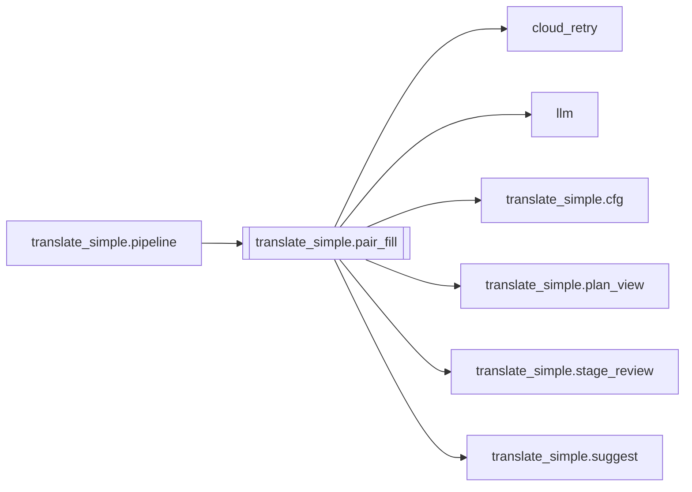

# `translate_simple.pair_fill`

[← Index](../generated/module-index.md) · [Brain home](../README.md)

<!-- AUTO:START — sinh bởi scripts/brain_build.py 2026-11-17 19:05. Đừng sửa tay khối này. -->
**File:** `translate_simple/pair_fill.py` · **Lớp:** `translate` · **134 dòng** (116 code) · **6 hàm**, **0 class** · sha1 `afe55e0d20`

> Bước 6 (2026-11-12 next) — bổ sung cặp xưng hô THIẾU bằng 1 lần gọi model (cờ SIMPLE_PAIR_FILL=1). Sau review lượt 1: cặp spk→to mà cả hai là nhân vật plan, CHƯA có cặp (kể cả sau bảng quy tắc bước 2), xuất hiện ≥ SIMPLE

### Phụ thuộc

- **Gọi tới (import nội bộ):** [cloud_retry](./cloud_retry.md), [llm](./llm.md), [translate_simple.cfg](./translate_simple.cfg.md), [translate_simple.plan_view](./translate_simple.plan_view.md), [translate_simple.stage_review](./translate_simple.stage_review.md), [translate_simple.suggest](./translate_simple.suggest.md)
- **Được dùng bởi:** [translate_simple.pipeline](./translate_simple.pipeline.md)
- **Test:** `tests/test_translate_simple_next.py`
- **Thư viện ngoài:** `translate_simple`

### Hàm & class top-level

| Tên | Dòng | Dài | Tham số | Docstring |
|---|---:|---:|---|---|
| `candidates` | 31 | 2 | `rows, pv, conf_min, min_n` |  |
| `_char` | 35 | 6 | `pv, name` |  |
| `_lines_between` | 43 | 9 | `rows, pv, a, b` |  |
| `build_prompt` | 54 | 21 | `rows, pv, cands` |  |
| `parse` | 77 | 21 | `text, want, pv, conf_min` |  |
| `run` | 100 | 35 | `rows, pv, model, conf_review, min_n, conf_min, stop_check` | Trả {"asked": [...], "added": [...], "rows": [i…], "error"?}. Không ném (trừ «stopped by user»). |

**Tín hiệu rủi ro (đếm tĩnh):** broad_except=1

### Lịch sử (từ docs/)

- **Fix logs (1):**
  - [translate-simple «next»: lexicon src · bảng quy tắc xưng hô · bổ sung cặp thiếu · học lại · nguồn ZH · gỡ lặp ](../../fixes/2026-11-12-translate-simple-next.md)
- Nhắc trong CHANGELOG: **1** lần · DECISIONS: **0** lần

<!-- AUTO:END -->

<!-- MANUAL:START -->
## Vai trò (viết tay)

_Chưa viết. 2–4 câu: module này chịu trách nhiệm gì trong pipeline, ai gọi nó, nó KHÔNG làm gì._

## Luồng chính

_Các hàm vào (entry) → bước chính → output/side effect. Ghi tên hàm thật._

## Bất biến & hợp đồng

_Điều luôn phải đúng (vd: chỉ ghi manifest qua `Manifest.update`; 1 job / ghế). Vi phạm = bug._

## Bẫy đã biết

_Lỗi từng gặp + link `docs/fixes/...`. Những chỗ dễ sửa sai._

## Ghi chú vận hành

_Config key quan trọng, cần restart gì khi sửa (:8801 / :8802 / hot-reload), cách test._
<!-- MANUAL:END -->
