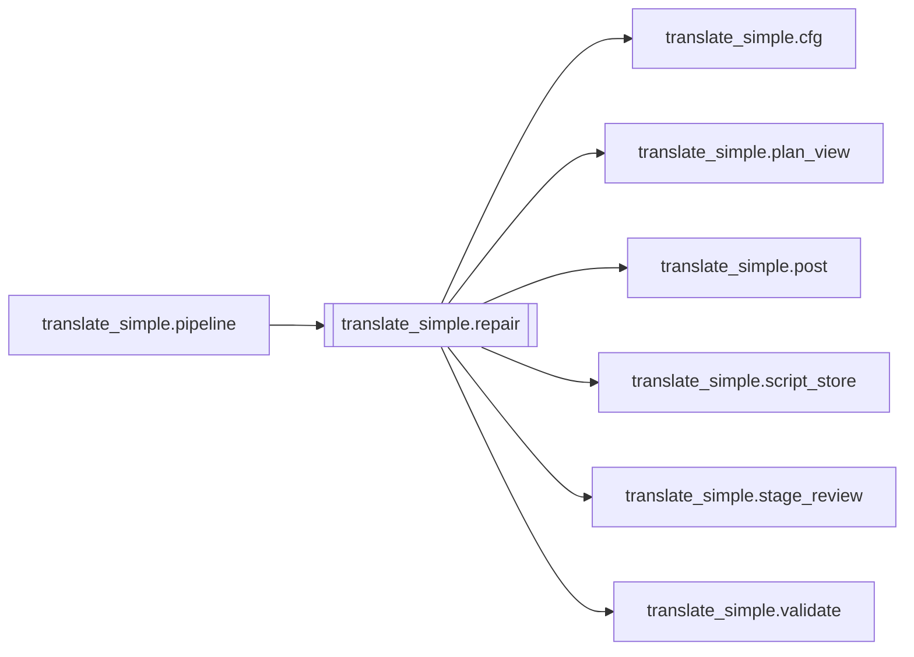

# `translate_simple.repair`

[← Index](../generated/module-index.md) · [Brain home](../README.md)

<!-- AUTO:START — sinh bởi scripts/brain_build.py 2026-11-17 19:05. Đừng sửa tay khối này. -->
**File:** `translate_simple/repair.py` · **Lớp:** `translate` · **56 dòng** (52 code) · **1 hàm**, **0 class** · sha1 `0cb280b6d6`

> Bước 5: vá ĐÚNG các câu bị bộ kiểm đánh cờ — tối đa SIMPLE_REPAIR_ROUNDS (≤2) lượt. Mỗi lượt: gom câu có cờ thành lô (≤ SIMPLE_BATCH, ngữ cảnh ±SIMPLE_CTX chỉ đọc) → 1 lần gọi/lô (prompt vá: trường «loi» cho từng câu) → 

### Phụ thuộc

- **Gọi tới (import nội bộ):** [translate_simple.cfg](./translate_simple.cfg.md), [translate_simple.plan_view](./translate_simple.plan_view.md), [translate_simple.post](./translate_simple.post.md), [translate_simple.script_store](./translate_simple.script_store.md), [translate_simple.stage_review](./translate_simple.stage_review.md), [translate_simple.validate](./translate_simple.validate.md)
- **Được dùng bởi:** [translate_simple.pipeline](./translate_simple.pipeline.md)
- **Test:** ❌ chưa có test import trực tiếp
- **Thư viện ngoài:** `translate_simple`

### Hàm & class top-level

| Tên | Dòng | Dài | Tham số | Docstring |
|---|---:|---:|---|---|
| `run` | 15 | 42 | `store, pv, flags, model, stop_check, progress, rounds` | Trả (cờ còn lại, nhật ký từng lượt [{round, sent, fixed, left}]). |

**Tín hiệu rủi ro (đếm tĩnh):** broad_except=1

### Lịch sử (từ docs/)

- Fix logs: —
- Nhắc trong CHANGELOG: **0** lần · DECISIONS: **0** lần

<!-- AUTO:END -->

<!-- MANUAL:START -->
## Vai trò (viết tay)

_Chưa viết. 2–4 câu: module này chịu trách nhiệm gì trong pipeline, ai gọi nó, nó KHÔNG làm gì._

## Luồng chính

_Các hàm vào (entry) → bước chính → output/side effect. Ghi tên hàm thật._

## Bất biến & hợp đồng

_Điều luôn phải đúng (vd: chỉ ghi manifest qua `Manifest.update`; 1 job / ghế). Vi phạm = bug._

## Bẫy đã biết

_Lỗi từng gặp + link `docs/fixes/...`. Những chỗ dễ sửa sai._

## Ghi chú vận hành

_Config key quan trọng, cần restart gì khi sửa (:8801 / :8802 / hot-reload), cách test._
<!-- MANUAL:END -->
