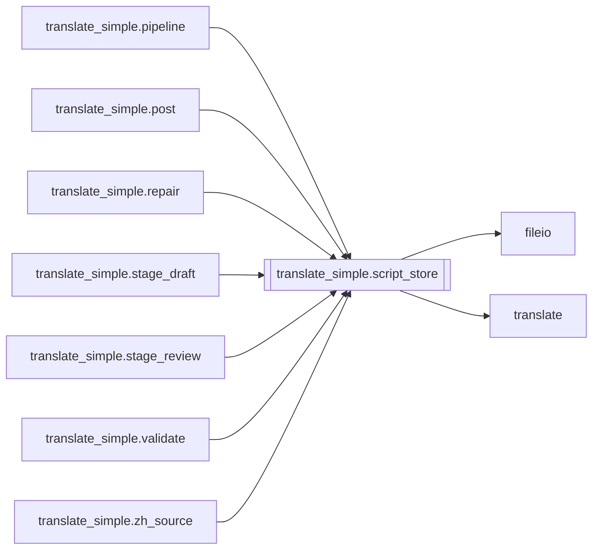

# `translate_simple.script_store`

[← Index](../generated/module-index.md) · [Brain home](../README.md)

<!-- AUTO:START — sinh bởi scripts/brain_build.py 2026-11-17 19:05. Đừng sửa tay khối này. -->
**File:** `translate_simple/script_store.py` · **Lớp:** `translate` · **184 dòng** (158 code) · **3 hàm**, **1 class** · sha1 `7758c3f464`

> Một cửa đọc/ghi script.json + trace.jsonl cho luồng simple. - Ghi atomic (fileio.atomic_write_json), giữ MỌI trường của hàng (kể cả trường lạ do module khác thêm). - KHÔNG BAO GIỜ đổi `vi` của câu `manual` (người sửa tay

### Phụ thuộc

- **Gọi tới (import nội bộ):** [fileio](./fileio.md), [translate](./translate.md)
- **Được dùng bởi:** [translate_simple.pipeline](./translate_simple.pipeline.md), [translate_simple.post](./translate_simple.post.md), [translate_simple.repair](./translate_simple.repair.md), [translate_simple.stage_draft](./translate_simple.stage_draft.md), [translate_simple.stage_review](./translate_simple.stage_review.md), [translate_simple.validate](./translate_simple.validate.md), [translate_simple.zh_source](./translate_simple.zh_source.md)
- **Test:** `tests/test_simple_junk_park.py`, `tests/test_simple_r1_bugs.py`, `tests/test_translate_simple.py`, `tests/test_translate_simple_a7_a8.py`, `tests/test_translate_simple_next_review.py`, `tests/test_translate_simple_scenarios.py`

### Hàm & class top-level

| Tên | Dòng | Dài | Tham số | Docstring |
|---|---:|---:|---|---|
| **class `ScriptStore`** | 42 | 11 method | |  |
| `has_cjk` | 26 | 2 | `s` |  |
| `is_manual` | 30 | 2 | `r` |  |
| `_clean_zh` | 34 | 6 | `zh` |  |

**File/artifact nhắc tới:** `script.json`, `trace.1.jsonl`, `trace.jsonl`

**Tín hiệu rủi ro (đếm tĩnh):** broad_except=2

### Lịch sử (từ docs/)

- **Fix logs (1):**
  - [translate-simple: luồng dịch mới (plan ∥ NMT → review 1 lần/lô → vá câu bị cờ → cổng), sau cờ TRANSLATE_PIPELI](../../fixes/2026-11-12-translate-simple.md)
- Nhắc trong CHANGELOG: **0** lần · DECISIONS: **0** lần

<!-- AUTO:END -->

<!-- MANUAL:START -->
## Vai trò (viết tay)

_Chưa viết. 2–4 câu: module này chịu trách nhiệm gì trong pipeline, ai gọi nó, nó KHÔNG làm gì._

## Luồng chính

_Các hàm vào (entry) → bước chính → output/side effect. Ghi tên hàm thật._

## Bất biến & hợp đồng

_Điều luôn phải đúng (vd: chỉ ghi manifest qua `Manifest.update`; 1 job / ghế). Vi phạm = bug._

## Bẫy đã biết

_Lỗi từng gặp + link `docs/fixes/...`. Những chỗ dễ sửa sai._

## Ghi chú vận hành

_Config key quan trọng, cần restart gì khi sửa (:8801 / :8802 / hot-reload), cách test._
<!-- MANUAL:END -->
