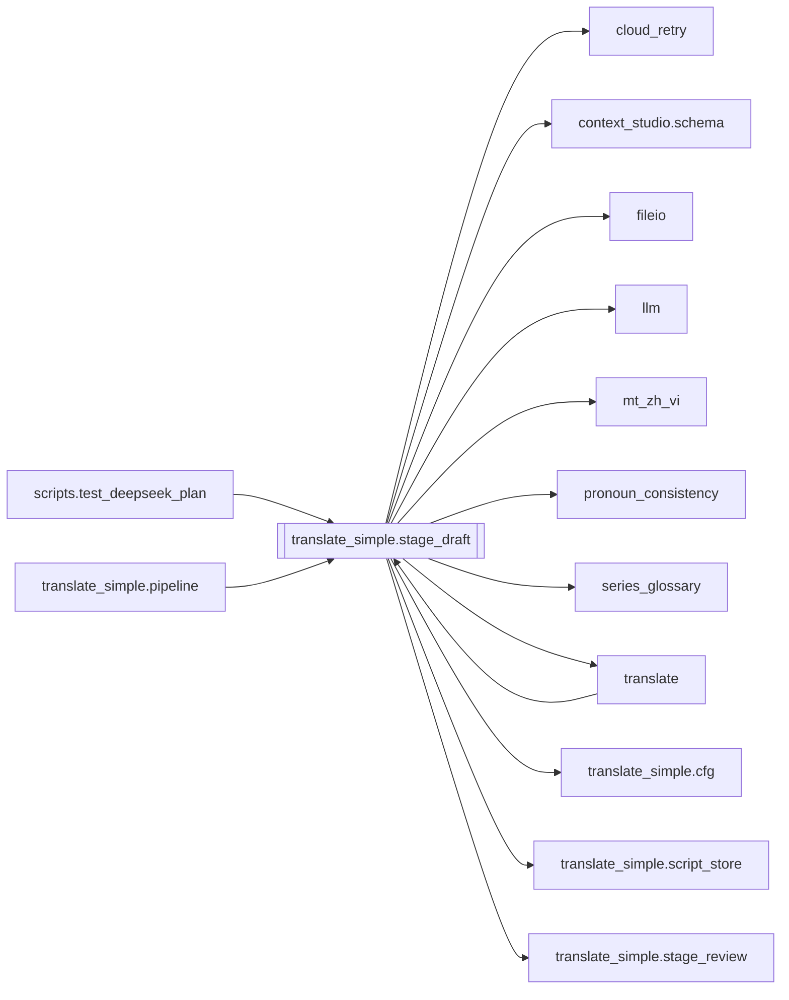

# `translate_simple.stage_draft`

[← Index](../generated/module-index.md) · [Brain home](../README.md)

<!-- AUTO:START — sinh bởi scripts/brain_build.py 2026-11-17 19:05. Đừng sửa tay khối này. -->
**File:** `translate_simple/stage_draft.py` · **Lớp:** `translate` · **349 dòng** (310 code) · **7 hàm**, **0 class** · sha1 `fb9bb49d79`

> Bước 2: Plan (cloud) ∥ NMT nháp (GPU) — chạy SONG SONG bằng 2 thread. Plan: dùng lại glossary.json nếu có (trừ force — như run_translate cũ; context_pack.skip_plan luôn giữ), không thì translate.build_plan (PLAN_MODE=fil

### Phụ thuộc

- **Gọi tới (import nội bộ):** [cloud_retry](./cloud_retry.md), [context_studio.schema](./context_studio.schema.md), [fileio](./fileio.md), [llm](./llm.md), [mt_zh_vi](./mt_zh_vi.md), [pronoun_consistency](./pronoun_consistency.md), [series_glossary](./series_glossary.md), [translate](./translate.md), [translate_simple.cfg](./translate_simple.cfg.md), [translate_simple.script_store](./translate_simple.script_store.md), [translate_simple.stage_review](./translate_simple.stage_review.md)
- **Được dùng bởi:** [scripts.test_deepseek_plan](./scripts.test_deepseek_plan.md), [translate](./translate.md), [translate_simple.pipeline](./translate_simple.pipeline.md)
- **Test:** `tests/test_deepseek_empty_and_brain_idle.py`, `tests/test_simple_r1_bugs.py`, `tests/test_translate_simple.py`, `tests/test_translate_simple_a7_a8.py`
- **Thư viện ngoài:** `translate_simple`

### Hàm & class top-level

| Tên | Dòng | Dài | Tham số | Docstring |
|---|---:|---:|---|---|
| `_load_json` | 24 | 5 | `p` |  |
| `_series_plan` | 31 | 7 | `work_dir` |  |
| `_plan_usable` | 40 | 13 | `plan` | R1.2: glossary rỗng / plan_status=failed → không reuse (phải lập lại). |
| `build_full_movie_plan` | 55 | 136 ⚠️ | `work_dir, segments, target, model, name_hints, series_plan` | A7: Lập glossary toàn phim bằng cách đưa toàn bộ text thoại ASR vào LLM context lớn. |
| `build_plan` | 193 | 67 | `work_dir, segments, target, force` |  |
| `nmt_drafts` | 262 | 26 | `rows, hint_plan` | {i: nháp} — chỉ câu chưa có vi, không manual, chưa rv. NMT tắt/lỗi → {}. |
| `run` | 290 | 60 | `store, segments, target, force, progress` | Chạy plan ∥ NMT. Trả (plan, info). Ghi nháp NMT vào store (mt=1, trace 'nmt'). |

**Hàm dài ≥120 dòng:** `build_full_movie_plan` (136, L55)

**File/artifact nhắc tới:** `context_pack.json`, `glossary.json`, `glossary.plan_failed.json`, `style_lock.json`

**Tín hiệu rủi ro (đếm tĩnh):** broad_except=10 · pools=1 · swallow_except=3

### Lịch sử (từ docs/)

- **Fix logs (1):**
  - [translate-simple: luồng dịch mới (plan ∥ NMT → review 1 lần/lô → vá câu bị cờ → cổng), sau cờ TRANSLATE_PIPELI](../../fixes/2026-11-12-translate-simple.md)
- **Reviews:** [2026-11-12-translate-simple-review](../../reviews/2026-11-12-translate-simple-review.md)
- Nhắc trong CHANGELOG: **1** lần · DECISIONS: **0** lần

<!-- AUTO:END -->

<!-- MANUAL:START -->
## Vai trò (viết tay)

_Chưa viết. 2–4 câu: module này chịu trách nhiệm gì trong pipeline, ai gọi nó, nó KHÔNG làm gì._

## Luồng chính

_Các hàm vào (entry) → bước chính → output/side effect. Ghi tên hàm thật._

## Bất biến & hợp đồng

_Điều luôn phải đúng (vd: chỉ ghi manifest qua `Manifest.update`; 1 job / ghế). Vi phạm = bug._

## Bẫy đã biết

_Lỗi từng gặp + link `docs/fixes/...`. Những chỗ dễ sửa sai._

## Ghi chú vận hành

_Config key quan trọng, cần restart gì khi sửa (:8801 / :8802 / hot-reload), cách test._
<!-- MANUAL:END -->
