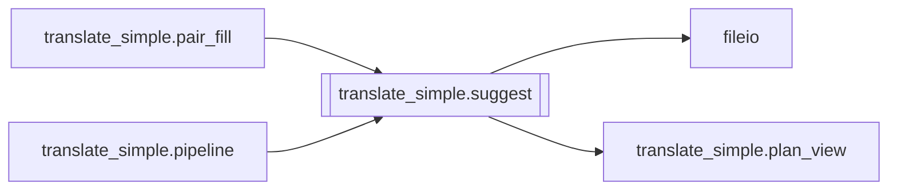

# `translate_simple.suggest`

[← Index](../generated/module-index.md) · [Brain home](../README.md)

<!-- AUTO:START — sinh bởi scripts/brain_build.py 2026-11-17 19:05. Đừng sửa tay khối này. -->
**File:** `translate_simple/suggest.py` · **Lớp:** `translate` · **94 dòng** (81 code) · **4 hàm**, **0 class** · sha1 `74acf64551`

> Đề xuất cặp xưng hô CHƯA có trong plan (review 2026-11-12) → work_dir/plan_suggestions.json. Hai nguồn: model_pairs   : REVIEW tự khai trong khoá "new_pairs" (tự xưng / cách gọi model đã dùng)

### Phụ thuộc

- **Gọi tới (import nội bộ):** [fileio](./fileio.md), [translate_simple.plan_view](./translate_simple.plan_view.md)
- **Được dùng bởi:** [translate_simple.pair_fill](./translate_simple.pair_fill.md), [translate_simple.pipeline](./translate_simple.pipeline.md)
- **Test:** ❌ chưa có test import trực tiếp

### Hàm & class top-level

| Tên | Dòng | Dài | Tham số | Docstring |
|---|---:|---:|---|---|
| `_known` | 22 | 2 | `pv` |  |
| `missing_pairs` | 26 | 22 | `rows, pv, conf_min` |  |
| `clean_model_pairs` | 50 | 17 | `raw, pv` | Chuẩn hoá tên theo plan, bỏ cặp đã có trong plan / tự-với-tự / dạng rỗng; gộp trùng (đếm n). |
| `write` | 69 | 26 | `work_dir, rows, pv, model_raw, conf_min, extra` | Gộp với file cũ (model_pairs cộng dồn qua các lần chạy), tính lại missing_pairs; ghi atomic. |

**File/artifact nhắc tới:** `plan_suggestions.json`

**Tín hiệu rủi ro (đếm tĩnh):** broad_except=1

### Lịch sử (từ docs/)

- **Fix logs (2):**
  - [translate-simple: luồng dịch mới (plan ∥ NMT → review 1 lần/lô → vá câu bị cờ → cổng), sau cờ TRANSLATE_PIPELI](../../fixes/2026-11-12-translate-simple.md)
  - [translate-simple «next»: lexicon src · bảng quy tắc xưng hô · bổ sung cặp thiếu · học lại · nguồn ZH · gỡ lặp ](../../fixes/2026-11-12-translate-simple-next.md)
- **Reviews:** [2026-11-12-translate-simple-review](../../reviews/2026-11-12-translate-simple-review.md)
- Nhắc trong CHANGELOG: **0** lần · DECISIONS: **0** lần

<!-- AUTO:END -->

<!-- MANUAL:START -->
## Vai trò (viết tay)

_Chưa viết. 2–4 câu: module này chịu trách nhiệm gì trong pipeline, ai gọi nó, nó KHÔNG làm gì._

## Luồng chính

_Các hàm vào (entry) → bước chính → output/side effect. Ghi tên hàm thật._

## Bất biến & hợp đồng

_Điều luôn phải đúng (vd: chỉ ghi manifest qua `Manifest.update`; 1 job / ghế). Vi phạm = bug._

## Bẫy đã biết

_Lỗi từng gặp + link `docs/fixes/...`. Những chỗ dễ sửa sai._

## Ghi chú vận hành

_Config key quan trọng, cần restart gì khi sửa (:8801 / :8802 / hot-reload), cách test._
<!-- MANUAL:END -->
