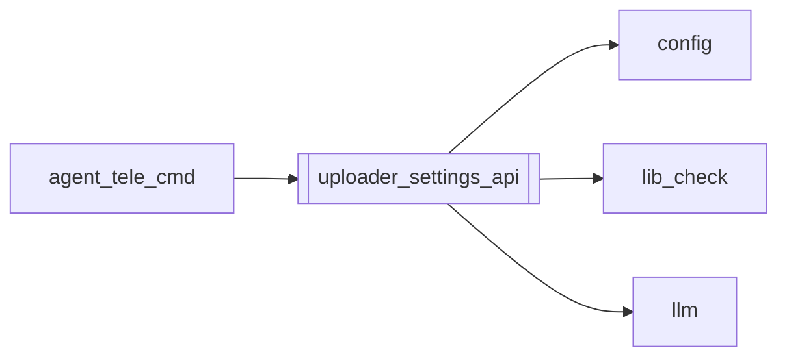

# `uploader_settings_api`

[← Index](../generated/module-index.md) · [Brain home](../README.md)

<!-- AUTO:START — sinh bởi scripts/brain_build.py 2026-11-17 19:05. Đừng sửa tay khối này. -->
**File:** `uploader_settings_api.py` · **Lớp:** `publish` · **675 dòng** (584 code) · **31 hàm**, **0 class** · sha1 `ea992060b3`

> Settings + YouTube Uploader API — dùng được từ sidecar :8802 (stdlib) và FastAPI. Trả về (http_status: int, body: dict). Không phụ thuộc FastAPI.

### Phụ thuộc

- **Gọi tới (import nội bộ):** [config](./config.md), [lib_check](./lib_check.md), [llm](./llm.md)
- **Được dùng bởi:** [agent_tele_cmd](./agent_tele_cmd.md)
- **Test:** ❌ chưa có test import trực tiếp
- **Thư viện ngoài:** `psutil`

### Hàm & class top-level

| Tên | Dòng | Dài | Tham số | Docstring |
|---|---:|---:|---|---|
| `_ok` | 33 | 3 | `data, **extra` |  |
| `_err` | 38 | 2 | `msg, code, **extra` |  |
| `_norm_status` | 42 | 2 | `s` |  |
| `_is_active` | 46 | 2 | `st` |  |
| `_is_done` | 50 | 3 | `st` |  |
| `_is_skip` | 55 | 3 | `st` |  |
| `_ui_status` | 60 | 12 | `st` | Map status yt_uploader → badge UI (uploading/done/failed/skipped/queued). |
| `_read_json` | 74 | 7 | `path, default` |  |
| `_write_json` | 83 | 7 | `path, data` |  |
| `_read_queue` | 92 | 3 | `` |  |
| `_write_queue` | 97 | 2 | `items` |  |
| `_read_history` | 101 | 17 | `limit` |  |
| `_is_yt_uploader_running` | 120 | 16 | `` |  |
| `_enrich_queue_item` | 138 | 13 | `it` |  |
| `get_settings` | 155 | 57 | `` |  |
| `_save_cfg_updates` | 214 | 18 | `updates` |  |
| `update_settings` | 234 | 33 | `payload` |  |
| `test_telegram` | 269 | 30 | `payload` |  |
| `test_llm` | 301 | 31 | `payload` |  |
| `get_uploader_status` | 336 | 37 | `` |  |
| `_oversized_warnings` | 375 | 20 | `path, duration_sec` | Cảnh báo file quá dài / quá nặng cho YouTube. |
| `enqueue_upload` | 397 | 89 | `payload` |  |
| `remove_upload_item` | 488 | 25 | `payload` |  |
| `clear_done_uploads` | 515 | 11 | `` |  |
| `clear_skipped` | 528 | 6 | `` |  |
| `skip_upload_item` | 536 | 23 | `payload` | Đánh dấu 1 mục (chờ hoặc đang tải) = bỏ qua. |
| `skip_current_upload` | 561 | 28 | `` | Skip video đang upload (+ báo hiệu yt_uploader dừng item hiện tại). |
| `move_upload_item` | 591 | 14 | `payload` | Đổi thứ tự hàng chờ: index → to_index. |
| `save_uploader_settings` | 607 | 11 | `payload` |  |
| `launch_uploader` | 620 | 18 | `` |  |
| `dispatch` | 640 | 36 | `method, path, body` | Router nhỏ cho agent_tele_cmd. None = không khớp. |

### Config / env keys (2)

`TEMP`, `YT_UPLOADER_DIR`

**Cổng nhắc tới:** 8083

**File/artifact nhắc tới:** `pineline.config.json`, `queue_state.json`, `settings.json`, `upload_history.jsonl`

**Tín hiệu rủi ro (đếm tĩnh):** broad_except=22 · file_writes=3 · sleep=1 · subprocess=1 · swallow_except=7

### Lịch sử (từ docs/)

- **Fix logs (3):**
  - [2026-11-11 — machine-config: cổng/thư mục phụ thuộc máy thành setting (V4 — layout phẳng)](../../fixes/2026-11-11-machine-config.md)
  - [Skip đang upload khó tìm — UX sticky + Done; cảnh báo file >11.5h](../../fixes/2026-11-07-uploader-skip-ux.md)
  - [Settings + Uploader API 404 trên :8802; thiếu skip upload](../../fixes/2026-11-07-uploader-settings-8802.md)
- Nhắc trong CHANGELOG: **1** lần · DECISIONS: **0** lần

<!-- AUTO:END -->

<!-- MANUAL:START -->
## Vai trò (viết tay)

_Chưa viết. 2–4 câu: module này chịu trách nhiệm gì trong pipeline, ai gọi nó, nó KHÔNG làm gì._

## Luồng chính

_Các hàm vào (entry) → bước chính → output/side effect. Ghi tên hàm thật._

## Bất biến & hợp đồng

_Điều luôn phải đúng (vd: chỉ ghi manifest qua `Manifest.update`; 1 job / ghế). Vi phạm = bug._

## Bẫy đã biết

_Lỗi từng gặp + link `docs/fixes/...`. Những chỗ dễ sửa sai._

## Ghi chú vận hành

_Config key quan trọng, cần restart gì khi sửa (:8801 / :8802 / hot-reload), cách test._
<!-- MANUAL:END -->
