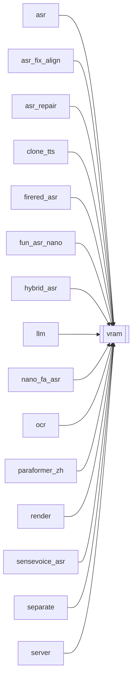

# `vram`

[← Index](../generated/module-index.md) · [Brain home](../README.md)

<!-- AUTO:START — sinh bởi scripts/brain_build.py 2026-11-11 02:37. Đừng sửa tay khối này. -->
**File:** `vram.py` · **Lớp:** `ops` · **89 dòng** (76 code) · **4 hàm**, **0 class** · sha1 `0c23090f49`

> vram.py — Nhả VRAM trước MỖI bước dùng GPU. Ollama (Gemma ctx 128k), FunASR, Demucs, TTS, NVENC tranh nhau 12GB. Model Ollama sống dai sau bước dịch; torch cache sống dai trong cùng process.

### Phụ thuộc

- **Gọi tới (import nội bộ):** —
- **Được dùng bởi:** [asr](./asr.md), [asr_fix_align](./asr_fix_align.md), [asr_repair](./asr_repair.md), [clone_tts](./clone_tts.md), [firered_asr](./firered_asr.md), [fun_asr_nano](./fun_asr_nano.md), [hybrid_asr](./hybrid_asr.md), [llm](./llm.md), [nano_fa_asr](./nano_fa_asr.md), [ocr](./ocr.md), [paraformer_zh](./paraformer_zh.md), [render](./render.md), [sensevoice_asr](./sensevoice_asr.md), [separate](./separate.md), [server](./server.md), [translate](./translate.md)
- **Test:** ❌ chưa có test import trực tiếp
- **Thư viện ngoài:** `torch`

### Hàm & class top-level

| Tên | Dòng | Dài | Tham số | Docstring |
|---|---:|---:|---|---|
| `_ollama_loaded` | 14 | 11 | `` |  |
| `_stop_ollama` | 27 | 9 | `` |  |
| `_empty_torch` | 38 | 16 | `` | Xả cache CUDA — KHÔNG synchronize (dễ treo vô hạn khi GPU kẹt). |
| `free_gpu_vram` | 56 | 34 | `reason` | Stop Ollama + xả torch cache. An toàn gọi nhiều lần, kể cả không có GPU. |

### Config / env keys (1)

`SKIP_VRAM_FREE`

**Tín hiệu rủi ro (đếm tĩnh):** broad_except=6 · sleep=1 · subprocess=2 · swallow_except=3 · threads=1

### Lịch sử (từ docs/)

- Fix logs: —
- **Reviews:** [2026-10-06-code-review](../../reviews/2026-10-06-code-review.md)
- Nhắc trong CHANGELOG: **0** lần · DECISIONS: **0** lần

<!-- AUTO:END -->

<!-- MANUAL:START -->
## Vai trò (viết tay)

_Chưa viết. 2–4 câu: module này chịu trách nhiệm gì trong pipeline, ai gọi nó, nó KHÔNG làm gì._

## Luồng chính

_Các hàm vào (entry) → bước chính → output/side effect. Ghi tên hàm thật._

## Bất biến & hợp đồng

_Điều luôn phải đúng (vd: chỉ ghi manifest qua `Manifest.update`; 1 job / ghế). Vi phạm = bug._

## Bẫy đã biết

_Lỗi từng gặp + link `docs/fixes/...`. Những chỗ dễ sửa sai._

## Ghi chú vận hành

_Config key quan trọng, cần restart gì khi sửa (:8801 / :8802 / hot-reload), cách test._
<!-- MANUAL:END -->
